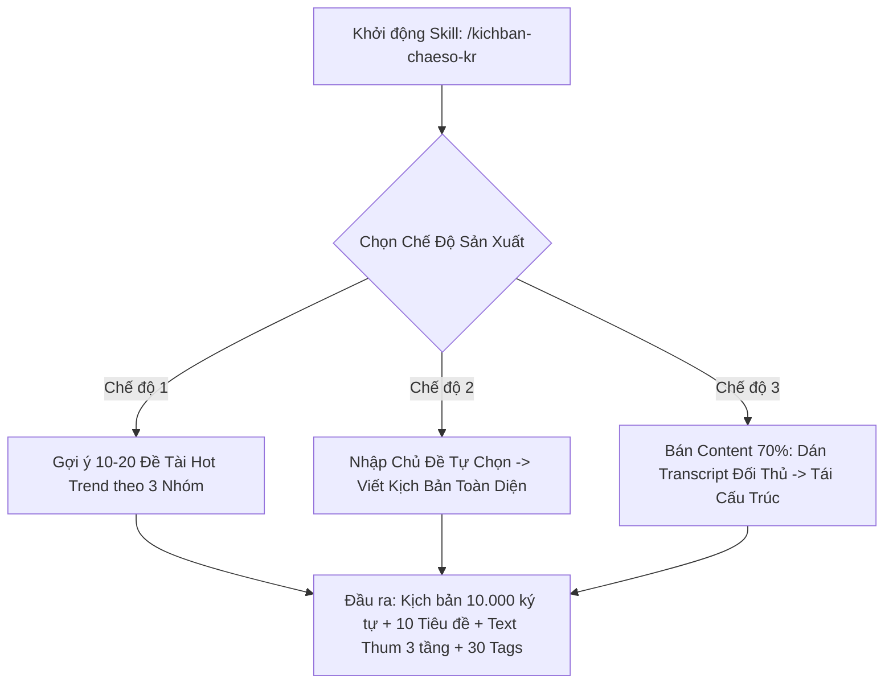

# SOP — Quy Trình Huấn Luyện Prompt & Đóng Gói Claude Skill Viết Kịch Bản 3 Chế Độ Ngách Sức Khỏe Hàn Quốc
> **Mã video:** `VIDEO-043d15` | **Hệ thống:** H2DEV SSoT 2026 | **Thị trường:** Hàn Quốc (`KR`)  
> **Nguồn bài giảng:** [https://h2dev.vn/learn/study/thuc-chien-huong-dan-train-prompt-va-lam-kich-ban-ngach-nho-key-suc-khoe-thi-truong-han-quoc-update-02-10-2026](https://h2dev.vn/learn/study/thuc-chien-huong-dan-train-prompt-va-lam-kich-ban-ngach-nho-key-suc-khoe-thi-truong-han-quoc-update-02-10-2026)

---

## 1. Mục Tiêu & Cấu Trúc Đóng Gói Claude Skill
- **Mục tiêu:** Tự động hóa 100% quy trình sản xuất kịch bản chuẩn SEO tiếng Hàn (độ dài 28-32 phút, ~10.000 ký tự) cho ngách Sức Khỏe & Dưỡng Sinh.
- **Tên Skill đóng gói:** `/kichban-chaeso-kr` (hoặc Prompt Master đóng gói thành file ZIP).
- **Brand Keywords đề xuất:** `밥상 건강` (Mâm cơm sức khỏe) / `건강 채소` (Rau củ sức khỏe).

---

## 2. Thiết Kế 3 Chế Độ Hoạt Động Trong 1 Skill

### Chi tiết 3 Chế độ:
1. **Chế độ 1 — Gợi ý Đề tài Hot Trend:**
   - Cú pháp: `Gọi skill /kichban-chaeso-kr gợi ý [N] chủ đề` (mặc định 10-20 chủ đề).
   - Tự động phân loại theo 3 nhóm:
     + *Nhóm A:* Đường huyết, huyết áp & mỡ máu.
     + *Nhóm B:* Mẹo thực dưỡng & thói quen ăn uống buổi sáng.
     + *Nhóm C:* Đập tan tin đồn / Cảnh báo thực phẩm phá hủy thận.
2. **Chế độ 2 — Viết Theo Chủ Đề Tự Chọn:**
   - Cú pháp: Nhập từ khóa chủ đề (ví dụ: `Hành tây và mạch máu U60`).
   - Claude triển khai kịch bản chi tiết theo cấu trúc: Hook mở đầu (4-7%), Bối cảnh nỗi sợ (8-10%), Nội dung y khoa (60-65%), Kế hoạch hành động (8-10%), Tổng kết & Lời chúc ấm áp (10-12%).
3. **Chế độ 3 — Bán Content 70% Từ Video Triệu View:**
   - Cú pháp: Dán transcript và tiêu đề của video đối thủ.
   - Claude giữ nguyên luận điểm và số liệu khoa học nhưng viết lại toàn bộ câu từ, ẩn dụ bếp núc và cảm xúc thế hệ, né 100% thuật toán quét trùng lặp AI của YouTube.

---

## 3. Cấu Hình Voiceover ElevenLabs & Cảnh Báo Bẫy Lỗi
- **Quy tắc chọn Model:** Bắt buộc chọn đúng model đa ngôn ngữ như `Eleven Multilingual v2` (hoặc v4).
- ⚠️ **Cảnh báo lỗi chết người:** Nếu chọn sai sang model đơn ngữ tiếng Anh (v1), khi lồng tiếng Hàn/Việt sẽ bị vấp từ hoặc biến âm sang tiếng Thái Lan!
- **Đồng bộ thông số:**
  + Tốc độ đọc: Cài đặt `Speed: 0.95 - 0.96` (tốc độ chuẩn ~330 ký tự/phút cho thị trường Hàn Quốc).
  + Độ ổn định: `Stability: 0.50 - 0.60`.
  + Tích chọn `Change Voice Setting` trong Tool để nhận diện thông số chuẩn.

---

## 4. Nguyên Tắc Quản Trị Context
- ⚠️ **Bắt buộc tạo New Chat cho mỗi kịch bản mới:** Sau khi hoàn thành 1 kịch bản, phải tạo cuộc trò chuyện mới trong Claude trước khi gọi lại Skill để tránh hiện tượng suy thoái ngữ cảnh (context drift).
