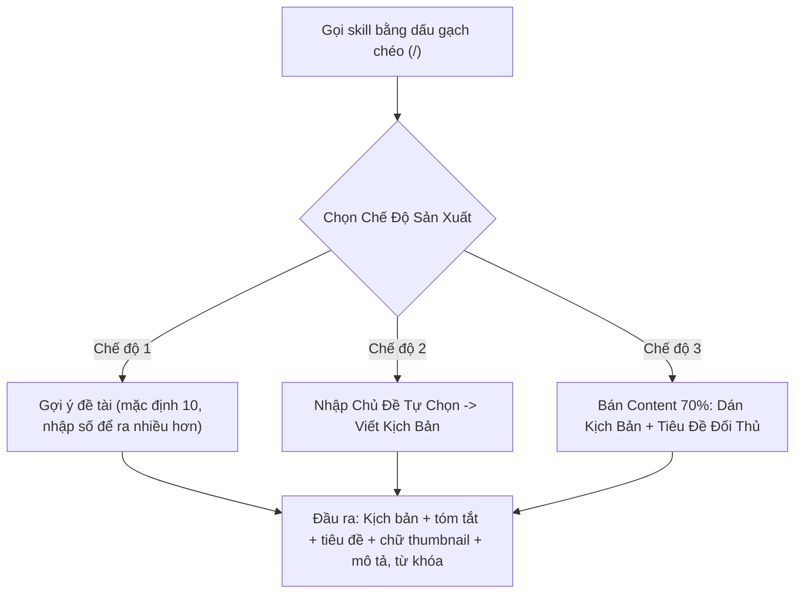

# SOP — Quy Trình Huấn Luyện Prompt & Đóng Gói Claude Skill Viết Kịch Bản 3 Chế Độ Ngách Sức Khỏe Hàn Quốc
> **Mã video:** `VIDEO-043d15` | **Hệ thống:** H2DEV SSoT 2026 | **Thị trường:** Hàn Quốc (`KR`)  

---

## 1. Mục Tiêu & Cấu Trúc Đóng Gói Claude Skill
- **Mục tiêu:** Train prompt trên Claude AI để đóng gói thành một skill viết kịch bản cho ngách nhỏ key sức khỏe thị trường Hàn Quốc. Train kỹ từ đầu để về sau làm nhiều ngách, nhiều thứ khác nhau vẫn gọi lại skill được mà không phải ghi lại từ đầu.
- **Dữ liệu nạp cho AI (nên dùng 2-3 kênh đối thủ, 3 kênh là ổn nhất):** Với mỗi kênh, vào mục Phổ biến, copy toàn bộ thông tin kênh rồi dán vào Claude. Trong bài, tác giả chỉ cho AI học 2 kênh cùng một hướng ngách.
- **Train từ từ, không train một lần:** Sau khi AI phân tích hai kênh, nạp tiếp kịch bản cao view nhất của từng kênh (tổng 4 kịch bản theo yêu cầu của AI), cùng thông tin kênh, mô tả video và thẻ từ khóa của video đối thủ. Kịch bản lấy bằng một web lấy kịch bản miễn phí, lưu bằng Notepad.
- **Đọc kỹ kết quả phân tích:** AI chỉ ra ngách chính xác (đi sâu vào ngách cực nhỏ chứ không phải ngách sức khỏe chung chung), các từ khóa chính, các kiểu kịch bản của đối thủ, phần đi kèm kịch bản và những điều nên/không nên làm, rồi sẵn sàng đóng gói thành skill.
- **Brand keyword:** Là từ khóa thương hiệu cho kênh. Nếu đã có tên kênh và ý tưởng thương hiệu thì nhập vào; nếu chưa có thì nhờ AI đề xuất tên kênh và brand keyword, rồi chọn một phương án (mặc định chọn 1 cho nhanh).
- **Cấu hình khác khi trả lời AI:** Thời lượng chọn theo đề xuất của AI (theo 2 kênh đối thủ); giọng đọc có thể clone giống đối thủ hoặc dùng ElevenLabs.
- **Lưu skill:** Bấm lưu để skill tự lưu vào Claude; hoặc yêu cầu AI xuất file zip để tải về và tự upload.
- **Gói Pro:** Tác giả khuyên nâng cấp gói Pro của Claude AI; dùng bản free thì không được gì nhiều.

---

## 2. Thiết Kế 3 Chế Độ Hoạt Động Trong 1 Skill

### Chi tiết 3 Chế độ:
1. **Chế độ 1 — Gợi ý Đề tài:**
   - Cú pháp: Gọi skill rồi để trống hoặc ghi "gợi ý đề tài" thì AI tự đưa ra 10 chủ đề đã được phân tích kỹ; muốn nhiều hơn thì nhập số (ví dụ 20 thì ra đúng 20).
   - Các chủ đề được chia nhóm, ví dụ nhóm liên quan đường huyết, mạch máu và nhóm mẹo thực hành.
   - Chọn chủ đề bằng cách ghi số thứ tự rồi nhấn Enter.
2. **Chế độ 2 — Viết Theo Chủ Đề Tự Chọn:**
   - Cú pháp: Gọi skill và ghi từ khóa chủ đề đã có sẵn, nhấn Enter thì AI tự viết.
3. **Chế độ 3 — Bán Content Từ Video Cao View Của Đối Thủ:**
   - Cú pháp: Sao chép kịch bản của video cao view nhất, tải lên kèm tiêu đề của đối thủ, nhấn Enter.
   - Đây là kiểu bán content lấy 70% như tác giả đã nói trước đó. Nếu ra lệnh cứng "lấy 70%" thì các model AI hiện nay thường từ chối vì được hạn chế để bảo vệ bản quyền; nên train theo cách trong bài thì AI vẫn viết được.

### Đầu ra của kịch bản:
- Phần kịch bản, kèm tóm tắt số ký tự, số từ.
- Tiêu đề, chữ trên thumbnail, mô tả và từ khóa.
- Danh sách xác minh để kiểm lại tính đúng sự thật trong kịch bản.

---

## 3. Cấu Hình Voiceover ElevenLabs & Cảnh Báo Bẫy Lỗi
- **Quy tắc chọn Model:** Mỗi giọng trên web có một model đi kèm; trong tool phải chọn đúng model đó, giống hệt thông số bên web.
- ⚠️ **Cảnh báo lỗi:** Nếu chọn sai model, giọng đọc sẽ sai, có lúc đọc ra tiếng Thái Lan.
- **Đồng bộ thông số:**
  + Các thông số bên tool (tốc độ, độ ổn định âm thanh...) phải xét theo đúng thông số bên web; ví dụ tốc độ bên web là 0.96 thì bên tool cũng xét 0.96.
  + Nhớ tích vào ô thiết lập thông số giọng trong tool, nếu không tool sẽ không nhận các thông số đó.
- **Giọng đọc:** Với ngách sức khỏe, chỉ cần giọng đọc tốt; ngách về người nổi tiếng thì bắt buộc phải clone giọng. Thị trường Hàn tác giả chủ yếu dùng ElevenLabs.

---

## 4. Nguyên Tắc Quản Trị Context
- ⚠️ **Bắt buộc tạo New Chat cho mỗi kịch bản mới:** Xong một kịch bản, sang video tiếp theo phải tạo cuộc trò chuyện mới rồi mới gọi skill; viết chung trong một đoạn chat sẽ không ngon như nhiều người tưởng.
