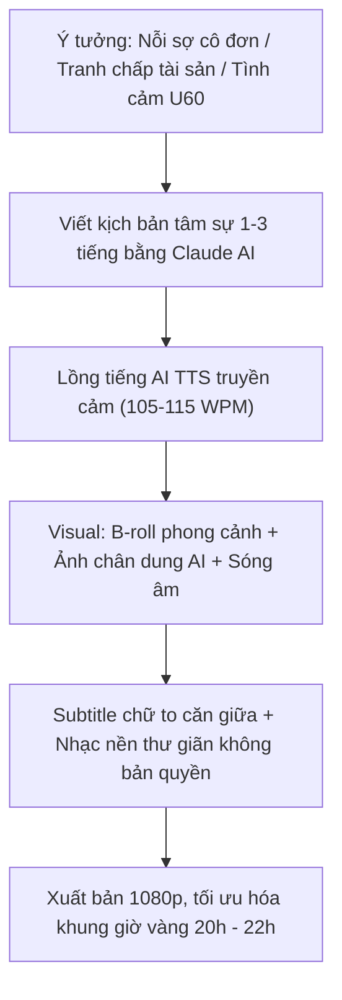

# SOP — Khai Thác Ngách Tâm Sự Người Cao Tuổi & Bán Content Gia Đình Thị Trường Việt Nam
> **Mã video:** `VIDEO-0be6c9` | **Hệ thống:** H2DEV SSoT 2026 | **Thị trường:** Việt Nam (`VN`)  
> **Nguồn bài giảng:** [https://h2dev.vn/learn/study/kinh-khung-voi-ngach-cuc-nho-view-viet-kenh-moi-8-video-hon-3-trieu-view-ban-content-ngach-nguoi-cao-tuoi](https://h2dev.vn/learn/study/kinh-khung-voi-ngach-cuc-nho-view-viet-kenh-moi-8-video-hon-3-trieu-view-ban-content-ngach-nguoi-cao-tuoi)

---

## 1. Bản Đồ Tổng Quan & Hiện Tượng Triệu View
- **Hiện tượng thực tế:** Kênh mới lập `Chuyện Nhà Xưa Nay` (`@ChuyenNhaXuaNay-s2j`) chỉ với 8 video dài đã thu hút hơn **3.100.000 lượt xem** và 10.600 người đăng ký chỉ trong 2-3 tuần.
- **Tệp khán giả cốt lõi:** Người lớn tuổi (U50, U60, U70) tại Việt Nam. Thói quen bật TV thông minh hoặc điện thoại khi làm việc nhà, chuẩn bị đi ngủ hoặc mất ngủ ban đêm.
- **Thời lượng vàng:** Video dài từ **1 tiếng 30 phút đến 3 tiếng 30 phút** (ghép nối 2-3 mẩu chuyện tâm sự). Tối ưu hóa thời lượng giữ chân người xem trung bình (AVD), kích hoạt thuật toán YouTube đẩy video vào luồng đề xuất trang chủ.

---

## 2. Công Thức Giật Hook Tiêu Đề & Thiết Kế Thumbnail

### Cấu trúc tiêu đề 3 thành phần:
`[Chủ đề giật gân / Tình huống nghịch lý] + [Độ tuổi nhân vật U60/U70] + [Kể Truyện Đêm Khuya / Nghe Để Ngẫm]`

### Các mẫu tiêu đề chiến thắng (Trích từ kênh mẫu):
1. *Ngoại tình tuổi 65 - Họp lớp gặp lại mối tình đầu* (1,7 triệu view)
2. *Vợ chồng U70 quan hệ thế này sướng lắm, phê lắm* (818.000 view)
3. *Đau nhất là xin lại tiền đã cho con - Kể truyện đêm khuya* (94.000 view)
4. *70 tuổi quan hệ có lợi ích gì? Nghe để ngẫm* (128.000 view)

### Quy chuẩn Thumbnail 3 điểm chạm:
- **Nhân vật:** Chân dung người phụ nữ/ông cụ lớn tuổi biểu cảm sang trọng, quý phái hoặc nét mặt trầm tư, rơi nước mắt.
- **Màu sắc & Phông chữ:** Chữ to in đậm, chia 2-3 tầng màu tương phản mạnh:
  + Dòng 1: Chữ Trắng viền đen đậm.
  + Dòng 2: Chữ Vàng chanh (`#FACC15`) hoặc Đỏ rực (`#EF4444`).
- **Badge trên cùng:** Đặt khung badge nổi bật: `CHUYỆN TUỔI GIÀ CỰC HAY` hoặc `TRUYỆN MỚI 2026`.

---

## 3. Quy Trình Sản Xuất (SOP) Né Quét AI & Bản Quyền

1. **Âm thanh & Voice:**
   - Dùng giọng đọc AI trầm ấm, truyền cảm, phát âm chuẩn tiếng Việt (nhịp độ 105 - 115 từ/phút).
   - Nhạc nền: Nhạc không lời thư giãn, tiếng mưa rào nhẹ, tiếng sáo trúc hoặc lofi nhẹ nhàng lấy từ YouTube Audio Library hoặc Epidemic Sound.
2. **Kỹ thuật Visual né quét trùng lặp:**
   - Sử dụng ảnh chân dung tạo bởi AI (Midjourney/Flux) kết hợp hiệu ứng sóng âm (Audio Spectrum) chuyển động theo giọng nói.
   - Thêm hiệu ứng zoom pan chậm (Slow Zoom-in / Zoom-out) và chèn hạt bụi ánh sáng (Dust Particles Overlay) để khung hình luôn có chuyển động số (Motion Vector).
   - Phụ đề chữ to màu vàng viền đen căn giữa màn hình để người lớn tuổi đọc rõ trên TV.

---

## 4. Cảnh Báo Đỏ & Ranh Giới An Toàn (Avoid Flags)
- ⚠️ **Tuyệt đối không lấy ảnh người nổi tiếng thật:** Tránh lạm dụng hình ảnh các MC, nghệ sĩ nổi tiếng (như MC Lại Văn Sâm) vì nguy cơ bị khiếu nại bản quyền hình ảnh, vi phạm quyền riêng tư và pháp lý.
- ⚠️ **Ranh giới nội dung nhạy cảm:** Mặc dù đề tài có yếu tố tình cảm tuổi già, nhưng tuyệt đối không đưa hình ảnh dung tục, khiêu dâm thô thiển; tập trung vào tâm lý, đạo lý nhân quả gia đình để tránh bị YouTube gắn cờ vàng hạn chế quảng cáo (Advertiser-friendly guidelines).
