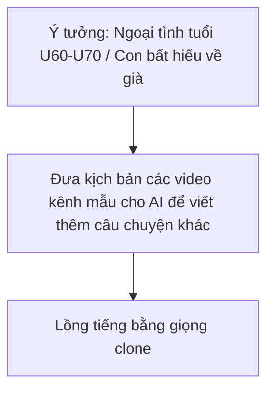

# SOP — Khai Thác Ngách Tâm Sự Người Cao Tuổi & Bán Content Gia Đình Thị Trường Việt Nam
> **Mã video:** `VIDEO-0be6c9` | **Hệ thống:** H2DEV SSoT 2026 | **Thị trường:** Việt Nam (`VN`)  

---

## 1. Bản Đồ Tổng Quan & Hiện Tượng Triệu View
- **Hiện tượng thực tế:** Một kênh mới chỉ có 8 video. Tác giả nhận định hiện ở Việt Nam chỉ thấy một kênh làm dạng ngách này; có video đăng 1 tháng trước đạt 1,7 triệu view, các video còn lại cũng rất cao.
- **Tệp khán giả cốt lõi:** Người cao tuổi (U60, U70 trở lên) tại Việt Nam. Theo tác giả, người già ở Việt Nam đa số xem TV và điện thoại hàng ngày, và ngách ngoại tình tuổi U60, U70 cũng có rất nhiều người xem.
- **Ngách cực nhỏ:** Tác giả gọi đây là ngách cực nhỏ nhưng view rất lớn; điều quan trọng là ý tưởng và kịch bản để bám vào.

---

## 2. Cách Đặt Tiêu Đề & Từ Khóa Ngách
- Nội dung nói về ngoại tình, nhưng là ngoại tình dành cho người cao tuổi, không đánh vào tất cả tệp khán giả.
- Tiêu đề đặt theo hướng nhắm đúng độ tuổi U60, U70 trở lên để thuật toán không quét rộng.
- Từ khóa ngách chính của dạng này: ngoại tình ở tuổi 65, 60.

---

## 3. Quy Trình Sản Xuất (SOP)

1. **Kịch bản:**
   - Lấy kịch bản của các video kênh mẫu làm đầu vào cho AI, từ đó AI viết thêm những câu chuyện khác.
2. **Âm thanh & Voice:**
   - Kênh mẫu dùng giọng clone để đọc truyện.
3. **Các hướng ngách khác tác giả nhắc tới:**
   - Kênh lấy nhân vật nổi tiếng là bác Lại Văn Sâm (từng share cách đây hơn một năm, dạng triết lý tuổi già; sau đó nhiều anh em làm theo).
   - Kênh nói về người già và những người con bất hiếu, về già nương tựa vào ai; người xem hình dung ra ngay từ tiêu đề.

---

## 4. Cảnh Báo Đỏ & Ranh Giới An Toàn (Avoid Flags)
- ⚠️ **Cẩn trọng khi dùng nhân vật nổi tiếng:** Bác Lại Văn Sâm rất nổi tiếng ở Việt Nam; nếu làm sai sự thật, xuyên tạc hoặc ghép hình quá nhiều thì có thể bị kiện. Tác giả kể bác từng đăng trên Facebook về việc nhiều bên dùng AI xuyên tạc, quảng cáo cờ bạc làm ảnh hưởng hình ảnh của bác. Làm ở thị trường Việt phải cẩn thận vì làm sai hướng rất dễ dính pháp lý.
- ⚠️ **Đề tài nhạy cảm:** Tác giả nói đề tài này có thể gây cảm giác nhạy cảm với người không làm YouTube; với người đã xác định làm YouTube để kiếm thêm thu nhập thì cứ làm bình thường, theo tác giả không vi phạm gì.
