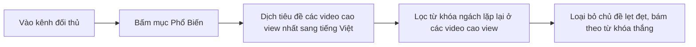

# SOP — Kỹ Thuật Đào Key Dưỡng Sinh Sức Khỏe & Tâm Sự Người Cao Tuổi Thị Trường Hàn Quốc
> **Mã video:** `VIDEO-a85eac` | **Hệ thống:** H2DEV SSoT 2026 | **Thị trường:** Hàn Quốc (`KR`)  
> **Nguồn bài giảng:** [https://h2dev.vn/learn/study/kham-kenh-va-update-share-ngach-nho-thi-truong-han-moi-nhat-29-09-2026](https://h2dev.vn/learn/study/kham-kenh-va-update-share-ngach-nho-thi-truong-han-moi-nhat-29-09-2026)

---

## 1. Case Study Khám Kênh Thành Viên PRO & Bằng Chứng Số Liệu
- **Kênh thực chiến:** Kênh của một thành viên, làm thị trường Hàn Quốc, lập từ ngày 14 tháng 9; video đầu đăng khoảng 2 tuần trước thời điểm quay. View lên dần theo từng video, video cao nhất hơn 200.000 view sau 7 ngày. Đây là một ngách nhỏ về sức khỏe.
- **Sự khác biệt về từ khóa:**
  + Tiêu đề video cao view nhất có câu hook mở đầu "video nhất định phải xem nếu bạn bị suy thận"; từ khóa ngách là suy thận.
  + Từ khóa quan trọng thứ hai là **táo và cà rốt**: các video có từ khóa này view khá cao, khá ổn với một kênh mới.
  + Các video bị lẹt đẹt view là những dạng rau củ khác, không bám từ khóa táo và cà rốt.
- **Quy luật đối thủ:** Kênh đối thủ thứ 2 mới làm 2 tuần (19 video), cùng thị trường Hàn Quốc và đúng ngách này; tiêu đề đọc lên là hình dung ra (ví dụ ăn táo vào buổi sáng, cà rốt). Video về khoai tây cũng có lên nhưng đa số video cao view nhất đều là từ khóa táo và cà rốt.
- **Kênh thứ 3 (ngách người già):** Làm từ đầu tháng 9, chưa được một tháng, chỉ có 4 video nhưng có video hơn 100k view sau 12 ngày và 9 ngày. Tiêu đề kiểu "tại sao con cái lại phải chịu khổ sở hơn khi cha mẹ sống càng lâu".

---

## 2. Quy Trình Đào Key Bán Content Từ Mục Phổ Biến

- Copy tiêu đề của đối thủ vào Claude AI, nhờ AI phân tích và học theo thì AI tự ra tiêu đề có đủ câu hook, từ khóa chính, từ khóa phụ.
- Đây là cách bán content tác giả đã hướng dẫn nhiều lần: bám theo đối thủ, bấm vào mục Phổ biến, phân tích rồi bám theo các từ khóa và kênh của họ.

### Các cụm từ khóa ngách sức khỏe Hàn Quốc rút ra trong bài:
1. Suy thận (câu hook của tiêu đề video cao view nhất).
2. Táo và cà rốt (cụm từ khóa quan trọng nhất).

---

## 3. Edit SOP & Quy Trình Dựng Video
1. **Hình ảnh & Visual:**
   - Kênh ngách sức khỏe: dùng hình ảnh minh họa tải về, kèm video từ các nguồn miễn phí như tác giả đã share; chủ yếu hạ hình ảnh rồi zoom to nhỏ, kéo qua kéo lại, rất đơn giản nhưng view vẫn cao.
   - Kênh ngách người già: lấy video tự nhiên ghép vào, cho phụ đề chạy và kèm thêm hình ảnh nhân vật; giống quy trình đã hướng dẫn cho thị trường Việt và Nhật.
2. **Kịch bản:**
   - Vấn đề chủ yếu là kịch bản: sao chép kịch bản của đối thủ cho AI học, train theo quy trình dùng Claude trong mô-đun hướng dẫn của tác giả (mục mô đun thứ 3).
3. **Giọng đọc:**
   - Sau kịch bản đến giọng đọc, đây là những thứ quan trọng nhất; hình ảnh minh họa không chiếm tỷ trọng quan trọng bằng kịch bản.

---

## 4. Cảnh Báo & Lỗi Cần Tránh (Avoid Flags)
- ⚠️ **Tránh đi theo chủ đề lẹt đẹt:** Những chủ đề view thấp thì loại bỏ, để không đi theo con đường sai; bám vào từ khóa đã được chứng thực bằng video cao view trong mục Phổ biến của đối thủ.
- ⚠️ **Nhân bản thị trường:** Có thể lấy kịch bản của các kênh bên Hàn đem về thị trường Việt mình làm; tác giả nhận định ngách sức khỏe có nhu cầu thị trường lúc nào cũng có. Sau khi có ngách nhỏ, điều quan trọng nhất là kịch bản phải hay để giữ chân người xem.
