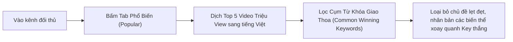

# SOP — Kỹ Thuật Đào Key Dưỡng Sinh Sức Khỏe & Tâm Sự Người Cao Tuổi Thị Trường Hàn Quốc
> **Mã video:** `VIDEO-a85eac` | **Hệ thống:** H2DEV SSoT 2026 | **Thị trường:** Hàn Quốc (`KR`)  
> **Nguồn bài giảng:** [https://h2dev.vn/learn/study/kham-kenh-va-update-share-ngach-nho-thi-truong-han-moi-nhat-29-09-2026](https://h2dev.vn/learn/study/kham-kenh-va-update-share-ngach-nho-thi-truong-han-moi-nhat-29-09-2026)

---

## 1. Case Study Khám Kênh Thành Viên PRO & Bằng Chứng Số Liệu
- **Kênh thực chiến:** Kênh học viên lập ngày 14/09/2026 tại thị trường Hàn Quốc.
- **Sự khác biệt về từ khóa:**
  + Video chứa cụm từ khóa **"Táo & Cà Rốt" (사과와 당근)** hoặc **"Suy Thận" (신장 / 신부전)** bùng nổ **209.000 lượt xem** chỉ sau 7 ngày!
  + Các video làm về khoai tây, rau cải thông thường chỉ đạt lẹt đẹt vài nghìn view.
- **Quy luật đối thủ:** Kênh đối thủ thứ 2 mới lập 2 tuần (19 video) bám đúng cụm từ khóa này cũng liên tục đạt hàng chục nghìn view.

---

## 2. Quy Trình 4 Bước Đào Key Bán Content Từ Tab Phổ Biến

### Các cụm từ khóa vàng ngách Sức Khỏe Hàn Quốc:
1. `사과와 당근` (Táo và cà rốt)
2. `신장 회복 1등 채소` (Rau số 1 phục hồi thận)
3. `의사가 숨긴 비법` (Bí quyết bác sĩ giấu kín)
4. `신장 나이 20세 젊게` (Thận trẻ ra 20 tuổi)
5. `아침에 "이렇게" 드세요` (Buổi sáng ăn "như thế này")
6. `보약이 따로 없습니다` (Không khác gì thuốc bổ)

---

## 3. Edit SOP & Quy Trình Dựng Video Né Quét Bản Quyền AI
1. **Hình ảnh & Visual:**
   - Thumbnail: Hình quả táo cắt đôi màu đỏ tươi + củ cà rốt cam rực rỡ + bắp cải trên nền đen tuyền; chữ to màu vàng / trắng viền nổi bật.
   - Video: Lấy video/ảnh B-roll thiên nhiên, rau củ quả độ phân giải cao miễn phí từ Pexels/Pixabay. Dùng hiệu ứng scale zoom-in, zoom-out (1.05 - 1.1x) và pan nhẹ nhàng để chống quét khung hình tĩnh.
2. **Kịch bản:**
   - Nạp các kịch bản đối thủ vào Claude AI theo quy trình Module 3 để trích xuất cấu trúc hook, luận điểm khoa học và giải pháp thực tế.
3. **Âm thanh:**
   - Lồng tiếng AI TTS tiếng Hàn bản địa, tốc độ vừa phải, âm vực trầm ấm, tạo cảm giác tin cậy của chuyên gia y tế dưỡng sinh.

---

## 4. Cảnh Báo & Lỗi Cần Tránh (Avoid Flags)
- ⚠️ **Tránh tư vấn y khoa sai lệch (YMYL):** Không đưa ra các tuyên bố điều trị bệnh dứt điểm hoặc phủ nhận y học hiện đại; luôn có câu disclaimer y tế khéo léo ("Nội dung mang tính chất tham khảo dưỡng sinh đời sống, vui lòng tham khảo ý kiến bác sĩ chuyên khoa").
- ⚠️ **Tránh lan man sang các loại rau củ không có trend:** Tuyệt đối không chọn đề tài theo cảm tính; chỉ làm các chủ đề đã được chứng thực bằng view cao trên tab Phổ Biến của đối thủ.
