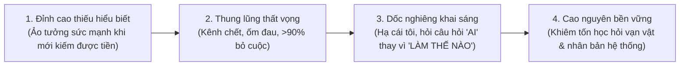

# VIDEO-22064e — Cách Chuyển Mình Từ Làm Thuê Sang Làm Chủ Nhanh Nhất

> **Mã video:** `VIDEO-22064e` (Bài 53 — Chương trình đào tạo Huân Academy Offline: *YouTube Total Success — Mindset and Strategy*)  
> **Thời lượng:** `10:04` (`604.0s` — 122 phân đoạn phụ đề đã kiểm chứng)  
> **Chủ đề thực tế:** Ứng dụng mô hình **Kim Tứ Đồ (Cashflow Quadrant)** của Robert Kiyosaki vào ngành MMO/YouTube, giải phẫu đồ thị **Hiệu ứng tâm lý Dunning-Kruger** khiến hơn 90% người làm lẻ tự đào thải, và lộ trình nâng cấp từ **Tự doanh (Level 2)** lên **Chủ doanh nghiệp (Level 3)** & **Nhà đầu tư (Level 4)**.  
> **Phân nhóm hệ thống:** `he_thong` / `he_thong_cashflow_quadrant_dunning_kruger` (`VN_GLOBAL`)  
> **Trạng thái kiểm chuẩn:** `GROUNDED_VERIFIED` · `visual_audio_checked: true` (Đã trích xuất và đối chiếu trực tiếp màn hình chiếu đồ thị *Hiệu ứng Dunning-Kruger* trên `glints.com` cùng sơ đồ *Kim Tứ Đồ* vẽ trực tiếp trên bảng trắng tại hội trường).

---

## 1. Giải Phẫu Kim Tứ Đồ (Robert Kiyosaki) Dưới Góc Nhìn MMO & YouTube (`00:00 – 02:00`)

Mở đầu bài giảng, giảng viên dẫn chiếu lý thuyết **Kim Tứ Đồ (*Cashflow Quadrant*)** của tác giả **Robert Kiyosaki** (`@TheRichDadChannel`) và vẽ trực tiếp lên bảng trắng 4 góc phần tư đại diện cho 4 phương thức tạo ra dòng tiền trong xã hội:

| Góc Phần Tư trên Bảng Trắng | Ký hiệu Viết Tắt | Bản chất Đòn bẩy Thời gian & Tiền bạc | Đặc điểm Thực tế trong Ngành MMO / YouTube |
| :--- | :---: | :--- | :--- |
| **Level 1: Làm công ăn lương (*Employee*)** | `TG -> $` | Bán thời gian của bản thân để người khác trả lương cố định. | Công việc hành chính, văn phòng (như ví dụ học viên làm chuyên môn Excel đi làm thuê). An toàn bề nổi nhưng thu nhập bị giới hạn bởi số giờ làm việc. |
| **Level 2: Tự làm chủ / Tự doanh (*Self-Employed*)** | `MMO` / `TG MÌNH -> $` | Dùng chính thời gian và sức lao động của bản thân để tự tạo ra tiền cho mình. | **MMO (*Make Money Online*) và làm Video YouTube** là con đường **nhanh nhất, đơn giản nhất và ít vốn nhất** để một người bước từ Level 1 xuống Level 2. Trong đó, Video ngắn giúp bán hàng nhanh, còn **Video dài YouTube** tạo ra nguồn thu bền vững. |
| **Level 3: Chủ doanh nghiệp (*Business Owner*)** | `DN` / `TG + $ = $` | Dùng **Thời gian của mình + Tiền để mua Thời gian của người khác** tạo ra lợi nhuận cấp số nhân. | Tuyển dụng nhân sự, đào tạo kiến thức gốc, xây dựng quy trình linh động để vận hành hàng chục/hàng trăm kênh cùng lúc (phá vỡ giới hạn 24 giờ/ngày của cá nhân). |
| **Level 4: Nhà đầu tư (*Investor*)** | `ĐT` | Dùng **Tiền + Kiến thức + Kinh nghiệm** tái đầu tư vào chính hệ sinh thái đang thắng lợi. | Cấp vốn và hệ thống cho các nhánh/công ty con trong cùng ngành truyền thông số để tiền đẻ ra tiền mà không rơi vào bẫy đầu tư tài chính mù quáng. |

---

## 2. Đồ Thị Hiệu Ứng Dunning-Kruger: Tại Sao 90% Người Làm YouTube Bỏ Cuộc Ở Level 2? (`02:01 – 06:32`)

Trên màn hình chiếu lớn phía sau sân khấu (`frame_03_201s` đến `frame_07_469s`), giảng viên mở trực tiếp biểu đồ **"Hiệu ứng Dunning-Kruger"** (từ chuyên trang `glints.com/vn/blog/hieu-ung-dunning-kruger-effect-la-gi/`) với trục tung là **`Lòng Tự Tin`** và trục hoành là **`Khả Năng`** để chỉ rõ căn bệnh chết người của dân Tự doanh (Level 2):

### Phân Tích 4 Giai Đoạn Tâm Lý Trên Biểu Đồ Dunning-Kruger

#### Giai đoạn 1: Đỉnh cao thiếu hiểu biết (*Peak of Mount Stupid* — `02:01 – 03:38`)
* **Biểu hiện:** Khi một người mới bước từ làm thuê sang tự làm MMO/YouTube và bắt đầu kiếm được những khoản tiền đầu tiên, tinh thần hưng phấn tột độ. Lúc này **Khả năng thực sự mới nhích nhẹ từ 0 lên một chút**, nhưng **Lòng tự tin đã vọt thẳng lên đỉnh cao nhất** (giống như nhân vật trong phim kiếm hiệp mới học lỏm được vài chiêu võ công đã tưởng mình vô địch thiên hạ, xách kiếm đi thách đấu khắp nơi).
* **4 Dấu hiệu điển hình hiển thị trực tiếp trên màn hình chiếu:**
  1. *Đánh giá quá cao kỹ năng, năng lực của bản thân.*
  2. *Không thể nhận ra sự thiếu sót của chính mình.*
  3. *Không thể nhận ra năng lực thật sự ở người khác.*
  4. *Tuy nhiên, vẫn có thể nhận thức về sự yếu kém của mình nếu được hướng dẫn để cải thiện.*
* **Hệ quả tại góc MMO:** Cái tôi phình to, không muốn đi học thêm ai, không muốn giao lưu chia sẻ với đồng nghiệp, khép kín với tư duy **"Bố mày làm một mình, làm tất ăn cả"**.

#### Giai đoạn 2: Thung lũng thất vọng (*Valley of Despair* — `03:39 – 04:40`)
* **Biểu hiện:** Vì làm lẻ một mình, đến một ngày đẹp trời khi bản thân đau ốm, mệt mỏi, hoặc thuật toán quét làm kênh chết, kênh tắt kiếm tiền vì vi phạm chính sách, không có bất kỳ ai duy trì hệ thống thay mình. Khi thử lập kênh mới thì làm mãi không lên được.
* **Tỷ lệ đào thải khốc liệt (`04:08`):** Giảng viên dẫn chứng thực tế trong số **hơn 200 người bạn đi học các khóa YouTube cùng thời với mình** (nhiều người từng kiếm được tiền và thành công sớm hơn giảng viên rất nhiều), đến nay **chỉ còn chưa tới 10% trụ lại được với nghề**. Hơn **90% đã gục ngã và bỏ cuộc vĩnh viễn ngay tại "Thung lũng của sự thất vọng"**, nhận ra trước đó mình chỉ là người ăn may được 1 kênh (hoặc một số người không làm được nữa thì chuyển sang đóng gói kiến thức cũ đi dạy lại như ví dụ Mr. Excel).

#### Giai đoạn 3: Dốc nghiêng khai sáng (*Slope of Enlightenment* — `04:41 – 05:46`)
* **Bước ngoặt chuyển hóa:** Những người vượt qua được Thung lũng thất vọng là những người biết **hạ cái tôi của mình xuống** để leo lên *Dốc nghiêng khai sáng*.
* **Sự thay đổi câu hỏi cốt lõi (`04:50`):**
  * Ở đáy thung lũng, người ta chỉ hỏi câu hỏi **"Làm thế nào (How)?"** (*Làm thế nào để tự mình cày tiếp kênh nữa?*).
  * Khi bước lên Dốc nghiêng khai sáng, họ bắt đầu hỏi câu hỏi **"Ai (Who)?"** (*Ai có thể giúp mình? Ai sẽ làm cùng mình?*).
* **Bí quyết "Vòng quay vô hạn" — Học từ những kênh YouTube nhỏ (`05:15 – 05:46`):**
  * Không được coi thường bất kỳ ai trong cuộc đời vì mỗi cá thể đều có góc nhìn xuất sắc riêng.
  * Trong YouTube cũng vậy: **Đừng chỉ chăm chăm đi học các kênh khổng lồ!** Một kênh rất bé mới lập nhưng có dấu hiệu bật view bất thường chính là mỏ vàng. Nếu bạn phát hiện và học hỏi (pick content) từ những kênh nhỏ đang lên này, tỷ lệ thắng của bạn còn cao và thực tế hơn rất nhiều so với việc cố bắt chước một kênh đại thụ đã làm 5–7 năm.

#### Giai đoạn 4: Cao nguyên bền vững (*Plateau of Sustainability* — `05:47 – 06:32`)
* Càng về sau, kiến thức và năng lực thực chiến càng tăng cao vững chắc; dù lòng tự tin không còn ngông cuồng "vô địch thiên hạ" như thuở ban đầu, nhưng họ sở hữu sự điềm tĩnh, bền vững và coi mọi người xung quanh đều là người thầy của mình.

---

## 3. Lộ Trình Phá Kén: Từ Tự Doanh (Level 2) Lên Chủ Doanh Nghiệp (Level 3) & Nhà Đầu Tư (Level 4) (`06:33 – 10:04`)

### A. Phá bỏ "Tâm lý Thu Về Mình" ở Level 2 (`06:33 – 07:26`)
Trên bảng trắng (`frame_06_402s`), ngay bên dưới ô `MMO / TG MÌNH -> $`, giảng viên vẽ một vòng tròn ở giữa với hàng loạt mũi tên hướng từ ngoài chụm vào tâm:
* Đó là biểu tượng của tư duy **"Thu về mình"** — tự ôm hết mọi khâu từ kịch bản, thu âm, dựng phim đến đăng bài vì 2 nỗi sợ lớn:
  1. *Sợ công việc dễ quá, dạy cho nhân viên xong họ nghỉ việc ra làm mất chủ đề của mình.*
  2. *Sợ nhân viên làm xong lại mang bí quyết đi kể cho người ngoài.*
* Chính vì nỗi sợ đó mà tuyệt đại đa số dân MMO chọn cách im lặng, giấu giếm và tự giam mình mãi mãi ở quy mô nhỏ lẻ.

### B. Bước nhảy lên Level 3 — Xây dựng Doanh nghiệp (`DN: TG + $ = $` — `07:27 – 08:53`)
Để bước sang góc phần tư thứ 3 trên bảng trắng (`frame_07_469s`), chủ kênh bắt buộc phải thực hiện cuộc cách mạng về quản trị:
1. **Đi từ nhóm hạt nhân tin cậy:** Ban đầu khi mới mở rộng ở đầu Level 3, việc chỉ chia sẻ và chuyển giao cho người thân hoặc anh em ruột thịt để đào tạo thành các **Leader** là hoàn toàn tự nhiên và hợp lý.
2. **Công thức Đòn bẩy Thời gian (`08:40`):** Tài nguyên duy nhất công bằng và hữu hạn với mọi người là **24 giờ/ngày**. Người chiến thắng là người biết **dùng Tiền (`$`) để mua lại Thời gian (`TG`) của hàng chục nhân sự khác** cộng hưởng vào thời gian của chính mình.
3. **3 trụ cột bắt buộc phải xây dựng ở Level 3:**
   * **Tuyển dụng nhân sự.**
   * **Đào tạo kiến thức gốc.**
   * **Đóng gói Quy trình theo triết lý Linh động Phương Đông (`08:02`):**
     > *"Quy trình có thể đúng, có thể sai không quan trọng! Quan trọng là mình đang làm thực tế như thế nào thì mình dạy lại anh em làm đúng như thế — thế là xong! Đừng máy móc chạy theo quy trình chuẩn A, chuẩn B, chuẩn C của Phương Tây. Quy trình của chúng ta phải linh động điều chỉnh và tiến hóa mỗi ngày."*

### C. Bước nhảy lên Level 4 — Nhà Đầu Tư Thông Thái (`08:54 – 10:04`)
Khi doanh nghiệp YouTube ở Level 3 đã tạo ra dòng tiền thặng dư lớn, cách chuyển sang góc phần tư thứ 4 (**Đầu tư**) quyết định việc bạn giữ được thành quả hay mất trắng:
* **Nguyên tắc số 1 — Tái đầu tư vào chính cỗ máy đang chiến thắng (`09:07`):** Tuyệt đối không cầm tiền lãi từ YouTube nhảy sang đầu tư linh tinh vào các sới bạc tài chính mà mình không có chuyên môn. Khoản đầu tư khôn ngoan nhất là kết hợp **Tiền vốn + Kinh nghiệm + Kiến thức sẵn có** tái đầu tư mở rộng chính mô hình doanh nghiệp YouTube đang sinh lời của mình.
* **Nguyên tắc số 2 — Dũng cảm cắt bỏ mô hình không hiệu quả (`09:31`):** Nhiều người khi lập ra một dự án hoặc một hướng kênh mới không hiệu quả (*không win*), nhưng vì coi đó là *"đứa con tinh thần do mình khai sinh ra"* nên cứ cố chấp bơm tiền và thời gian cứu vãn, dẫn đến kiệt quệ và mất sạch thành quả tích lũy trước đó. Nếu mô hình không hiệu quả, phải tỉnh táo dừng lại để bảo toàn nguồn lực cho nhánh chiến thắng.

---

## 4. Bộ Tài Liệu & Biểu Mẫu Thực Chiến Đính Kèm Trong Kho Học Liệu

* 🗺️ **[Bản Đồ Phát Triển Nhân Sự & Hệ Thống YouTube (MAP YTS)](/assets/docs-huan/MAP_YTS.pdf)** (`assets/docs-huan/MAP_YTS.pdf`) — Sơ đồ cấu trúc nhân sự giúp chủ kênh chuyển mình từ làm lẻ (Level 2) sang mô hình doanh nghiệp (Level 3).
* 📊 **[Checklist Tuyển Dụng, Đào Tạo & Quản Trị Nhân Sự Hệ Thống](/assets/docs-huan/CHECKLIST_NHAN_SU.xlsx)** (`assets/docs-huan/CHECKLIST_NHAN_SU.xlsx`) — Bảng tính Excel chi tiết hóa quy trình tuyển dụng, đào tạo kiến thức gốc và bàn giao công việc cho đội ngũ.
* 📄 **[7 Bước Thành Công Với YouTube — Bí Mật Kiếm Tiền YouTube](/assets/docs-huan/7_buoc_thanh_cong_voi_Youtube_-_BI_MAT_KIEM_TIEN_YOUTUBE_.pdf)** (`assets/docs-huan/7_buoc_thanh_cong_voi_Youtube_-_BI_MAT_KIEM_TIEN_YOUTUBE_.pdf`) — Tài liệu tổng quan lộ trình xây dựng sự nghiệp YouTube bền vững từ con số 0.
