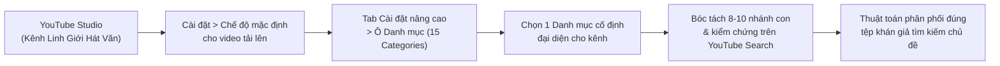

# Hiểu Rõ 15 Danh Mục Quan Trọng Trong YouTube Studio

> **Mã bài học:** `VIDEO-52b908` | **Module:** `DGMD-M10` (Bài 39) — *Chiến Lược Tăng Trưởng & Thuật Toán Đề Xuất*
> **Thời lượng:** `16:51` (`1011.47s` — `107 segments`) | **Phân nhóm:** `chuyen_gia` (*SEO & Thuật Toán YouTube*)
> **Tài liệu thực hành đính kèm:** [`assets/docs-dgmd/VIDEO-52b908/master_prompt.md`](../../assets/docs-dgmd/VIDEO-52b908/master_prompt.md)

---

## 1. Tổng Quan & Ý Nghĩa Chiến Lược Của 15 Danh Mục Trong YouTube Studio

Trong **Bài 39 (`VIDEO-52b908`)**, giảng viên trực tiếp thao tác trên giao diện **YouTube Studio** (sử dụng kênh demo **Linh Giới Hát Văn** — `UCBPGUH6eET9nTlbF72YmI7g`) và giải phẫu toàn bộ **15 bộ Infographic từ khóa chủ đề** tương ứng với **15 Danh mục (`Category`) chính thức của YouTube**.

Bài học giải quyết hai bài toán cốt lõi của người xây kênh:
1. **Định danh kênh với thuật toán phân phối:** Khi người sáng tạo khóa đúng Danh mục mặc định tại `YouTube Studio > Cài đặt > Chế độ mặc định cho video tải lên > Cài đặt nâng cao > Danh mục`, hệ thống YouTube sẽ nhận diện chính xác kênh đang phục vụ nhóm chủ đề nào, từ đó phân bổ video tới đúng tệp người dùng thường xuyên tìm kiếm các từ khóa thuộc danh mục đó.
2. **Bản đồ mỏ từ khóa bất tận (8–10 nhánh con/danh mục):** Thay vì nhìn 15 danh mục như những cái tên chung chung (*Giải trí*, *Giáo dục*, *Thể thao*...), giảng viên bóc tách từng danh mục thành **8 đến 10 nhóm chủ đề ngách** kèm **10 từ khóa tìm kiếm thực tế trong mỗi nhóm** để học viên lưu lại làm cẩm nang tra cứu ý tưởng trọn đời.

---

## 2. Phân Giải Chi Tiết 15 Danh Mục & Ma Trận Từ Khóa Theo Dòng Thời Gian

### 2.1. Thao Tác Thiết Lập Danh Mục Mặc Định Trên YouTube Studio (`00:00 – 00:50`)
Ngay ở đầu video (`00:00`), giảng viên mở trang quản trị **YouTube Studio** của kênh **Linh Giới Hát Văn** (`studio.youtube.com/channel/UCBPGUH6eET9nTlbF72YmI7g`) và hướng dẫn đường dẫn cấu hình:
- **Bước 1:** Nhấn vào mục **Cài đặt** (`Settings`) ở thanh menu bên trái.
- **Bước 2:** Chọn **Chế độ mặc định cho video tải lên** (`Upload defaults`).
- **Bước 3:** Chuyển sang thẻ **Cài đặt nâng cao** (`Advanced settings`) và mở ô **Danh mục** (`Category`).
- Tại đây xuất hiện đầy đủ **15 danh mục chuẩn**: *Du lịch và sự kiện*, *Giải trí*, *Giáo dục*, *Hài kịch*, *Hướng dẫn và phong cách*, *Khoa học và công nghệ*, *Mọi người và blog*, *Âm nhạc*, *Ô tô và xe cộ*, *Phim và hoạt hình*, *Thể thao*, *Thú cưng và động vật*, *Tin tức và chính trị*, *Tổ chức phi lợi nhuận và hoạt động xã hội*, và *Trò chơi*.

---

### 2.2. Nhóm Danh Mục Đời Sống, Giải Trí & Kỹ Năng (Danh Mục 1 – 5)

| STT & Mốc thời gian | Tên Danh mục | Số nhánh con | Phân tích chuyên sâu & Ví dụ thực chiến từ bài giảng |
| :--- | :--- | :--- | :--- |
| **01. Du lịch và Sự kiện** (`00:50 – 01:55`) | `Travel & Events` | **10 nhóm** | Bao gồm: *Du lịch trong nước*, *Du lịch nước ngoài*, *Sự kiện - Lễ hội*, *Ẩm thực & Du lịch*, *Kinh nghiệm du lịch*, *Phương tiện di chuyển*, *Lưu trú*, *Check-in - Sống ảo*, *Sự kiện doanh nghiệp*. Học viên lấy thẳng các từ khóa như `"du lịch trong nước"` gõ lên `YouTube Search` hoặc `Google Search` để kiểm tra dung lượng người xem và đối thủ. |
| **02. Giải trí** (`01:56 – 03:33`) | `Entertainment` | **10 nhóm** | Trên slide `KEYWORD LIÊN QUAN CHỦ ĐỀ GIẢI TRÍ` gồm 10 nhánh: `1. Hài hước - Thư giãn`, `2. Game - Trò chơi`, `3. Âm nhạc - Ca nhạc` (nhạc review phim), `4. Phim ảnh - TV Show`, `5. Check-in - Hot Trend`, `6. Ẩm thực - Ăn uống` (**Mukbang** — hôm nay Mukbang món này, ngày mai Mukbang món kia), `7. Làm đẹp - Phong cách`, `8. Thể thao - Vận động`, `9. Cuộc sống - Vlog` (quay vlog đi vào rừng, nấu món ăn dân dã), `10. Sáng tạo - DIY`. |
| **03. Giáo dục** (`03:34 – 04:22`) | `Education` | **9 nhóm** | Bao gồm: *Học tập - Phương pháp*, *Toán học*, *Tiếng Anh*, *Khoa học tự nhiên*, *Lịch sử - Địa lý*, *Kỹ năng phát triển bản thân*, *Tin học - Công nghệ*, *Giáo dục trẻ em*, *Ôn thi - Kiểm tra*. Ví dụ thực tế: Ngách **Dạy tiếng Anh** trên YouTube cực kỳ rộng, chia thành dạy tiếng Anh cho bé, dạy cho người nước ngoài, học từ vựng, cách phát âm, câu hỏi và câu đố tiếng Anh. |
| **04. Hài kịch** (`04:23 – 05:15`) | `Comedy` | **10 nhóm** | Trên slide `KEYWORD LIÊN QUAN CHỦ ĐỀ HÀI KỊCH` gồm: `1. Hài tình huống` (chuyện vợ chồng, tiểu phẩm 2–3 người đóng), `2. Hài thoại - Đối đáp`, `3. Hài nhân vật`, `4. Hài Parody - Chế`, `5. Stand-up Comedy`, `6. Hài ngắn - Clip ngắn`, `7. Hài học đường`, `8. Hài gia đình`, `9. Hài động vật` (tổng hợp cảnh chú chó **Husky** ngáo ngơ lao vào cửa kính mang lại tiếng cười), `10. Hài theo Trend`. |
| **05. Hướng dẫn và Phong cách** (`05:16 – 06:49`) | `Howto & Style` | **10 nhóm** | Trên slide `KEYWORD LIÊN QUAN CHỦ ĐỀ HƯỚNG DẪN & PHONG CÁCH` gồm: `1. Hướng dẫn - How to`, `2. Phong cách thời trang`, `3. Làm đẹp - Chăm sóc`, `4. Nấu ăn - Vào bếp` (hướng dẫn cuốn nem, hoặc **cách đánh tiết canh chuẩn tỷ lệ nước mắm/nước lọc để đông đẹp**), `5. Nhà cửa - Đời sống`, `6. Học tập - Kỹ năng`, `7. Công nghệ - Thủ thuật` (hướng dẫn dùng ứng dụng trên điện thoại làm **video hoạt hình AI**), `8. Sức khỏe - Thể hình` (dạy tập yoga mỗi ngày, rèn cơ bắp 6 múi), `9. Phong cách sống`, `10. DIY - Handmade`. |

---

### 2.3. Nhóm Danh Mục Chuyên Môn, Âm Nhạc, Xe Cộ & Điện Ảnh (Danh Mục 6 – 10)

| STT & Mốc thời gian | Tên Danh mục | Số nhánh con | Phân tích chuyên sâu & Ví dụ thực chiến từ bài giảng |
| :--- | :--- | :--- | :--- |
| **06. Khoa học và Công nghệ** (`06:50 – 07:12`) | `Science & Technology` | **9 nhóm** | Bao gồm: *Khoa học tự nhiên*, *Công nghệ thông tin*, *Robot - Tự động hóa*, *Năng lượng - Môi trường*, *Vũ trụ - Khám phá*, *Phát minh - Sáng chế*, *Điện tử gia dụng*, *Y học & Sức khỏe*, *Toán học & Tư duy công nghệ*. Phù hợp cho những người có nền tảng chuyên môn công nghệ, kỹ thuật sâu. |
| **07. Mọi người và Blog** (`07:13 – 08:33`) | `People & Blogs` | **10 nhóm** | Bao gồm: *Chân dung - Câu chuyện* (`Storytelling`), *Phong cách cuộc sống*, *Mối quan hệ - Tình cảm*, *Làm đẹp - Thời trang* (chăm sóc da), *Học tập - Phát triển bản thân*, *Công việc - Sự nghiệp* (**Định hướng nghề nghiệp** cho người trẻ giỏi máy tính theo CNTT; **Kiếm tiền online** qua chạy quảng cáo, làm `Affiliate`, hoặc dạy kiếm tiền từ view YouTube như chính giảng viên), *Trải nghiệm*, *Ẩm thực - Nấu ăn*, *Giải trí - Thư giãn*, *Vlog sáng tạo nội dung*. |
| **08. Âm nhạc** (`08:34 – 09:30`) | `Music` | **8 nhóm** | Trên slide `KEYWORD LIÊN QUAN CHỦ ĐỀ ÂM NHẠC` gồm 8 nhánh: `1. Nhạc Trend - Thịnh hành` (tổng hợp nhạc hot TikTok), `2. Nhạc Trẻ - Việt Nam`, `3. Nhạc Remix - DJ` (`Nonstop`, `Vinahouse`), `4. Nhạc Buồn - Tâm trạng`, `5. Nhạc Lofi - Chill`, `6. Nhạc Quốc tế - US UK`, `7. Nhạc Bolero - Trữ tình` (tổng hợp những bài Bolero hay nhất), `8. Karaoke - Beat - Instrumental` (ngách làm beat **Karaoke chúc mừng sinh nhật** hoặc beat hát phòng karaoke gia đình có nhu cầu tìm kiếm cực lớn). |
| **09. Ô tô và Xe cộ** (`09:31 – 10:46`) | `Autos & Vehicles` | **10 nhóm** | Bao gồm: *Đánh giá xe*, *Hướng dẫn kinh nghiệm*, *Bảo dưỡng - Sửa chữa* (kiểm tra hệ thống phanh, sửa chữa ô tô cơ bản khi xe hỏng), *Công nghệ - Tính năng*, *So sánh xe*, *Tin tức - Xu hướng*, *Xe điện*, *Độ xe* (quay quá trình **độ xe điện chạy 40–50km/h**, **độ xe Wave**, **mạ vàng vô lăng xe hơi** thu hút tệp đam mê độ xe cực lớn), *Mẹo - Thủ thuật*, *Hành trình - Trải nghiệm*. |
| **10. Phim và Hoạt hình** (`10:47 – 11:44`) | `Film & Animation` | **10 nhóm** | Trên slide `KEYWORD LIÊN QUAN CHỦ ĐỀ PHIM & HOẠT HÌNH` gồm: `1. Phim lẻ - Điện ảnh`, `2. Phim bộ - Series`, `3. Review - Tóm tắt phim` (tóm tắt phim đăng trên Facebook, YouTube, TikTok bằng cách vận dụng luật **Fair Use** của YouTube), `4. Hoạt hình - Cartoon` (hoạt hình trẻ em), `5. Anime - Manga`, `6. Phim kinh dị - Ma`, `7. Phim hài - Giải trí`, `8. Phim hành động - Võ thuật`, `9. Siêu anh hùng - Khoa học viễn tưởng`, `10. Trend - Hot`. |

---

### 2.4. Nhóm Danh Mục Thể Thao, Động Vật, Tin Tức, Xã Hội & Gaming (Danh Mục 11 – 15)

| STT & Mốc thời gian | Tên Danh mục | Số nhánh con | Phân tích chuyên sâu & Ví dụ thực chiến từ bài giảng |
| :--- | :--- | :--- | :--- |
| **11. Thể thao** (`11:45 – 12:48`) | `Sports` | **10 nhóm** | Bao gồm: *Bóng đá*, *Bóng rổ*, *Thể hình*, *Chạy bộ* (hướng dẫn chạy bộ giảm cân, **bài tập giảm 10kg mỡ bụng trong bao lâu** cho dân văn phòng ngồi máy tính nhiều), *Võ thuật đối kháng* (võ thuật tổng hợp MMA), *Tennis - Cầu lông - Bóng bàn*, *Thể thao mạo hiểm*, *eSports*, *Kênh thể thao*, *Xu hướng thể thao*. |
| **12. Thú cưng và Động vật** (`12:49 – 13:38`) | `Pets & Animals` | **9 nhóm** | Trên slide `KEYWORD LIÊN QUAN CHỦ ĐỀ ĐỘNG VẬT` gồm 9 nhánh "làm không bao giờ hết trend": `1. Chăm sóc thú cưng` (cách chăm sóc mèo), `2. Huấn luyện - Hành vi` (video **huấn luyện chó quân đội** thông minh), `3. Giống - Nhân giống`, `4. Động vật hoang dã`, `5. Thú cưng dễ thương`, `6. Động vật biển`, `7. Chim - Bò sát - Côn trùng`, `8. Động vật nông trại`, `9. Video tổng hợp`. |
| **13. Tin tức và Chính trị** (`13:39 – 14:48`) | `News & Politics` | **10 nhóm** | Bao gồm: *Thời sự Việt Nam*, *Quốc hội Việt Nam mới nhất* (hôm nay Thủ tướng, Chủ tịch nước làm gì, thông báo mới về thuế), *Chính trị thế giới*, *Kinh tế - Chính sách*, *Phân tích & Bình luận*, *Bầu cử & Lãnh đạo*, *Xã hội & Dân sinh*, *Pháp luật & Biến động* (tin pháp luật, **án hình sự**, điều tra vụ án, tham nhũng tiêu cực, xét xử hôm nay tại **Tòa án nhân dân**, hoặc tổng hợp báo chí bình phẩm vụ việc người nổi tiếng vi phạm pháp luật), *Ngoại giao & Hội nghị*, *Tiêu điểm & Xu hướng*. |
| **14. Tổ chức phi lợi nhuận và Hoạt động xã hội** (`14:49 – 15:50`) | `Nonprofits & Activism` | **10 nhóm** | Trên slide `KEYWORD CHỦ ĐỀ TỔ CHỨC PHI LỢI NHUẬN & HOẠT ĐỘNG XÃ HỘI` gồm: `1. Tổ chức phi lợi nhuận`, `2. Hoạt động tình nguyện` (tóm tắt các chiến dịch tình nguyện trồng cây, làm sạch môi trường của **MrBeast** `@MrBeast`), `3. Gây quỹ & Ủng hộ`, `4. Giáo dục & Trẻ em`, `5. Y tế & Sức khỏe`, `6. Môi trường & Bảo vệ thiên nhiên`, `7. Bình đẳng & Nhân quyền` (bình đẳng giới, quyền phụ nữ), `8. Cứu trợ & Khẩn cấp`, `9. Phát triển cộng đồng`, `10. Truyền thông & Nâng cao nhận thức`. Cá nhân không trực tiếp lập quỹ vẫn có thể kết hợp từ khóa *"hoạt động tình nguyện ý nghĩa"* với tin tức thời sự để làm video tổng hợp. |
| **15. Trò chơi** (`15:51 – 16:51`) | `Gaming` | **10 nhóm** | Bao gồm: *Game hành động*, *Game phiêu lưu*, *Game nhập vai*, *Game chiến thuật*, *Game sinh tồn*, *Game thể thao*, *Game đua xe*, *Game giải trí*, *Game Mobile* (quay màn hình chơi **Liên Quân**, **Liên Minh** trên điện thoại), *Game hot xu hướng*. |

---

## 3. Quy Trình Chuẩn (SOP 5 Bước) Cài Đặt Danh Mục & Khai Thác Bộ Từ Khóa

1. **Bước 1 — Truy cập cài đặt nâng cao trong YouTube Studio:** Mở `YouTube Studio` của kênh (như kênh demo **Linh Giới Hát Văn** trên màn hình), chọn **Cài đặt** (`Settings`) -> **Chế độ mặc định cho video tải lên** (`Upload defaults`) -> chuyển sang tab **Cài đặt nâng cao** (`Advanced settings`).
2. **Bước 2 — Đối chiếu với 15 Danh mục chuẩn:** Mở danh sách thả xuống tại ô **Danh mục** (`Category`) và xác định chính xác nhóm danh mục phản ánh đúng bản chất nội dung của kênh.
3. **Bước 3 — Bóc tách nhánh chủ đề con (Sub-niche):** Dựa vào bộ 15 bảng Infographic từ khóa (mỗi danh mục có 8–10 nhóm chủ đề con), chọn 1 nhánh ngách cụ thể thay vì làm dàn trải.
4. **Bước 4 — Kiểm chứng từ khóa trên YouTube Search & Google Search:** Gõ trực tiếp từ khóa ngách (ví dụ: *"cách đánh tiết canh đông"*, *"huấn luyện chó quân đội"*, *"nhạc karaoke chúc mừng sinh nhật"*, *"bài tập giảm 10kg mỡ bụng"*) lên thanh tìm kiếm YouTube và Google để xác nhận nhu cầu khán giả.
5. **Bước 5 — Khóa cố định Danh mục cho kênh:** Chọn cố định Danh mục tương ứng để thuật toán YouTube nhận diện đúng bản sắc kênh và phân phối video cho đúng tệp người xem có hành vi tìm kiếm chủ đề đó.

---

## 4. Các Cờ Đỏ Cần Tránh (Avoid Flags)

- **Chọn lệch Danh mục giữa các ngách gần nhau:** Không nhầm lẫn giữa video giải trí đơn thuần với video hướng dẫn kỹ năng (ví dụ: tổng hợp chó Husky hài hước lao vào cửa kính đặt ở **Hài kịch**, trong khi hướng dẫn chăm sóc mèo hoặc huấn luyện chó quân đội phải đặt ở **Thú cưng & Động vật**).
- **Lạm dụng nội dung phim ảnh không qua biên tập Fair Use:** Khi sản xuất ngách *Review - Tóm tắt phim* trong danh mục **Phim & Hoạt hình**, bắt buộc phải tóm tắt lại nội dung, bình luận và tuân thủ nguyên tắc **Fair Use** của YouTube để tránh bị đánh bản quyền.
- **Bỏ trống hoặc để sai Danh mục mặc định:** Khi kênh không khai báo đúng Danh mục cố định trong `Chế độ mặc định cho video tải lên`, thuật toán YouTube sẽ mất phương hướng trong việc phân bổ video tới tệp khán giả đang tìm kiếm từ khóa chuyên ngành.
