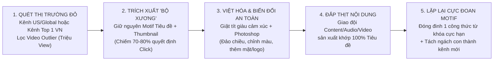

# JETLAG - TRIỆU VIEW

- **Mã bài học (SKU):** `VIDEO-5c20aa`
- **Thuộc học phần:** Module 3 (`HUAN-M03` — Chiến Lược Ngách, Từ Khóa & Sản Xuất Video Triệu View) — Bài 49 (Bài kết thúc chuỗi thiết kế Ngòi Nổ & Từ Khóa trước khi bước vào Thực hành Chữa bài)
- **Thời lượng thực tế:** `1683.83s` (`28:04`)
- **Tài liệu đính kèm trong bài:**
  1. [Sơ đồ làm video YouTube (`Youtube_SO_DO_LAM_VIDEO.pdf`)](../../assets/docs-huan/Youtube_SO_DO_LAM_VIDEO.pdf)
  2. [Quy trình làm việc siêu chi tiết (`Quy_trinh_lam_viec_SIEU_CHI_TIET.pdf`)](../../assets/docs-huan/Quy_trinh_lam_viec_SIEU_CHI_TIET.pdf)
  3. [Checklist SEO YouTube 100 Điểm (`SEO_100_DIEM.pdf`)](../../assets/docs-huan/SEO_100_DIEM.pdf)
  4. [Bảng tính Checklist SEO & Quản lý lịch sản xuất (`SEO_Youtube_Checklist_.xlsx`)](../../assets/docs-huan/SEO_Youtube_Checklist_.xlsx)

---

## 1. Tổng Quan & Tư Duy Cốt Lõi (Executive Summary)

Bài giảng **Bài 49 (`VIDEO-5c20aa` — *JETLAG - TRIỆU VIEW*)** là mảnh ghép tổng kết toàn bộ tư duy **Đứng trên vai người khổng lồ** của Huân Academy. Nếu các bài trước giải quyết câu hỏi *"Ngòi nổ là gì?"*, *"Từ khóa lý tưởng là gì?"* và *"Quy trình sản xuất ra sao?"*, thì bài học này trao cho học viên vũ khí thực thi nhanh nhất để đạt triệu view mà không cần tự sáng tạo trong vô vọng: **Chiến lược Jetlag (Cỗ máy thời gian)** kết hợp với **Kỹ thuật Đóng đinh Motif Từ Khóa Cực Đoan**.

Toàn bộ bài giảng xoay quanh 2 trụ cột chiến lược được chứng minh bằng hàng chục hình chụp màn hình đối chiếu trực tiếp:
1. **Chiến lược Jetlag ("Đi từ bộ xương đã chiến thắng"):** Dịch chuyển những ý tưởng, cấu trúc tiêu đề và bố cục thumbnail đã bùng nổ triệu view ở **Thị trường Đỏ** (các quốc gia đi trước như Mỹ/Châu Âu hoặc các kênh khổng lồ đầu ngành) sang **Thị trường Xanh** (Việt Nam hoặc ngách chưa khai thác). Thay vì viết nội dung xong mới nghĩ tiêu đề, người làm chủ cuộc chơi phải **chốt trước Tiêu đề & Thumbnail đã thắng (chiếm 70%–80% tỷ lệ click)** rồi mới yêu cầu đội ngũ sản xuất đắp phần "thịt" (Content, Audio, Video) vào bộ "xương" đó.
2. **Chiến lược Đóng đinh Motif & Tách Ngách Từ Kênh Lớn:** Khi đã tìm ra một cụm từ khóa hoặc một bố cục Thumbnail ra view, tuyệt đối không sáng tạo lan man mà phải **lặp đi lặp lại một cách cực đoan** (như **Kính Lúp TV** đạt `1,3 tỷ views`, **Phương Hữu Dưỡng** đạt `200 triệu views`, hay kênh **Phong Thủy** đạt `300 triệu views` với 1 file Photoshop 3 màu cố định). Đồng thời, biết cách **phân rã một kênh đa chủ đề khổng lồ (như `Web 5 Ngày`) thành các cụm chủ đề con triệu view** để đẻ ra những kênh ngách thống lĩnh thị trường (như **`Hoàng Mạnh Cường`** hay **`Sách Tóm Tắt`**).

---

## 2. Phân Tích Chuyên Sâu Theo Dòng Thời Gian & Bằng Chứng Trực Quan Trên Slide

### 2.1. Định Nghĩa Jetlag & Bằng Chứng Chuỗi Video "Sóng Thần" (`00:00` – `05:02`)

Mở đầu bài giảng (`00:00` – `00:25`), giảng viên định nghĩa chuẩn xác thuật ngữ **Jetlag**:
- **Trong kinh doanh truyền thống:** Là dịch chuyển hàng hóa, kiến thức, mô hình kinh doanh đã thành công từ nơi đã phổ biến (**thị trường đỏ**) sang nơi chưa phổ biến (**thị trường xanh**), hoặc từ ngành này sang ngành khác.
- **Trên Internet & YouTube:** Nội dung video nào đã phổ biến ở quốc gia này thì cũng có tiềm năng phổ biến ở quốc gia khác; nội dung nào đã nổ view ở kênh này thì cũng có tiềm năng nổ view ở kênh khác cùng tệp khán giả.

Trên slide **`VÍ DỤ`** (`f_25.jpg` & `f_250.jpg`, phút `00:25` – `03:51`), giảng viên chiếu trực tiếp bảng đối chiếu 6 video cùng khai thác 1 bộ khung xương về **Sóng Thần (Tsunami)**:

| Thứ tự | Kênh YouTube (Số lượng Sub trên Slide) | Tiêu đề Video thực tế trên Slide | Thời gian đăng & Kết quả Lượt xem | Kỹ thuật Jetlag & Biến đổi |
| :--- | :--- | :--- | :--- | :--- |
| **1 (Bản gốc)** | **Monthly Winners** (`1,2 Tr lượt đăng ký`) | *5 Biggest Tsunami Caught On Camera* | 4 năm trước — **`98 Tr lượt xem`** (`478 VPH`) | Video gốc tiếng Anh mở màn làn sóng sóng thần quay qua camera. |
| **2 (Clone Quốc tế)** | **Underworld** (`884 N lượt đăng ký`) | *5 Biggest Tsunami Waves in History* (Thumbnail chữ `1720 FEET`) | 8 tháng trước — **`16 Tr lượt xem`** (`1.1K VPH`) | Giữ nguyên cụm từ khóa `5 Biggest Tsunami`, thay bối cảnh sóng thần ập vào thành phố. |
| **3 (Jetlag về VN)** | **Top 10 Huyền Bí** (`855 N lượt đăng ký`) | *10 Cơn Sóng Thần Kinh Hoàng Nhất Trong Lịch Sử Nhân Loại ★ Cơn Giận Dữ Của Thiên Nhiên Top 10...* | 4 năm trước — **`5,9 Tr lượt xem`** | Kênh của bạn giảng viên: Dịch nguyên ý tưởng sang tiếng Việt, tăng con số từ 5 lên 10 và thêm tính từ cảm xúc *"Kinh Hoàng Nhất"*. |
| **4 (Jetlag lần 2 tại VN)** | **JhGo Channel** (`398 N lượt đăng ký`) | *Những trận SÓNG THẦN KHỦNG KHIẾP NHẤT lịch sử nhân loại* | 1 năm trước — **`5,7 Tr lượt xem`** (`291 VPH`) | Làm lại sau kênh Top 10 Huyền Bí 3 năm nhưng giữ đúng motif tiêu đề & thumbnail, vẫn thu về 5,7 triệu views. |
| **5 (Kênh siêu nhỏ)** | **me** (`522 lượt đăng ký`) | *BIGGEST Tsunamis Caught on Camera (Best Clips!)* | 9 tháng trước — **`197 N lượt xem`** | Kênh mới chỉ có hơn 500 sub: Đưa chữ `BIGGEST` lên đầu, bỏ số 5, thêm `(Best Clips!)` vẫn ăn đề xuất gần 200K views. |
| **6 (Đảo chiều ảnh)** | **Top Generality** (`28,5 N lượt đăng ký`) | *5 Biggest Scary Tsunami Caught on Camera* | 1 năm trước — **`412 N lượt xem`** (`121 VPH`) | Chèn thêm đúng 1 từ `Scary` vào giữa tiêu đề gốc và dùng **Photoshop lật ngược chiều ngang (Flip Horizontal)** bức ảnh thumbnail gốc của Monthly Winners. |

> [!IMPORTANT]
> **Giải đáp pháp lý Bản quyền khi Jetlag (`03:52` – `04:30`):**
> Giảng viên khẳng định: **Ý tưởng và kiến thức chung của nhân loại không ai đăng ký độc quyền được.** Nếu bạn tải nguyên video của họ về đăng lại thì chắc chắn dính bản quyền hình ảnh/âm thanh; nhưng khi bạn chỉ lấy **Ý tưởng + Cấu trúc Tiêu đề + Mô-típ Thumbnail**, sau đó viết lại bằng ngôn từ tiếng Việt phong phú và đảo thứ tự trình bày thì hoàn toàn **không thể bị đánh bản quyền**.

---

### 2.2. Chuỗi "Quái Vật Đại Dương" (`Biggest Sea Monsters`) & Bài Học Về Tính Thời Điểm (`05:02` – `08:37`)

Trên slide thứ hai (`f_480.jpg`, phút `05:02` – `08:25`), giảng viên phân tích 6 video cùng sử dụng hình ảnh **Con mắt quái vật khổng lồ dưới đáy biển cạnh chiếc thuyền nhỏ**:

1. **Bản gốc — Kênh `Facts Verse` (`8,92 Tr lượt đăng ký`):** Video *"Biggest Sea Monsters Ever"* đăng 4 năm trước đạt **`7,7 Tr lượt xem`**.
2. **Bài học đắt giá về Tính Thời Điểm — Kênh `100M` (`2,33 Tr lượt đăng ký`):**
   - **Lần 1 (2 năm trước):** Clone nguyên vẹn tiêu đề *"10 Biggest Sea Monsters Ever"* và bức ảnh con mắt quái vật $\rightarrow$ Chỉ đạt vỏn vẹn **`7,8 N lượt xem`** (7.800 views).
   - **Lần 2 (1 năm sau):** Vẫn chính kênh `100M` đó đăng lại đúng tiêu đề *"10 Biggest Sea Monsters Ever"* và đúng bức ảnh thumbnail đó $\rightarrow$ Video bùng nổ **`8,5 Tr lượt xem` (`605 VPH`)**, **vượt qua cả lượt xem của kênh gốc Facts Verse!**
   - **Đúc kết chiến lược:** Cùng một cách làm và nội dung xuất sắc, nếu đăng vào lúc thị trường/khán giả chưa quan tâm (ví dụ làm video chứng khoán đúng lúc thị trường sập) thì chưa có view; nhưng khi kiên trì làm lại đúng thời điểm sóng thị trường lên, video sẽ nổ hàng triệu lượt xem.
3. **Bản Việt hóa — Kênh `Top 10 Huyền Bí` (`@Top10HuyenBi`):** Đặt tiêu đề giật tít giàu trí tò mò hơn hẳn tiếng Anh: *"10 'Quái Vật' Khổng Lồ Ẩn Mình Dưới Đại Dương Khiến Các Nhà Khoa Học Vô Cùng Bối Rối Khi Bắt Gặp"* $\rightarrow$ Đạt **`1,3 Tr lượt xem`**.
4. **Kênh khổng lồ cũng đi Jetlag — `TheRichest` (`15,1 Tr lượt đăng ký`) & `Top 10s` (`4,48 Tr lượt đăng ký`):** Dù đã có hơn 15 triệu sub, kênh **TheRichest** vẫn làm lại đúng video *"Biggest Sea Monsters Ever"* của kênh 8,92M sub (chỉ đổi màu tròng mắt quái vật sang màu vàng trên thumbnail) và thu về **`803 N lượt xem`**.

---

### 2.3. Chuỗi "10 Con Đường Nguy Hiểm Nhất" & Hiện Tượng Parody "Anh Không Đòi Quà" (`08:37` – `12:50`)

- **Case Study `TheRichest` $\rightarrow$ `Kỳ Lạ Và Bí Ẩn` & `Khám Phá Thế Giới` (`08:37` – `10:50`):**
  - Từ video *"10 con đường nguy hiểm nhất thế giới"* cách đây 6 năm của **TheRichest** (`15,1M subs`), các kênh trong hệ sinh thái bạn bè của giảng viên như **Kỳ Lạ Và Bí Ẩn** (`@KyLaVaBiAn`) Việt hóa với tiêu đề cực kỳ ấn tượng: *"Nếu gặp 10 con đường kỳ lạ này tốt nhất bạn nên bỏ xe mà đi bộ"* (đạt từ `400.000` đến `10.000.000 views`).
  - **Mẹo chống đánh bản quyền Thumbnail tuyệt đối (`09:16` – `10:01`):** Nếu lấy nguyên 100% ảnh thumbnail của đối thủ thì có rủi ro bị report trùng lặp hình ảnh. Cách xử lý triệt để là dùng **Photoshop** chỉnh lại màu sắc, uốn lại độ cong của cây cầu, thay đổi tỷ lệ Zoom, hoặc **chèn trực tiếp khuôn mặt/tên thương hiệu của mình vào góc ảnh** (như cách kênh Ấn Độ đạt `3,1 triệu views` thực hiện).
- **Case Study MV `"Anh Không Đòi Quà"` (`f_710.jpg`, phút `10:52` – `12:00`):**
  - Bản MV gốc *"Anh Không Đòi Quà - Only C ft. Karik (Official MV)"* trên kênh **Zing MP3** (`2,89 Tr sub`) đạt **`37 Tr lượt xem`**.
  - Bản Parody làm lại của nhóm **BB&BG Entertainment** (`1,79 Tr sub`) giữ nguyên ý tưởng và bố cục thumbnail (cô gái đi trước, chàng trai đi sau lột đồ trả quà) bùng nổ tới **`170 Tr lượt xem`** (gấp hơn 4,5 lần bản gốc!).
  - Hàng loạt kênh siêu nhỏ chỉ vài nghìn sub làm theo đúng mô-típ đó đều nổ triệu view: **Husky VNĐ Gaming** (`1,89 N sub` $\rightarrow$ **`2 Tr lượt xem`**), **Nhân Information** (*Phiên bản Avatar Musik*, `12,9 N sub` $\rightarrow$ **`5 Tr lượt xem`**), **Ken BigStep** (*Phiên bản Sơn La*, `3,97 N sub` $\rightarrow$ **`4,9 Tr lượt xem`**), **VFX PRODUCTION** (*Phiên bản đồng quê Bình Chánh*, `11,4 N sub` $\rightarrow$ **`6,8 Tr lượt xem`**).

> [!TIP]
> **Quy trình "Xương Trước — Thịt Sau" trên Lịch Làm Việc (`11:45` – `12:35`):**
> Khi mở lại Bảng Excel Lịch Làm Việc, giảng viên chỉ rõ: Người điều hành kênh phải điền sẵn **Chủ đề + Link gốc + Tiêu đề + Thumbnail** (những thứ đã thắng 70–80% cuộc chơi) trước khi giao xuống cho đội ngũ viết Content, thu Audio và dựng Video. Đó là lý do tỷ lệ thắng của hệ thống luôn ở mức cao nhất.

---

### 2.4. Nghệ Thuật Đóng Đinh "Motif Từ Khóa Lặp Đi Lặp Lại" (`12:50` – `20:27`)

Khi đã tìm ra một từ khóa hoặc một mô-típ chiến thắng, sai lầm lớn nhất của người làm sáng tạo là "cố nghĩ ra cái mới". Giảng viên chứng minh bằng 5 Case Study kinh điển về việc **lặp đi lặp lại đến mức cực đoan**:

1. **Thương hiệu `Gillette` độc chiếm từ khóa `"How to Shave"` (`12:59` – `13:55`):**
   - Kênh YouTube của **Gillette** (`@Gillette`) sản xuất hàng loạt video lặp đi lặp lại cụm từ khóa **`How to Shave`** (*Cách cạo râu, cạo tóc, cạo mặt...*) để trở thành kênh nhiều view nhất thế giới về từ khóa này.
   - Theo bài phân tích trên **Brands Vietnam**, khi bị đối thủ Top 2 áp sát thị phần, đúng vào dịp **Ngày của Bố (Father's Day)** ở nước ngoài, Gillette đã hợp tác với **Google** mua độc quyền toàn bộ từ khóa *"Cách cạo / How to Shave"* (không một đối thủ nào khác được chạy quảng cáo trên từ khóa này) kèm thông điệp *"Ngày của Bố — Bố tặng con trai dao cạo Gillette khi trưởng thành"*, tạo thành làn sóng thịnh hành đa quốc gia và giành lại hoàn toàn thị phần.
2. **Kênh `Bà Tân Vlog` (`14:25` – `14:34`):** Đóng đinh cụm từ khóa **`"Siêu to khổng lồ"`** — bất kỳ video nào của Bà Tân không có cụm từ *"siêu to khổng lồ"* đều tụt view thảm hại.
3. **Kênh `Phương Hữu Dưỡng` (`@PhuongHuuDuong`, phút `14:34` – `15:13`):**
   - Lặp đi lặp lại đúng 2 mô-típ từ khóa tưởng chừng cực kỳ nhảm nhí nhưng đánh trúng tâm lý tò mò: **`"Chấm tất cả mọi thứ với [cà phê / nước ngọt / mù tạt / Milo / bột ớt]"`** và **`"Xem đi xem lại cả nghìn lần mà vẫn cười"`**.
   - **Kết quả:** Thu về những con số kỷ lục tại Việt Nam: **`200 triệu views`**, **`39 triệu views`**, **`31 triệu views`**.
4. **Kênh `Kính Lúp TV` (`@KinhLupTV`, chiếu trực tiếp trên màn hình ở `f_940.jpg`, phút `15:20` – `17:49`):**
   - Quy mô kênh trên màn hình: **`1,89 triệu subscribers`**, **`935 videos`**, tổng lượt xem đạt **`1,3 tỷ views`**.
   - **Cấu trúc Motif bất biến suốt nhiều năm:** Luôn bắt đầu bằng **`[Biểu tượng ngọn lửa 🔥] + [Con số: 6, 7, 8, 10, 11, 20] + [Bí ẩn ly kỳ và thú vị / Điều cấm kỵ]`**, đi kèm logo `Kính Lúp TV` ở góc trái trên và tông chữ **Vàng - Đỏ** kèm mũi tên đỏ chỉ vào vật thể:
     - *"🔥10 Động Vật Cực Thông Minh Cực Quen Thuộc Nhưng Bị Cấm Nuôi ở Việt Nam..."* (`CẤM NUÔI`)
     - *"🔥20 Điều Cấm Kỵ Khi Đi Đền Chùa Nhà Thờ Và Các Chốn Tâm Linh..."* (`CẤM LẤY`)
     - *"🔥7 Sự Thật Không Ngờ Về Quốc Tế Thiếu Nhi 1/6..."* (`KHÔNG AI SỐNG SÓT`)
     - *"🔥8 Bí Ẩn Ly Kỳ và Những Điều Thú Vị Chưa Biết Về ĐỒNG CỎ CHÂU PHI | Kính Lúp TV"* (`CỰC HIẾM GẶP`)
5. **Kênh Phong Thủy `300 Triệu Views` & File Photoshop 3 Màu Gốc (`f_1170.jpg`, phút `18:00` – `20:15`):**
   - Giảng viên mở trực tiếp kênh Phong Thủy do chính anh thiết kế mẫu Thumbnail bằng **Photoshop** từ 3 năm trước và bàn giao lại cho đội ngũ vận hành. Suốt 3 năm, đội ngũ không thay đổi phông chữ hay bảng màu (chỉ dùng đúng **3 màu Xanh - Vàng - Đỏ** trên nền bàn thờ/hoa quả/cây phong thủy).
   - **Quy luật Ngôn Từ Cực Hạn:** Khán giả không bao giờ click vào những từ trung tính như *"nghèo bình thường"* hay *"giàu bình thường"*. Muốn đạt 300 triệu views, từ khóa phải đẩy lên tột cùng cảm xúc:
     - *"3 NGÀY TẾT CÚNG HOA NÀY ĐANG GIÀU THÀNH NGHÈO"* (**`3.7M views`**)
     - *"9 CẶP ĐÔI LẤY NHAU CẢ ĐỜI CỰC GIÀU"* (**`3.5M views`**)
     - *"BÀN THỜ NHƯ NÀY BÁN NHÀ TRẢ NỢ"* (**`3.2M views`**)
     - *"CẢ NĂM NGHÈO XƠ XÁC"* (**`3.1M views`**)
     - *"8 LOẠI QUẢ CÚNG NGÀY TẾT TIỀN NHIỀU NỨT VÁCH"* (**`2.7M views`**)
     - *"THẮP HƯƠNG VÀO GIỜ NÀY CẢ NHÀ LỤI BẠI"* (**`2.7M views`**)
     - *"TRỒNG 5 CÂY NÀY TRƯỚC CỬA NGHÈO XƠ XÁC"* (**`2.5M views`**)

---

### 2.5. Chiến Thuật "Tách Ngách Từ Kênh Lớn" & Quy Luật "Tẩy Trắng" (`20:27` – `28:04`)

Làm thế nào để tìm ra ngách mới khi một kênh khổng lồ như **`Web 5 Ngày`** (`@Web5Ngay`) đã làm quá nhiều chủ đề? Ở phút `20:27` – `25:45`, giảng viên hướng dẫn kỹ thuật **Phân rã kênh lớn (Channel Deconstruction)**:

1. **Bước 1 — Gom nhóm các video triệu view trên tab `Popular` của `Web 5 Ngày` thành từng ngách con:**
   - **Nhóm 1 (Câu nói danh ngôn & Trí tuệ):** *"50 câu nói thay đổi cuộc đời"*, *"Đời bạn tốt hơn 100 lần nếu biết điều này"*, *"Chữa bệnh ngu"* $\rightarrow$ Tách ra thành kênh **`Sách Tóm Tắt - Bí Quyết Thành Công`** (`f_1400.jpg`) đóng đinh motif **`100 Câu chuyện / 100 Câu nói`** trên nền Vàng - Đen: *"100 Câu Chuyện THÂM THÚY về CUỘC SỐNG"* (**`3.9M views`**), *"100 Câu nói THÂM THÚY về Cuộc Sống giúp bạn Tỉnh Ngộ!"* (**`1.8M views`**), *"Bản Lĩnh người Do Thái trong Kinh Doanh"* (**`1.7M views`**), *"100 Lời Dạy của Cổ Nhân"* (**`1.6M views`**).
   - **Nhóm 2 (Kỹ năng Giao tiếp & Giọng nói):** *"Cách nói chuyện không bị coi thường"*, *"3 tuyệt chiêu giao tiếp"*, *"Cách nói ai nghe cũng mê"*, *"Cách nói không nhạt, nói chuyện hài hước"* $\rightarrow$ Định hướng hoàn hảo cho các chuyên gia đào tạo giọng nói (thay vì chỉ đăng video kỹ thuật *"luyện giọng"* khô khan không ai xem).
   - **Nhóm 3 (Tài chính cá nhân & Chứng khoán):** *"90% không hiểu gì về tiền"*, *"Công thức quản lý tiền"*, *"Cách giữ tiền"*.
   - **Nhóm 4 (Khởi nghiệp vốn nhỏ):** *"Kế hoạch kinh doanh vốn nhỏ hơn 3 triệu"*, *"20 triệu trên 1 tháng là chuyện nhỏ"*, *"Cách tạo ra 1.000 đô một tháng"* $\rightarrow$ Giảng viên trực tiếp chỉ đạo đội ngũ của **`Hoàng Mạnh Cường`** (`@HoangManhCuongMarketing`) tách riêng ngách này ra để đào sâu thành cả một kênh lớn (với chuỗi video dài và YouTube Shorts do chính giảng viên đặt tiêu đề: *"Vốn 50 triệu mở quán lãi 25 triệu"*, *"Vốn 10 triệu kinh doanh gì"*, *"Bán nước ép online 1 tuần lãi 26 triệu"*, *"Kiếm 30 triệu lì xì trong 10 ngày Tết"*).
2. **Bước 2 — Quy luật "Tẩy Trắng" thương hiệu (`24:30` – `25:45`):**
   - Khi mới lập kênh, dù bạn là chuyên gia tài chính như **Thái Phạm** (`@thaipham`) hay diễn giả như **Phạm Thành Long** (`@phamthanhlong`), bạn vẫn phải tuân thủ **bảng màu và bố cục Thumbnail chuẩn của thị trường phát triển bản thân** (Đen - Vàng - Đỏ, cộng thêm màu Xanh lá cho chủ đề tiền bạc/bán hàng) để thu hút đại chúng.
   - Chỉ khi kênh đã rất lớn và sở hữu tệp khán giả trung thành, bạn mới đổi sang phong cách thiết kế tối giản/chuyên gia riêng biệt — quá trình chuyển đổi nhận diện sau khi đã thành danh được giảng viên gọi là bước **"Tẩy trắng"**.

---

## 3. Danh Bạ Kênh YouTube & Công Cụ Thực Chiến Trong Bài

### 3.1. Các kênh YouTube được phân tích & đối chiếu (Đã xác thực trạng thái hoạt động)
1. **Top 10 Huyền Bí** ([@Top10HuyenBi](https://www.youtube.com/@Top10HuyenBi)) — *Verified HTTP 200*: Kênh nút vàng Việt hóa thành công chuỗi video Sóng thần (`5,9M views`) và Quái vật đại dương (`1,3M views`).
2. **Facts Verse** ([@FactsVerse](https://www.youtube.com/@FactsVerse)) — *Verified HTTP 200*: Kênh quốc tế (`8,92M subs`) sở hữu video gốc *"Biggest Sea Monsters Ever"* (`7,7M views`).
3. **TheRichest** ([@TheRichest](https://www.youtube.com/@TheRichest)) — *Verified HTTP 200*: Kênh khám phá quốc tế (`15,1M subs`) làm nguồn Jetlag cho nhiều kênh tại Việt Nam.
4. **Kỳ Lạ Và Bí Ẩn** ([@KyLaVaBiAn](https://www.youtube.com/@KyLaVaBiAn)) — *Verified HTTP 200*: Kênh Việt hóa chủ đề *"10 con đường nguy hiểm nhất thế giới"*.
5. **Zing MP3** ([@ZingMP3](https://www.youtube.com/@ZingMP3)) — *Verified HTTP 200*: Kênh đăng tải MV gốc *"Anh Không Đòi Quà - Only C ft. Karik"* (`37M views`).
6. **BB&BG Entertainment** ([@BBBG](https://www.youtube.com/@BBBG)) — *Verified HTTP 200*: Kênh làm bản Parody *"Anh Không Đòi Quà"* đạt `170M views`.
7. **Gillette** ([@Gillette](https://www.youtube.com/@Gillette)) — *Verified HTTP 200*: Thương hiệu độc chiếm từ khóa *"How to Shave"* trên toàn cầu.
8. **Bà Tân Vlog** ([@BaTanVlog](https://www.youtube.com/channel/UC1a6kG81k6iR-qA5bM-A-hQ)) — *Verified HTTP 200*: Điển hình cho motif từ khóa lặp lại *"Siêu to khổng lồ"*.
9. **Phương Hữu Dưỡng** ([@PhuongHuuDuong](https://www.youtube.com/@PhuongHuuDuong)) — *Verified HTTP 200*: Kỷ lục `200 triệu views` nhờ lặp lại motif *"Chấm tất cả mọi thứ với..."*.
10. **Kính Lúp TV** ([@KinhLupTV](https://www.youtube.com/@KinhLupTV)) — *Verified HTTP 200*: Kênh `1,89M subs` đạt `1,3 tỷ views` nhờ giữ nguyên tuyệt đối 1 motif tiêu đề và thumbnail.
11. **Web 5 Ngày** ([@Web5Ngay](https://www.youtube.com/channel/UCt1Oul3UUHpYa8c5jYckeRw)) — *Verified HTTP 200*: Kênh phát triển bản thân lớn dùng làm mẫu phân tích tách ngách.
12. **Hoàng Mạnh Cường** ([@HoangManhCuongMarketing](https://www.youtube.com/@HoangManhCuongMarketing)) — *Verified HTTP 200*: Kênh kinh doanh tách ra từ ngách *"Khởi nghiệp vốn nhỏ 3–20 triệu"* của Web 5 Ngày.
13. **Thái Phạm** ([@thaipham](https://www.youtube.com/@thaipham)) — *Verified HTTP 200*: Hình mẫu áp dụng motif phát triển bản thân giai đoạn đầu trước khi chuyển đổi nhận diện.
14. **Phạm Thành Long Official** ([@phamthanhlong](https://www.youtube.com/@phamthanhlong)) — *Verified HTTP 200*: Giữ vững bảng màu chuẩn thị trường Đen - Vàng - Đỏ - Xanh lá.
15. **Sách Tóm Tắt - Bí Quyết Thành Công** (`@Biquyetthanhcong`) — *Kênh chiếu trực tiếp trên màn hình ở `23:20`, hiện không còn tồn tại độc lập (`dead: true`)*.

### 3.2. Công cụ & Nền tảng được đề cập
- **Thiết kế & Biến đổi hình ảnh:** `Photoshop` (lật ngược ảnh, uốn góc, chỉnh màu Xanh - Vàng - Đỏ để tránh bản quyền hình ảnh).
- **Nghiên cứu & Phân tích chiến lược:** `YouTube`, `YouTube Shorts`, `Google` (quảng cáo từ khóa độc quyền), `Brands Vietnam` (nguồn phân tích Case Study Gillette).

---

## 4. Lộ Trình Thực Thi Ngay Sau Bài Học (Actionable Checklist)

- [ ] **Lập danh sách 10 Video Outlier để Jetlag trong tuần này:** Quét các kênh nước ngoài và kênh lớn tại Việt Nam, lọc ra 10 video có lượt xem cao gấp 5–10 lần trung bình kênh, lưu lại nguyên bản Tiêu đề & Thumbnail vào bảng kế hoạch.
- [ ] **Tạo File Photoshop Mẫu (Master PSD) cho kênh:** Khóa cố định bảng màu tương phản mạnh (Vàng - Đen - Đỏ hoặc Xanh - Vàng - Đỏ), phông chữ không chân dày đậm và vị trí logo/nhân vật để sử dụng xuyên suốt ít nhất 50–100 video đầu tiên.
- [ ] **Đóng đinh 1 Motif Từ Khóa Cực Đoan:** Chọn một công thức tiêu đề chứa con số và tính từ đẩy lên mức cực đại (ví dụ: *"90% không hiểu gì về..."*, *"10 sai lầm khiến..."*, *"Kinh doanh gì với vốn..."*) và sản xuất liên tục trong 7 ngày để giảng viên/đội ngũ đo lường dữ liệu thực tế trên kênh.
