# VIDEO-692285 — Phá Trần 1 Tỷ 1 Tháng: Công Thức Thành Công Tuyệt Đỉnh & Yếu Tố Quyết Định 90% Thành Bại

> **Mã video:** `VIDEO-692285` (Bài 52 — Chương trình đào tạo Huân Academy Offline: *YouTube Total Success — Mindset and Strategy*)  
> **Thời lượng:** `43:00` (`2580.46s` — 594 phân đoạn phụ đề đã kiểm chứng)  
> **Chủ đề thực tế:** Câu chuyện thực chiến phá trần tư duy từ 3 tỷ/năm lên **1 tỷ 199 triệu VNĐ/ngày**, sơ đồ 6 bước chuyển hóa nhận thức (`0 Biết -> Mơ hồ -> Biết -> Hiểu -> Cảm xúc -> Làm`), kỷ luật rèn nghề 1.800 video trong 6 tháng đầu, và **Công thức Thành công Tuyệt đỉnh** vận hành qua Vòng xoắn ốc Cộng đồng (`Cộng đồng -> Niềm tin -> Cảm xúc -> Hành động -> Kết quả`).  
> **Phân nhóm hệ thống:** `he_thong` / `he_thong_mindset_success_formula` (`VN_GLOBAL`)  
> **Trạng thái kiểm chuẩn:** `GROUNDED_VERIFIED` · `visual_audio_checked: true` (Đã trích xuất và đối chiếu trực tiếp sơ đồ bảng trắng tại hội trường ở phút `33:27` cùng toàn bộ diễn biến câu chuyện thực chiến).

---

## 1. Câu Chuyện Thực Chiến: Phá Trần Tư Duy Từ 3 Tỷ/Năm Lên 1 Tỷ 199 Triệu/Ngày (`00:00 – 10:45`)

Mở đầu bài giảng, giảng viên chia sẻ lại bước ngoặt năm `2020` khi bắt đầu tham gia mảng **Phong Thủy** — một câu chuyện minh họa sống động cho việc **Tầm nhìn (Vision)** quyết định trực tiếp đến trần doanh thu của một doanh nghiệp:

### A. Giới hạn của việc chỉ nhìn vào đối thủ bề nổi (`00:00 – 03:45`)
* Năm 2020, khi áp dụng phương pháp lập danh sách Top 100 đối thủ trong ngành Phong Thủy tại Việt Nam, đơn vị dẫn đầu thị trường lúc bấy giờ là **Phong Thủy Tam Nguyên** (`@PhongThuyTamNguyen` — do chính một người bạn của giảng viên đẩy kênh YouTube lên Top 1 suốt 3 năm, có năm đỉnh điểm đạt doanh thu `60 tỷ VNĐ`, còn mức trung bình bề nổi khoảng `3–4 tỷ VNĐ`), cùng cảm hứng từ người bạn Hoàng Mạnh Cường (Topmax) từng chia sẻ bán `10 tỷ` hàng phong thủy.
* Từ dữ liệu đó, giảng viên đặt mục tiêu xây dựng công ty đạt **3 tỷ VNĐ** (ngang ngửa đơn vị Top 1 lúc bấy giờ) và đã tự thấy mình vô cùng táo bạo.

### B. Cuộc hẹn 4 tiếng tại Highlands Royal City & Bài học "Chai nước LaVie 1 Tỷ/Ngày" (`03:46 – 05:56`)
Trước khi chính thức vận hành sâu, giảng viên có cuộc gặp gỡ định mệnh kéo dài 4 tiếng tại Royal City với anh **La Khắc Linh** (một doanh nhân đi lên từ ngành sức khỏe/dược mỹ phẩm có quy mô hàng nghìn tỷ mỗi năm):
* Khi nghe mục tiêu `3 tỷ`, anh Linh chỉ hỏi ngược lại một câu làm sụp đổ hoàn toàn giới hạn cũ: ***"Nhìn lên bàn cà phê này xem có thứ gì mà người ta không bán được 1 tỷ 1 ngày không?"***
  * **Chai nước lọc LaVie:** Có doanh nghiệp bán cả tỷ đồng mỗi ngày.
  * **Ly cà phê đang uống:** Có chuỗi bán hàng tỷ đồng mỗi ngày.
  * **Tờ giấy ăn, chiếc ống hút, bộ bàn ghế đang ngồi:** Đều có những nhà sản xuất bán doanh số trên `1 tỷ VNĐ/ngày`.
  * Trong mảng dược mỹ phẩm mà anh Linh triển khai, mỗi nhãn hàng hợp tác đều cam kết tối thiểu `30 tỷ VNĐ/tháng` (`1 tỷ/ngày`).
* **Bài học cốt lõi:** Sở dĩ trước đó chỉ dám đặt mục tiêu 3 tỷ là bởi những người xung quanh chưa bao giờ cho mình nhìn thấy bức tranh `1 tỷ/ngày`. Chỉ một cuộc trò chuyện 4 tiếng không dạy kỹ thuật kinh doanh nhưng đã **đập vỡ hoàn toàn chiếc trần tư duy (Mental Ceiling)**.

### C. Lộ trình tăng trưởng thực tế & Bài học quản trị kỳ vọng nội bộ (`05:57 – 10:45`)

| Cột mốc Thời gian | Doanh số Thực tế Đạt được | Bài học Quản trị & Tâm lý Đội ngũ |
| :--- | :--- | :--- |
| **Tháng thứ 1 – Tháng thứ 2** | `~200 triệu VNĐ/tháng` | Giai đoạn vừa mở văn phòng, trực tiếp làm kinh doanh và thử nghiệm thị trường. |
| **Tháng thứ 3** | `900 triệu VNĐ/tháng` | Bắt đầu vào guồng tăng trưởng nhanh. |
| **Tháng thứ 4** | **`7,5 tỷ VNĐ/tháng`** (Đỉnh điểm đạt **`635 triệu VNĐ/ngày`**) | • Đã **gấp hơn 2 lần mục tiêu 3 tỷ ban đầu**. • **Sai lầm xương máu:** Do ngay từ đầu trót tuyên bố với toàn bộ nhân viên cấp dưới rằng *"Anh sẽ bán 1 tỷ 1 ngày"*, nên khi đạt `635 triệu/ngày`, thay vì khâm phục thì nhân sự lại bàn tán sau lưng: *"Các anh vẫn chém gió, tuyên bố 1 tỷ mà có làm được đâu!"* • **Quy tắc rút ra:** Tuyệt đối **không chia sẻ mục tiêu vĩ mô cho những người không có cùng tầm nhìn và không nghe cùng câu chuyện với mình**. Từ đó trở đi, mục tiêu `1 tỷ/ngày` chỉ được giữ kín trong nhóm Core Leaders. |
| **Tròn 1 năm sau ngày gặp anh La Khắc Linh** | **`1 tỷ 199 triệu VNĐ/ngày`** (Duy trì đều `500–700 triệu/ngày`, hơn 20 ngày đạt `14 tỷ VNĐ`) | Bán cháy toàn bộ kho hàng, thậm chí phải gom mua lại toàn bộ hàng của các đối thủ cùng phân khúc trên thị trường (chấp nhận không có lãi ở lô hàng gom thêm) chỉ để kịp trả đơn phục vụ khách hàng. |

---

## 2. Sơ Đồ 6 Bước Chuyển Hóa Nhận Thức & 4 Trụ Cột Kiến Tạo Cảm Xúc (`10:46 – 18:49`)

Tại sao hàng trăm người cùng đi học một khóa học, cùng bỏ số tiền như nhau (năm 2016 giảng viên từng được bố mẹ vay tiền và em trai từ Nhật Bản gửi tiền về để đóng các khóa học YouTube giá `50 triệu VNĐ`), nhưng người thì bỏ cuộc giữa chừng, người lại đi đến đích?

Trên phần đầu bảng trắng (`frame_07_2007s`), giảng viên vẽ chuỗi 6 nấc chuyển hóa từ lúc chưa biết gì đến khi ra hành động thực tế:

$$\mathbf{0\text{ Biết}} \longrightarrow \mathbf{\text{MH (Mơ Hồ)}} \longrightarrow \mathbf{\text{BIẾT}} \longrightarrow \mathbf{\text{HIỂU}} \longrightarrow \mathbf{\text{CXÚC (Cảm Xúc)}} \longrightarrow \mathbf{\text{LÀM}}$$

### Giải mã Điểm Nghẽn giữa "HIỂU" và "LÀM" (`10:46 – 15:59`)
1. **Từ `0 Biết` -> `Mơ Hồ (MH)`:** Khi chưa biết thì đi học; nhưng vừa học xong một lượng kiến thức lớn, não bộ tất yếu rơi vào trạng thái **Mơ hồ**.
2. **Từ `Mơ Hồ` -> `Biết` -> `Hiểu`:** Cần thời gian va chạm để chuyển từ Mơ hồ sang Biết và Hiểu. Tuy nhiên, **Hiểu rồi vẫn chưa Làm!** Rất nhiều người tích lũy kiến thức uyên bác nhưng mãi mãi đứng yên ở chữ `HIỂU`.
3. **Chiếc cầu nối quyết định — `CẢM XÚC (CXÚC)`:** Muốn bước từ `Hiểu` sang `Làm (Hành động điên cuồng)`, bắt buộc phải kích hoạt được **Cảm xúc**. Cảm xúc được quyết định bởi **4 trụ cột**:
   * **Trụ cột 1 — Trạng thái Cơ thể (Sức khỏe — Tầng đáy Tháp Maslow):** Cơ thể khỏe mạnh thì tinh thần mới hưng phấn, làm việc mới quyết liệt; cơ thể yếu ớt sẽ tự động ưu tiên nghỉ ngơi và sinh ra chán nản.
   * **Trụ cột 2 — Sự Tập trung (Hai mặt của một vấn đề):** Mọi sự việc luôn có 2 mặt (trong/ngoài, sáng/tối, tích cực/tiêu cực). Cùng con số `635 triệu/ngày`, người tập trung vào mặt tích cực thấy đó là kỳ tích vượt gấp đôi mục tiêu, kẻ tập trung vào mặt tiêu cực lại thấy đó là thất bại so với mốc 1 tỷ. Tập trung vào đâu thì cảm xúc sinh ra ở đó.
   * **Trụ cột 3 — Ngôn từ sử dụng:** Bao gồm **Tông giọng**, **Ngôn ngữ cơ thể** và **Từ ngữ nói ra hàng ngày**. Cách một người đặt câu hỏi phản ánh chính xác họ hỏi để làm hay hỏi chỉ để tìm cớ thoái lui.
   * **Trụ cột 4 — Tầm nhìn (Yếu tố quan trọng nhất đánh thức Cảm xúc — `15:08`):** Nhìn thấy một bằng chứng sống động rằng con đường này hoàn toàn có thật.
     * *Dẫn chứng năm 2016 (`15:25`):* Giảng viên chỉ thực sự bùng nổ hành động khi tận mắt nhìn thấy người bạn **Bùi Xuân Ninh** (hiện là cổ đông công ty) rút tiền Google AdSense ngày 22 hàng tháng với con số **`$1,000` đầu tiên sau 3 tháng làm YouTube**. Khoảnh khắc nhìn thấy tờ hóa đơn `$1,000` đó chính là *"cửa sáng cuộc đời"* dập tắt mọi lời bàn lùi xung quanh.

---

## 3. Kỷ Luật Tôi Luyện 1.800 Video Trong 6 Tháng & Bí Mật Giữ Ngách Trending (`16:00 – 26:59`)

Hành trình từ con số 0 đến khi rút **100 triệu VNĐ/tháng đầu tiên về túi (tháng thứ 9)** của giảng viên là minh chứng điển hình cho sự kết hợp giữa **Nhóm bạn cùng tiến**, **Kỷ luật rèn tay nghề** và **Chọn đúng chủ đề**:

### A. Giai đoạn 6 tháng đầu "Học việc không lương" (`16:40 – 20:19`)
* **Xuất phát điểm kỹ thuật bằng 0:** Không biết dựng video, không biết dùng **Photoshop** (trong nhóm 7–8 anh em chơi với nhau có 1 người biết sơ qua Photoshop chỉ dạy cách cắt ghép hình A sang hình B và xóa phông đã thấy thần thánh; hay câu chuyện đàn anh **Cụ Mốc** ghép ảnh cây chuối với công an làm truyện ma cầu Long Biên mà trụ vững trên tab Trending suốt 6 tháng liền).
* **Vai trò của nhóm bạn "Buff năng lượng" (`18:10`):** Những lúc chán nản định bỏ cuộc ở tháng thứ 3–4, chính những người bạn trong nhóm vừa lĩnh `$1,000` lại mua chiếc bếp nướng `300.000 – 400.000 VNĐ` mời sang nhà ăn đồ nướng và động viên đúng một câu: ***"Cứ làm đi, chắc chắn có kết quả đấy!"***
* **Kết quả sau 6 tháng đầu:** Thu nhập vẫn lẹt đẹt ở mức `15 triệu VNĐ/tháng` (chưa nổi `$1,000`) vì **sai chủ đề**. Nhưng đổi lại, mỗi ngày đều đặn sản xuất **5 đến 10 video/ngày** suốt 180 ngày:
  $$180 \text{ ngày} \times 10 \text{ video/ngày} = \mathbf{1.800 \text{ video thực chiến}}$$
  Chính `1.800 video` này đã rèn giũa tốc độ làm video, tư duy tiêu đề và kỹ năng content lên mức thượng thừa.

### B. Cú nổ Trending tháng thứ 7–8 & Thủ thuật "Ẩn Video Top Thịnh Hành" (`20:20 – 24:15`)
* Nhờ một người bạn cũ sang phòng đòi lại `2 triệu VNĐ` tiền cọc thuê chung cư và vô tình tiết lộ một chủ đề ngách đang kiếm được tiền, giảng viên dành nửa tháng nghiên cứu rồi áp dụng toàn bộ kỹ năng của 6 tháng trước vào kênh mới:
  * **Cường độ xuất bản:** Dậy từ `6h00 sáng` làm liên tục **10 video/ngày** (`5 video buổi sáng/trưa` đăng rải đều các khung giờ vàng `10h00, 10h30, 11h00, 11h30, 12h00` cách nhau 30 phút; `5 video buổi tối` đăng liên hoàn `19h00, 19h30, 20h00, 20h30, 21h00`).
  * **Cắn đề xuất & Lọt Top Trending Việt Nam sau chưa đầy 1 tháng:** Khi video bất ngờ nhận thông báo lọt **Top 50 Tab Thịnh Hành (Trending) YouTube Việt Nam**, để tránh bị các đội MMO lớn phát hiện và nhảy vào đè bẹp chủ đề, giảng viên lập tức **chuyển video đang Trending sang chế độ Ẩn/Riêng tư** (khiến bảng Top 50 Trending lúc đó bị khuyết mất 1 vị trí còn 49 video). Kỳ lạ thay, vừa ẩn video này thì video kế tiếp trên kênh lại tự động leo lên Trending suốt 1 tuần liền!
  * **Trái ngọt:** Đạt doanh thu **100 triệu VNĐ/tháng** ngay ở tháng thứ 8 (rút tiền về tài khoản ngày 22 tháng thứ 9) — tức chỉ mất đúng **2 tháng sau khi đổi đúng chủ đề**.

### C. Bài toán Phá Trần từ Vài Nghìn Đô lên Hàng Chục Nghìn Đô (`24:20 – 26:59`)
* **Nghịch lý Sub cao nhưng Tiền ít (Case study Ngọc Gấu Bông):** Một kênh làm Shorts đạt tới **2 triệu subscribers** nhưng chỉ kiếm được `$5,000/tháng` (`~100 triệu VNĐ`), trong khi một kênh khác chỉ có **20.000 – 30.000 subscribers** làm đúng ngách giá trị cao lại kiếm tới **`$30,000/tháng` (`500–600 triệu VNĐ`)**.
* **Giải pháp phá trần:** Khi đã có dòng tiền từ kênh cũ hoặc kênh Shorts, phải lập tức đóng gói quy trình (hoặc dành 1 tuần quay hết video cho cả tháng), dùng **3 tuần còn lại và dòng tiền đang có để tái đầu tư sang làm Video dài (Long-form) ở các chủ đề RPM cao**. Muốn nhảy từ mốc `100 triệu` lên `300–500 triệu/tháng` hay từ vài tỷ lên `1 triệu USD/tháng` (như cuộc đua với hệ thống **7 team của Vích Thái Nguyên** đang đặt mục tiêu tổng **`$700,000/tháng`**), bắt buộc phải thay đổi phương thức vận hành chứ không thể cày tay theo cách cũ.

---

## 4. Công Thức Thành Công Tuyệt Đỉnh: Vòng Xoắn Ốc Cộng Đồng vs Vòng Xoáy Cô Độc (`27:00 – 43:00`)

Trên nửa phải bảng trắng tại hội trường (`frame_07_2007s`), giảng viên vẽ sơ đồ **"Công Thức Thành Công Tuyệt Đỉnh"** lý giải tại sao **Cộng đồng (`CĐ`)** quyết định tới 90% khả năng đi đường dài của người làm YouTube:

```mermaid
flowchart TD
    subgraph CoCongDong ["1. VÒNG XOẮN ỐC ĐI LÊN (KHI CÓ CỘNG ĐỒNG - BÊN PHẢI BẢNG)"]
        CD["CĐ (Cộng Đồng MMO / Nhóm Facebook Premium)"] --> NT["NT (Niềm Tin) + STT (Sự Tập Trung) + CC (Câu Chuyện)"]
        NT --> CX["CXÚC (Cảm Xúc Mạnh Mẽ)"]
        CX --> HD["HĐ (Hành Động Điên Cuồng)"]
        HD --> KQ["KQ (Kết Quả: $0.1 -> $1 -> $10 -> $100 -> $100,000)"]
        KQ -->|Chia sẻ kết quả ngược lại Cộng đồng| CD
    end

    subgraph KhongCongDong ["2. VÒNG XOÁY ĐI XUỐNG (KHI KHÔNG CÓ CỘNG ĐỒNG - BÊN TRÁI BẢNG)"]
        KCD["Làm Lẻ Cô Độc (Giấu nghề, thiếu người đồng hành)"] --> NTK["Niềm Tin Kém ('Chắc YouTube không hợp với mình')"]
        NTK --> HDK["Hành Động Kém / Cầm Chừng"]
        HDK --> KQK["Kết Quả Kém / Không Có Kết Quả"]
        KQK --> MH["Quay Ngược Về MƠ HỒ (MH) -> Lại đi học khóa mới liên miên"]
    end
```

### Bảng Đối Chiếu 2 Quỹ Đạo Vận Hành Trên Bảng Trắng

| Tiêu chí | Quỹ đạo 1: Có Cộng Đồng (`Vòng Xoắn Ốc Mở Rộng`) | Quỹ đạo 2: Không Có Cộng Đồng (`Vòng Xoáy Luân Hồi`) |
| :--- | :--- | :--- |
| **Nguồn năng lượng đầu vào** | Nhìn thấy anh em trong nhóm (như nhóm **Facebook Premium** của khóa học) liên tục đăng kết quả kênh mới nổ `$5,000/ngày` (chỉ chụp doanh thu, **không lộ tên kênh**). | Làm lủi thủi một mình; gặp khó khăn không biết hỏi ai hoặc hỏi nhầm những người đã bỏ cuộc bên ngoài. |
| **Diễn biến Niềm tin & Cảm xúc** | Củng cố **Niềm tin (`NT`)**, giữ **Sự tập trung (`STT`)** và có thêm **Câu chuyện thành công (`CC`)** -> Kích hoạt **Cảm xúc (`Cxúc`)** đỉnh cao. | Niềm tin hao mòn dần sau vài tháng chưa có tiền -> Tự kỷ ám thị *"Chắc YouTube chỉ hợp với người khác chứ không thuộc về mình"*. |
| **Hành động & Kết quả** | **Hành động (`HĐ`)** quyết liệt -> Tạo ra **Kết quả (`KQ`)** từ những đồng lẻ đầu tiên: **`$0 -> $0.1 -> $1 -> $10 -> $100 -> $1,000 -> $10,000 -> $100,000`**. | Hành động yếu ớt, vừa làm vừa nghĩ sẵn lý do để thất bại -> Không ra kết quả. |
| **Điểm đến cuối cùng** | Khi đăng cột mốc `$0.1` lên Cộng đồng, cả nhóm cùng chúc mừng -> Niềm tin lại nhân lên gấp bội tạo thành **Vòng xoắn ốc đi lên không giới hạn**. | Rơi ngược về ô **Mơ hồ (`MH`)** -> Tưởng mình thiếu kiến thức nên lại tiếp tục đóng tiền đi học hết khóa này đến khóa khác mà không bao giờ chịu **LÀM**. |

### 3 Nguyên Tắc Sống Còn: "Play To Win", Đạo Đức Nghề Nghiệp & Thang Quan Hệ (`34:30 – 43:00`)

1. **Châm ngôn trên màn hình hội trường (`34:15`):**
   > *"Khi có đủ niềm tin sẽ tạo ra động lực thực hiện không giới hạn. Khi thiếu niềm tin bạn sẽ vừa làm và vừa nghĩ ra lý do để thất bại."*
2. **Nguyên tắc Đặt Câu Hỏi — `Play To Win` (`34:53`):**
   * **Tìm đúng người — Hỏi đúng chuyện — Làm đúng việc.**
   * Đặt câu hỏi là để tìm giải pháp bắt tay vào làm ngay, tuyệt đối không đặt câu hỏi tiêu cực chỉ để tìm sự đồng cảm từ những người thất bại.
3. **Giữ gìn Đạo đức & Tích đức để Đổi vận (`35:45 – 39:10`):**
   * Giảng viên chia sẻ câu chuyện hoàn trả lại học phí trước giờ khai giảng cho một trường hợp có ý đồ xấu (clone giả mạo website `huan.vn` / thương hiệu `GODA` đã đăng ký bảo hộ nhãn hiệu để quay lậu khóa học bán giá rẻ một nửa, bất chấp việc hệ thống đã mở sẵn cơ chế Affiliate chính thống hưởng hoa hồng `20%` tương đương `2.570.000 VNĐ/đơn` khóa `12,8 triệu` cho học viên). Những hành vi vi phạm pháp luật và đạo đức từ việc nhỏ sẽ tạo thành thói quen xấu chặn đứng vận may dài hạn.
4. **Chiến lược Leo Thang Mối Quan Hệ (`42:20 – 43:00`):**
   * Khi bạn đang ở mức thu nhập **`$3,000 – $5,000/tháng`**, hãy chủ động tìm chơi và học hỏi những người đang đạt **`$10,000/tháng`** vì khoảng cách gần giúp bạn hiểu ngay ngôn ngữ và đủ nguồn lực làm theo. Đừng vội nhảy cóc đòi áp dụng ngay mô hình của người kiếm vài trăm nghìn đô khi nội lực chưa tới; hãy kiên trì leo từng bậc thang một.

---

## 5. Tài Liệu Học Thuật & Biểu Mẫu Thực Hành Đính Kèm

* 📄 **[7 Bước Thành Công Với YouTube — Bí Mật Kiếm Tiền YouTube](/assets/docs-huan/7_buoc_thanh_cong_voi_Youtube_-_BI_MAT_KIEM_TIEN_YOUTUBE_.pdf)** (`assets/docs-huan/7_buoc_thanh_cong_voi_Youtube_-_BI_MAT_KIEM_TIEN_YOUTUBE_.pdf`) — Cẩm nang nền tảng củng cố tư duy, lộ trình chọn chủ đề và xây dựng hệ thống kênh đi từ `$0.1` đầu tiên đến tự do tài chính.
* 📊 **[Kế Hoạch Tổng Thể GODA Level Chủ Đề](/assets/docs-huan/Bai_Tap/GODA_-_LEVEL_CHU_DE.xlsx_-_1._KE_HOACH_TONG_THE_2.pdf)** (`assets/docs-huan/Bai_Tap/GODA_-_LEVEL_CHU_DE.xlsx_-_1._KE_HOACH_TONG_THE_2.pdf`) — Biểu mẫu thiết lập mục tiêu kênh, phân tích đối thủ dẫn đầu và lập kế hoạch sản xuất kỷ luật.
* 🗺️ **[Bản Đồ 9 Bước Sản Xuất & SEO YouTube Content Map 2023](/assets/docs-huan/Youtube_content_map_2023.pdf)** (`assets/docs-huan/Youtube_content_map_2023.pdf`) — Quy trình chuẩn hóa kỹ năng sản xuất video giúp rút ngắn giai đoạn 6 tháng học việc ban đầu.
