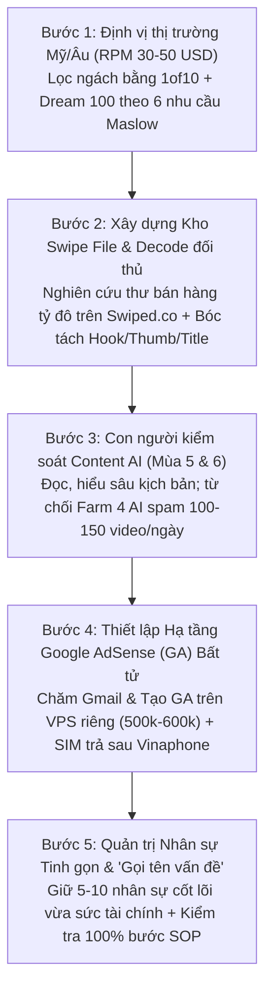

# VIDEO-6f9e8f — 1. Toàn Cảnh Chủ Đề YouTube Trong 3 Năm Gần Đây (Xem Trước Để Thấy Bức Tranh Lớn)

> **Mã video:** `VIDEO-6f9e8f` | **Bài học:** Bài 89 — Khóa học YouTube Huân Academy (GODA)  
> **Diễn giả:** Nguyễn Văn Huân (Nhà sáng lập GODA / Huân Academy)  
> **Thời lượng:** `35:31` (`2131.83 giây` — `413` phân đoạn phụ đề)  
> **Bối cảnh ghi hình:** Hội trường đào tạo trực tiếp Khóa 7 (GODA — *Excellence or nothing*), tổng kết hành trình 7 mùa đào tạo (`2.200` học viên lũy kế từ 2023 đến 2025/2026).

---

## 1. Tóm Tắt Chiến Lược & Bức Tranh Lớn 3 Năm (Executive Summary)

Bài giảng mở màn dài **35 phút 31 giây** của Nguyễn Văn Huân đóng vai trò là **"Tấm bản đồ toàn cảnh 3 năm"** dành cho toàn bộ học viên từ K1 đến K7. Thay vì đi ngay vào kỹ thuật lẻ tẻ, bài học giải phẫu quy luật tiến hóa và đào thải của thị trường YouTube qua **7 mùa khóa học** (`2.200` học viên), đồng thời công bố lời giải sống còn cho tử huyệt **Google AdSense (`GA`) bị vô hiệu hóa do Lưu lượng truy cập không hợp lệ (`Invalid Traffic`)** sau cơn bão quét lịch sử từ tháng 7/2025 đến đầu năm 2026.

Ba trục giá trị cốt lõi xuyên suốt bài giảng:
1. **Sự dịch chuyển tất yếu của Chủ đề & Công nghệ qua 7 mùa (K1 $\rightarrow$ K7):** Từ thời kỳ sơ khai tận dụng chênh lệch `RPM 30–50 USD` tại thị trường Mỹ/Âu bằng công cụ **`1of10`** với ngách **`Stoic`** (K1), khai thác vùng xám **`Fair Use`** Hoa Kỳ với ngách **`Copcam`** & vụ án kiện tụng (K2), làm **`YouTube Faceless`** ngách Triết lý & **`Quotes`** (K3), bùng nổ ngách **`Story` (Câu chuyện AI)** kiếm `1.000–3.000 USD/ngày` (K4), cho đến giai đoạn siết chặt buộc **con người phải đọc, hiểu và kiểm soát Content AI** thay vì chạy "Farm công nghiệp" (K5) và nâng lên tầng **`Hiểu sâu` (`Decode` video đối thủ + lập `Kho Swipe File` từ `Swiped.co` + `Dream 100`)** dựa trên 6 nhu cầu bất biến của tháp Maslow (K6–K7).
2. **Bài học xương máu khi chuyển từ Cá nhân sang Doanh nghiệp:** Phân tích trực diện lý do nhiều học viên K4 kiếm vài tỷ đồng nhanh chóng nhưng lại sập nặng nhất khi All-in gần **1 tỷ đồng** mở văn phòng đẹp với **30–40 nhân sự**, cùng lý do Huân Academy từ chối lời mời hợp tác làm **"Farm công nghiệp" 100–150 video/ngày** bằng tổ hợp 4 AI (**`Gemini`**, **`ChatGPT`**, **`DeepSeek`**, **`Grok`**).
3. **Chiến lược phòng thủ & tái sinh hạ tầng Google AdSense (`GA`):** Phân biệt rạch ròi lỗi *"Nội dung không trung thực"* ("lỗi trẻ con", giữ được kênh và GA) với án tử *"Lưu lượng truy cập không hợp lệ"* (`Invalid Traffic` — 10 năm không ai kháng được, 100% dịch vụ nhận kháng là lừa đảo), rút bài học từ tổn thất **hơn 1 triệu sub** và **gần 100.000 USD/tháng** (cùng cú vấp mua **GA Nhật tax 0%** giá 5 triệu/con), để chuẩn hóa quy trình tạo **hơn 50 tài khoản GA mới sống 100%** bằng **`VPS` riêng biệt (500.000–600.000 VNĐ)** kết hợp **SIM trả sau `Vinaphone`**.

---

## 2. Bản Đồ Tiến Hóa 7 Mùa Khóa Học YouTube (K1 – K7)

| Mùa / Giai đoạn | Từ khóa Trọng tâm | Chủ đề (Ngách) & Công cụ Chủ lực | Kết quả Thực chiến & Bài học Sống còn |
| :--- | :--- | :--- | :--- |
| **Mùa 1 (K1 - 2023)** | **Thị trường mới & `RPM 30`** | - Rời bỏ thị trường VN (`RPM 0.5–2 USD`) và giải trí ngoại (`RPM 3–5 USD`) sang Mỹ/Âu (`RPM 30 USD`, thực tế đạt **`40–50 USD`** = `40.000–50.000 USD / 1M view`). - Công cụ: **`1of10`**. - Ngách tiên phong: **`Stoic`** (Triết lý Khắc kỷ). | Đơn vị tiên phong tại Việt Nam sở hữu các kênh **`Stoic`** cán mốc **hàng trăm ngàn sub** đầu tiên; hàng loạt học viên K1, K2 kiếm bộn tiền nhờ đi đầu thị trường mới. |
| **Mùa 2 (K2)** | **Bán Content & Vùng xám rộng lớn** | - Dựa trên hành lang pháp lý **`Fair Use` của Hoa Kỳ** (nằm giữa Re-up và Content thuần). - Ngách chủ lực: **`Copcam`** (camera cảnh sát/giấu kín của Mỹ), tổng hợp các vụ án kiện tụng có thêm thuyết minh, bình luận. | Nhiều người chưa làm tưởng ngách `Copcam` nặng bản quyền, nhưng thực tế **rất ít bản quyền** — rủi ro chính nằm ở việc kiểm soát **Nguyên tắc cộng đồng**. |
| **Mùa 3 (K3)** | **`YouTube Faceless` & AI đời đầu** | - Mở rộng sang mọi dạng nội dung **không cần lộ mặt (`Faceless`)** khi công cụ AI bắt đầu xuất hiện. - Ngách chủ lực: **Triết lý**, **`Quotes`** (Danh ngôn). | Xây dựng được nhiều kênh Triết lý và `Quotes` rất lớn. Đến năm 2025 một số kênh bị reset kiếm tiền nhưng vẫn giữ được kênh để nâng cấp làm lại ở hình thái cao hơn. |
| **Mùa 4 (K4)** | **AI & Sự thích ứng (`Story`)** | - AI viết đoạn văn dài và tạo ảnh hoàn thiện vượt bậc so với 2022–2023. - Ngách bùng nổ: **`Story` (Câu chuyện)** thời lượng dài. | - **Đỉnh cao:** Nhiều học viên làm **40–50 kênh Story**, kiếm **`1.000–3.000 USD/ngày`** (biểu đồ học viên K4 ngày `08/04/2025` đạt **`$1,245.62/ngày`**), có kênh đạt **`40.000–80.000 USD/kênh`**. - **Cú ngã:** All-in mở văn phòng **gần 1 tỷ**, tuyển **30–40 nhân sự**, vài tháng sau kênh chết sạch. Phải dũng cảm trả đủ lương thưởng, cắt giảm 80% về **5–10 người cốt lõi**, tuyệt đối không vay tiền bố mẹ ở quê để gồng lỗ. |
| **Mùa 5 (K5)** | **`Content AI & Sự đơn giản`** | - Chuyển sang làm Content thực thụ: **Con người phải đọc, học, hiểu và kiểm soát nội dung**. - Phản chứng: Nhóm K4 gạ làm **"Farm công nghiệp"** bằng 4 AI (**`Gemini`**, **`ChatGPT`**, **`DeepSeek`**, **`Grok`**). | Từ chối mô hình ném 1 tiêu đề ra 10 video dài `1.5–2 tiếng` không cần đọc lại, băm **10 video/kênh/ngày $\times$ 10 kênh = `100–150 video/ngày`** trên 1 máy trong 8 tiếng. Cá nhân đánh quả ngắn hạn có thể kiếm vài trăm ngàn USD/tháng, nhưng nếu xây doanh nghiệp **60–200 người** trên mô hình đó thì khi gãy sẽ chết toàn tập. |
| **Mùa 6 (K6)** | **`Hiểu sâu` (`Decode` & `Swipe File`)** | - Module **`Decode`**: Bóc tách từng video thành công của đối thủ (`Hook`, `Thumbnail`, `Tiêu đề`, `Mô tả`). - Công cụ & Phương pháp: Website **`Swiped.co`**, lập **`Kho Swipe File`** kết hợp **`Dream 100`**. | - Nền tảng thay đổi qua 100 năm (Thư bưu điện 2 tỷ USD & 90 triệu USD $\rightarrow$ Yahoo Messenger nick `DH-PT` $\rightarrow$ Blog cá nhân $\rightarrow$ YouTube), nhưng **6 nhu cầu Maslow** (*Sinh lý, Tiền bạc, Sức khỏe, Danh vọng, Phát triển, Cống hiến*) là bất biến. - Không để AI làm mất thói quen tích lũy đầu vào. Tuân thủ luật nền tảng: ***"My room, my rule"***. |
| **Mùa 7 (K7 - 2026)** | **Hạ tầng `GA` Bất tử & Gọi tên vấn đề** | - Giải bài toán bão quét tháng 7–10/2025 (lỗi chết `GA` do `Invalid Traffic`). - Hạ tầng bắt buộc: **`VPS` riêng biệt (`500k–600k VNĐ`) + SIM trả sau `Vinaphone`**. | Test thành công **hơn 50 con `GA` mới không chết con nào** (duyệt nhanh trong `5–6 tiếng` đến `1–2 ngày`). Cảnh báo bài học team 20 người ở Thái Nguyên mất trắng dàn GA vì tiếc tiền VPS mà tự ý đổi sang dùng **`Proxy` `100.000 VNĐ`**. |

---

## 3. Bằng Chứng Thị Giác Trực Quan Từ Khung Hình Video (CUDA Frame Inspection)

Qua quá trình trích xuất và kiểm tra trực tiếp các khung hình thực tế từ tệp video `VIDEO-6f9e8f.mp4`, các tư liệu trình chiếu trên màn hình LED hội trường đã được xác thực chính xác từng con số và câu chữ:

1. **Khung hình `01:00` – `04:10` (`frame_0060.jpg`, `frame_0250.jpg`):**
   - Diễn giả Nguyễn Văn Huân mặc áo polo đỏ đứng trên sân khấu lớn với logo **`GODA - Excellence or nothing`** ở góc trên bên phải, trình bày lộ trình từ Khóa 1 (2023) khi đặt câu hỏi cho học viên về con số **`RPM 30`** và giới thiệu công cụ **`1of10`** để khai phá ngách **`Stoic`**.
2. **Khung hình `08:20` (`frame_0500.jpg` — Báo cáo doanh thu thật của học viên K4):**
   - Màn hình chiếu ảnh chụp cuộc hội thoại Zalo từ học viên với dòng tin nhắn:
     - *"K4 báo cáo thầy"*
     - *"Mình đã chinh phục mốc 1k/ngày"*
     - *"vẫn nguyên tắc đúng-đủ-đều"*
     - *"tập trung chất lượng content hơn, sau 20 ngày tịt ngòi, hôm qua kênh lại lên mạnh"* (`08:07`)
   - Đính kèm ảnh chụp giao diện **YouTube Studio Analytics** (tab `Estimated revenue`) hiển thị biểu đồ doanh thu từ `Mar 12, 2025` đến `Apr 8, 2025`, trong đó điểm đỉnh ngày **`Tue, Apr 8, 2025`** đạt chính xác **`$1,245.62`**.
3. **Khung hình `13:00` (`frame_0780.jpg` — Slide chủ đề Mùa 5):**
   - Màn hình LED khổng lồ phía sau lưng diễn giả hiển thị dòng chữ 3D ánh kim và lửa rực rỡ: **`CONTENT AI & SỰ ĐƠN GIẢN`** trên nền biểu tượng thành phố hiện đại, đánh dấu bước chuyển từ chạy số lượng bằng tool sang kiểm soát chất lượng kịch bản bằng con người.
4. **Khung hình `18:00` (`frame_1080.jpg` — Trình chiếu trực tiếp website `Swiped.co`):**
   - Màn hình LED hiển thị trang chủ kho tư liệu copywriting tiếng Anh **`Swiped.co`** với các thẻ bài học **`SWIPE STUDY`** đóng dấu đỏ **`CONTROL`**, nổi bật gồm:
     - Mẫu thư bán hàng trực tiếp: *"WE'RE LOOKING FOR PEOPLE TO TEST FISHING GEAR! (And Keep It FREE!) — Direct Mail Package from North American Fishing Club (Outdoor)"*.
     - Mẫu quảng cáo báo giấy: *"Stem Cell research reveals a secret to looking up to 15 years younger than your age! Reduce Your Wrinkles 56% the First Month! (you can see the results for yourself - ABSOLUTELY FREE!)"*.
5. **Khung hình `21:40` (`frame_1300.jpg` — Toàn cảnh hội trường & Bài viết `Swipe File`):**
   - Góc máy rộng toàn cảnh hội trường hàng trăm học viên ngồi kín hai bên thảm đỏ, hướng mắt lên 3 màn hình LED lớn đang hiển thị bài viết tiếng Việt giải thích chuyên sâu về **`Swipe File`** (*"Công cụ đắc lực giúp bạn viết nhanh và hiệu quả hơn"*, nhắc tới tác giả viết những cuốn sách best-seller như *The Obstacle Is the Way*, *Ego Is the Enemy*, *The Daily Stoic* của Ryan Holiday).

---

## 4. Phân Tích Chuyên Sâu: Cơn Bão Tháng 7–10/2025 & Quy Trình Tạo 50+ Tài Khoản Google AdSense (`GA`) Bất Tử

### 4.1. Phân biệt 2 cấp độ lỗi kiếm tiền YouTube (`24:14` – `25:40`)
- **Cấp độ 1 — Lỗi `Nội dung không trung thực` (*Inauthentic Content*):**
  - Được Nguyễn Văn Huân gọi là **"lỗi trẻ con, lỗi dễ nhất, lỗi ngon nhất"**.
  - **Lý do:** Kênh không bị xóa và tài khoản Google AdSense (`GA`) vẫn còn nguyên vẹn. Chủ kênh chỉ cần đợi **3 tháng**, xóa toàn bộ video cũ đi và làm lại nội dung chuẩn chỉnh hơn là có thể bật kiếm tiền trở lại và tái sử dụng chính con GA đó.
- **Cấp độ 2 — Lỗi chết `GA` do `Lưu lượng truy cập không hợp lệ` (*Invalid Traffic*):**
  - Đây là **án tử nặng nhất** đối với người làm YouTube.
  - **Sự thật 10 năm:** Trong suốt 10 năm làm YouTube, Google/YouTube **không bao giờ giải thích lý do chi tiết** và **chưa từng có bất kỳ ai kháng cáo thành công lỗi này**.
  - **Cảnh báo chống lừa đảo (`Scam`):** Mọi cá nhân hay dịch vụ bên ngoài quảng cáo "nhận kháng GA chết do lưu lượng truy cập không hợp lệ" **100% là lừa đảo (`scam`)** — học viên phải tuyệt đối né tránh để không mất tiền oan.

### 4.2. Tổn thất thực tế và bài học "Tham bát bỏ mâm" với GA Nhật Tax 0% (`25:42` – `27:43`)
- Trong đợt bão quét từ **tháng 7/2025 đến tháng 10/2025**, bản thân hệ thống của Huân Academy đã chịu thiệt hại nặng nề:
  - Chết các cụm kênh và GA với tổng lượng người đăng ký **hơn 1 triệu subscribers**.
  - Bay màu dòng tiền doanh thu khoảng **gần `100.000 USD/tháng`** (tương đương mất khoảng **1 triệu USD/năm**).
- **Bài học xương máu về giá mua GA và GA Nhật Tax 0%:**
  - Giá thị trường của một tài khoản GA thường dao động từ **`1.800.000 – 2.500.000 VNĐ/con`**; những con GA đã xác minh **PIN tay** và có độ khỏe nhất định có giá **`3.000.000 – 5.000.000 VNĐ/con`**.
  - Năm trước, vì muốn tối ưu thuế Mỹ về `0%` (*Tax 0%*), hệ thống cũng từng mua các tài khoản **GA Nhật (`Tax 0%`)** với giá trung bình **`5.000.000 VNĐ/con`**. Dù ăn được vài tháng nhưng cuối cùng dàn GA Nhật này cũng chết hàng loạt, kéo theo sự biến mất của **vài triệu subscribers** — một bài học đắt giá về tâm lý *"tham bát bỏ mâm"*, buộc toàn đội ngũ phải quay về làm chuẩn từ gốc.

### 4.3. Quy trình chuẩn tạo & nuôi hơn 50 tài khoản `GA` sống 100% (`27:43` – `32:56`)
Không muốn biến học viên thành "chuột bạch" bằng những lời khuyên phỏng đoán, đội ngũ Huân Academy đã âm thầm tự thử nghiệm cho đến khi hoàn tất quy trình chuẩn và công bố lần đầu trong buổi **Zoom ngày 26/02** (cũng như cập nhật trên khóa học online):
1. **Hạ tầng Máy ảo (`VPS` riêng biệt):**
   - Mỗi tài khoản Gmail và GA mới bắt buộc phải được khởi tạo, nuôi dưỡng (chăm Gmail) và vận hành trên một **`VPS` độc lập** (chi phí khoảng **`500.000 – 600.000 VNĐ`**).
2. **Hạ tầng Số điện thoại (`SIM trả sau Vinaphone`):**
   - Sử dụng **số điện thoại trả sau của nhà mạng `Vinaphone`** để xác minh.
   - **Nguyên lý cốt lõi:** *"Cái gì càng dễ spam thì càng nát; cái gì càng khó đăng ký thì càng ít trùng lặp"*. Vì SIM trả sau đòi hỏi thủ tục đăng ký chặt chẽ nên giới làm farm/spam không thể mua đại trà, giúp dải số hoàn toàn sạch trong mắt hệ thống kiểm duyệt của Google.
3. **Hiệu quả đã kiểm chứng:**
   - Từ tháng 2 – tháng 3/2026 đến thời điểm ghi hình, đội ngũ đã tạo mới **hơn 50 tài khoản GA (từng đợt 30–40 con)** và **không bị chết hay trượt bất kỳ một con nào (`tỷ lệ sống 100%`)**.
   - Thời gian xét duyệt GA cực nhanh: nhanh thì chỉ mất **`5 – 6 tiếng`**, chậm thì khoảng **`1 – 2 ngày`** là hoàn tất.

### 4.4. Case Study Cảnh Tỉnh: Team 20 Nhân Sự Tại Thái Nguyên & Nguyên Tắc "Gọi Tên Vấn Đề" (`29:11` – `35:24`)
- **Sai lầm chết người vì tiết kiệm vài trăm nghìn đồng:**
  - Một học viên tại **Thái Nguyên** đã xây dựng được đội ngũ **20 nhân sự** và từng kiếm được **vài trăm ngàn USD**.
  - Sau khi bị tắt kiếm tiền lần 1 vì lỗi *Nội dung không trung thực*, bạn này làm lại nhưng tiếp tục chết lần 2 vì lỗi **GA**. Khi Nguyễn Văn Huân hỏi đã làm đúng quy trình chưa, bạn khẳng định *"Em làm đúng hết quy trình rồi"*.
  - Tuy nhiên, khi hỏi câu chốt: ***"Thế VPS đang dùng bên nào?"***, học viên mới trả lời: ***"Em dùng Proxy"***.
  - Dù đã là chủ doanh nghiệp 20 nhân sự kiếm hàng trăm ngàn đô, học viên này vẫn ngồi đắn đo suy nghĩ suốt mấy ngày vì tiếc **`500.000 – 600.000 VNĐ`** tiền thuê `VPS`, rồi tự ý đổi sang mua con **`Proxy` giá `100.000 VNĐ`** để tiết kiệm `400.000 – 500.000 VNĐ`. Hậu quả là toàn bộ dàn GA chết sạch và doanh thu tổng kết bị Google trừ trắng tay — trong khi chỉ riêng giá trị của 1 con GA bị chết đã bằng hàng trăm cái VPS hay hàng nghìn chiếc SIM điện thoại (chỉ vài chục nghìn đồng/số).
- **Nguyên tắc Quản trị Doanh nghiệp — *"Vấn đề là phải được gọi tên"* (`33:45` – `35:24`):**
  - Khi làm một mình (*Solo*), bạn tự làm từ A đến Z nên kiểm soát được 100% chất lượng. Nhưng khi thuê thêm 1–2 hay 3–4 nhân sự trở lên, nhân viên rất hay có thói quen **tự ý sửa hoặc cắt bớt quy trình** (giao quy trình 5 bước thì chỉ làm bước `1, 2, 3, 5` và tự bỏ bước `4`).
  - Giống như ví dụ người chồng đi uống rượu về muộn chỉ bị vợ nhắc nhẹ 1–2 câu thì chưa coi đó là vấn đề, chỉ đến khi hai người ngồi xuống đối thoại trực diện thì vấn đề mới được nhận diện. Trong doanh nghiệp cũng vậy: **"Vấn đề không phải là vấn đề khi chúng ta không gọi tên nó"** — người lãnh đạo bắt buộc phải gặp trực tiếp nhân sự làm sai SOP, chỉ đích danh bước bị bỏ sót và yêu cầu tuân thủ kỷ luật tuyệt đối.

---

## 5. Quy Trình Thực Thi Chuẩn (5 Bước SOP Áp Dụng Ngay)

1. **Bước 1 — Định vị thị trường RPM cao (Mỹ/Âu) và lọc ngách bằng `1of10` kết hợp `Dream 100`:**
   - Tập trung vào các chủ đề giải quyết 6 nhu cầu cốt lõi của tháp Maslow (*Sinh lý, Tiền bạc, Sức khỏe, Danh vọng, Phát triển bản thân, Cống hiến*) tại thị trường Mỹ/Âu có `RPM 30–50 USD`, sử dụng công cụ `1of10` và danh sách `Dream 100` để tìm ngách.
2. **Bước 2 — Xây dựng `Kho Swipe File` cá nhân và thực hành `Decode` video đối thủ (`Swiped.co`):**
   - Truy cập `Swiped.co` để học cấu trúc tâm lý từ những bức thư bán hàng trị giá 2 tỷ USD & 90 triệu USD; lập kho lưu trữ mọi mẫu quảng cáo/kịch bản xuất sắc và bóc tách (`Decode`) kỹ lưỡng `Hook`, `Thumbnail`, `Tiêu đề`, `Mô tả` của các video triệu view trong ngách.
3. **Bước 3 — Kiểm soát chất lượng Content AI bằng con người (Từ chối mô hình Farm spam số lượng):**
   - Dùng AI (`ChatGPT`, `Gemini`, `DeepSeek`, `Grok`) làm trợ lý nhưng người làm nội dung phải trực tiếp đọc, hiểu và biên tập lại kịch bản; tuyệt đối không chạy tool công nghiệp băm 10 video dài `1.5–2 tiếng`/kênh/ngày không qua kiểm duyệt.
4. **Bước 4 — Thiết lập hạ tầng Google AdSense (`GA`) chuẩn chỉnh trên `VPS` riêng và `SIM trả sau Vinaphone`:**
   - Khởi tạo và chăm sóc từng tài khoản Gmail/GA trên một máy ảo **`VPS` riêng biệt (`500.000 – 600.000 VNĐ`)** kết hợp xác minh bằng **SIM trả sau `Vinaphone`** (duyệt trong `5–6 tiếng` đến `1–2 ngày`); tuyệt đối không dùng `Proxy` `100.000 VNĐ`, không mua GA Nhật tax 0% và không thuê dịch vụ kháng lỗi `Invalid Traffic`.
5. **Bước 5 — Quản trị quy mô nhân sự linh hoạt và thực thi kỷ luật *"Gọi tên vấn đề"*:**
   - Mở rộng quy mô nhân sự tương xứng với năng lực quản trị và quỹ dự phòng tài chính (duy trì 5–10 nhân sự cốt lõi khi thị trường biến động, không vay mượn gia đình để nuôi bộ máy 30–40 người) và rà soát từng bước thực thi SOP; gặp trực tiếp nhân viên để **gọi thẳng tên vấn đề** ngay khi phát hiện hành vi tự ý cắt bớt quy trình.

---

## 6. Tài Liệu Khóa Học Đính Kèm (`course_docs`)

| STT | Tên Tài Liệu | Đường Dẫn Nội Bộ (`path` / `readFile`) | Liên Kết Gốc (`link`) |
| :---: | :--- | :--- | :--- |
| 1 | **GODA - File Upload Mẫu (Quy Trình Triển Khai Kênh 2025)** | [`GODA_-_File_Upload_-_Mau.docx.md`](/assets/docs-huan/QUY_TRINH_TRIEN_KHAI_KENH_2025/GODA_-_File_Upload_-_Mau.docx.md) | [Mở Google Drive](https://drive.google.com/file/d/1WS-GQzOY-5wUNF31JM5p6Ip6tlnzphf5/view) |
| 2 | **Tài Liệu SEO 100 Điểm (Chuẩn Hóa Đầu Vào & Metadata Kênh)** | [`SEO_100_DIEM.pdf.md`](/assets/docs-huan/SEO_100_DIEM.pdf.md) | [Mở Google Drive](https://drive.google.com/file/d/15v_9JyWCIUskVsdegZ1jePL-PbnyAo8X/view) |
| 3 | **Bảng Level Chủ Đề & Tương Tác Chủ Động Đầu Ra (GODA)** | [`GODA_-_LEVEL_CHU_DE.xlsx_-_5._TUONG_TAC_CHU_DONG-dau_ra.pdf.md`](/assets/docs-huan/Bai_Tap/GODA_-_LEVEL_CHU_DE.xlsx_-_5._TUONG_TAC_CHU_DONG-dau_ra.pdf.md) | [Mở Google Drive](https://drive.google.com/file/d/1qiA4g__Pk4eUEOXtew189TkoAGd3FEH4/view) |
