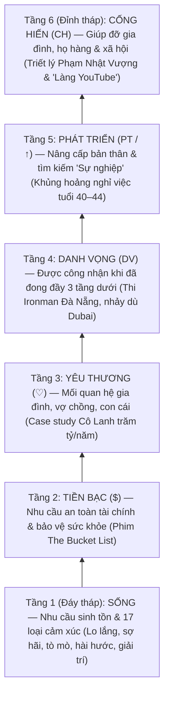

# Tập Trung Khán Giả Là Tập Trung Ở Đâu (`VIDEO-9542a5`)

- **Mã bài học (SKU):** `VIDEO-9542a5` (Bài 105 — Chương 8: Chọn Chủ Đề & Tư Duy Hệ Thống)
- **Chủ đề thực tế:** Giải mã quy luật bất biến 80 năm của Marketing (`1 - 1^N` qua 4 thế hệ nền tảng `Thư tay -> EM -> SEO -> MXH`), phân tích 6 tầng **Tháp nhu cầu Maslow** (`SỐNG -> $ -> ♡ -> DV -> PT -> CH`) kết hợp **17 loại cảm xúc cốt lõi của con người** được vẽ trực tiếp trên 2 tờ bảng giấy Flipchart, và ánh xạ thành quy trình chọn ngách **YouTube Faceless** vừa sức cho 1 người tự làm từ A đến Z.
- **Nhóm danh mục:** `he_thong` — Cảm Xúc Khán Giả & Tháp Nhu Cầu Maslow (`cam_xuc_khan_gia_thap_maslow`)
- **Thị trường mục tiêu:** Việt Nam & Toàn Cầu (`VN_GLOBAL`)
- **Trạng thái kiểm định:** `GROUNDED_VERIFIED` — Đã đối soát 100% lời giảng âm thanh (14 phút 28 giây, 134 phân đoạn phụ đề) và 8 khung hình trích xuất bằng phần cứng `NVDEC h264_cuvid` (`20s`, `74s`, `150s`, `224s`, `300s`, `355s`, `420s`, `480s`).

---

## 1. Bối cảnh & Luận điểm cốt lõi: Quy luật Marketing 80 năm (`1 - 1^N`)

Mở đầu bài giảng (`00:00` – `02:03`), giảng viên Nguyễn Văn Huân đặt câu hỏi nền tảng tiếp nối bài học trước (*Thuật Toán Đề Xuất YouTube*): khi thuật toán đã chuyển hoàn toàn sang **tập trung vào khán giả**, thì người làm nội dung phải tập trung vào điều gì ở khán giả? Câu trả lời nằm ở giao điểm giữa **sự tiến hóa của nền tảng (Platform)** và **sự bất biến của cảm xúc con người**.

Trên tờ bảng giấy Flipchart bên trái (`frame_74.jpg` – `frame_480.jpg`), giảng viên viết công thức **`1 - 1^N`** và sơ đồ tiến hóa dọc dưới chữ **`NT` (Nền tảng)**:

| Thế hệ Nền tảng (`NT`) | Ký hiệu trên bảng Flipchart | Phương thức tiếp cận (`1 -> N`) | Điểm chung bất biến suốt 80 năm |
| :--- | :--- | :--- | :--- |
| **1. Thư tay & Báo giấy** | Biểu tượng phong bì thư ✉️ | Viết thư bán hàng trực tiếp (Direct Mail), đăng bài PR trên báo giấy truyền thống | Dù công cụ thay đổi từ giấy mực sang thuật toán AI, đích đến cuối cùng vẫn là **con người** với **cảm xúc không bao giờ thay đổi** suốt hàng nghìn năm. |
| **2. Email Marketing** | `EM` | Một người soạn 1 bức thư điện tử gửi đồng loạt cho hàng nghìn khách hàng tiềm năng | Đánh vào nỗi sợ bỏ lỡ, sự tò mò và nhu cầu giải quyết vấn đề cá nhân. |
| **3. Website & Google Search** | `SEO` | Tối ưu hóa công cụ tìm kiếm để 1 bài viết tiếp cận hàng vạn người đang chủ động tra cứu | Giải quyết trực tiếp nỗi đau, thắc mắc và mong muốn cấp thiết của người tìm kiếm. |
| **4. Mạng xã hội & YouTube** | `MXH` | Đăng tải 1 video lên YouTube/TikTok/Facebook để thuật toán phân phối tới hàng triệu người (`1^N`) | Giữ chân người xem bằng **Tương tác (`TG TÁC`)** và **Hiệu suất (`H SUẤT`)** thông qua việc chạm đúng tầng cảm xúc trong Tháp Maslow. |

> **Trích dẫn nguyên văn lời giảng (`00:50` – `01:36`):**
> *"80 năm từ lúc khái niệm về marketing hình thành đến bây giờ nó vẫn không thay đổi... Xưa kia chưa có mạng xã hội thì các cụ viết thư tay, viết báo, PR ở trên báo; sau đó tiến hóa hơn là viết email, một người có thể gửi cho nhiều người; sau đấy làm những trang web SEO ở trên Google; và bây giờ chúng ta có mạng xã hội — nơi mà một người đăng lên là nhiều người cùng xem. Tất cả những sự thay đổi của công nghệ này nó chỉ hướng tới **con người** mà thôi, và ở con người thì **cảm xúc là thứ không bao giờ thay đổi**."*

---

## 2. Giải phẫu 6 Tầng Tháp Nhu Cầu Maslow & 17 Loại Cảm Xúc Cốt Lõi

Trên tờ bảng giấy Flipchart bên phải (`frame_150.jpg` – `frame_480.jpg`), bên dưới cụm 4 biểu tượng nút Play màu đỏ (`[>]`) dẫn sang hình người màu xanh lá, giảng viên vẽ một kim tự tháp 6 tầng từ đáy lên đỉnh. Mỗi tầng đại diện cho một nhóm cảm xúc và động lực hành vi khác nhau của khán giả:

### Bảng phân tích chi tiết 6 tầng cảm xúc & Case Study thực chiến trong bài giảng

| Tầng Maslow | Ký hiệu trên bảng | Nội dung cốt lõi & 17 loại cảm xúc | Ví dụ thực tế & Case Study giảng viên phân tích |
| :--- | :--- | :--- | :--- |
| **Tầng 1 (Đáy)** | **`SỐNG`** | Nhu cầu sinh tồn hàng ngày gắn liền với **17 loại cảm xúc của con người** (tra cứu được ngay trên Google): lo lắng, sợ hãi, buồn vui, tò mò, hài hước, giải trí... | Khán giả mở YouTube mỗi ngày để giải tỏa căng thẳng, xem video hài hước, giải trí hoặc thỏa mãn trí tò mò. Đây là tầng có tệp người xem rộng nhất hành tinh. |
| **Tầng 2** | **`$`** (Tiền bạc) | Nhu cầu an toàn tài chính và sức khỏe: làm sao kiếm nhiều tiền hơn để bảo vệ bản thân và gia đình khi biến cố xảy ra. | Bộ phim ***The Bucket List*** (`01:36` & `02:56`): hai nhân vật chính — một người nghèo và một tỷ phú giàu sụ sở hữu cả bệnh viện — khi cùng mắc bệnh ung thư giai đoạn cuối đều nằm chung một phòng bệnh. Tiền là công cụ thiết yếu để đảm bảo an toàn, nhưng không phải mục đích cuối cùng. |
| **Tầng 3** | **`♡`** (Trái tim) | Nhu cầu yêu thương, kết nối, hàn gắn mối quan hệ gia đình, vợ chồng, cha mẹ và con cái. | **Kênh Cô Lanh (`@CoLanh`)** (`03:20`): Chuyên sâu vào chủ đề chữa lành mối quan hệ gia đình và nuôi dạy con, chạy quảng cáo chuyển đổi 100% ở trên mạng và tạo doanh thu **hàng trăm tỷ đồng mỗi năm**. |
| **Tầng 4** | **`DV`** (Danh vọng) | Nhu cầu được tôn trọng, ngưỡng mộ và khẳng định vị thế cá nhân thông qua những trải nghiệm vượt giới hạn. | Giải ba môn phối hợp **Ironman tại Đà Nẵng** (`04:22` — chỉ khoảng 1.000–2.000 người tham gia vì đòi hỏi 6 tháng tập bơi biển, đạp xe, chạy bộ khắc nghiệt và có nền tảng tài chính vững) hoặc cảnh nhảy dù ở Dubai trong phim *The Bucket List*. **Quy luật sống còn:** Phải đong đầy 3 tầng dưới (`SỐNG` khỏe mạnh + `$` tài chính + `♡` gia đình) thì Danh vọng mới tự khắc bền vững; nếu đốt cháy giai đoạn chạy theo danh vọng ảo, hệ thống sẽ sụp đổ. |
| **Tầng 5** | **`PT` / `↑`** (Phát triển) | Nhu cầu học tập, nâng cấp năng lực và tìm kiếm ý nghĩa trong công việc (Sự nghiệp vs Công việc). | **Thống kê nhân sự tuổi 40–44** (`05:20` – `06:46`): Đây là độ tuổi có tỷ lệ nghỉ việc cao nhất trong các tập đoàn. Khi đã có nhà, có xe, con cái đã lớn (đủ 3 tầng dưới), lương cao hay phúc lợi tốt không còn giữ chân được họ nếu công việc lặp đi lặp lại không giúp họ phát triển thành một **sự nghiệp**. |
| **Tầng 6 (Đỉnh)** | **`CH`** (Cống hiến) | Nhu cầu để lại di sản, giúp đỡ người thân, cộng đồng và quê hương sau khi đã hoàn thiện bản thân. | **Bài học từ tỷ phú Phạm Nhật Vượng khi trò chuyện tại Viettel** (`07:13`): *"Trước tiên em chỉ nghĩ cho bản thân em trước, sau đó lo được cho bản thân rồi thì lo đến gia đình, anh em họ hàng, rồi lo cho công ty, xã hội và đất nước."* Từ triết lý đó, giảng viên Huân đã kéo em trai từ Nhật về làm cùng, kéo Hoàng (hàng xóm đối diện), Sơn (con nhà cậu), và tặng bộ máy tính cũ kèm khóa học cho người anh họ sinh năm 1993 ở quê để ấp ủ xây dựng **"Làng YouTube"** (`08:23` – `09:57`), giúp thanh niên nông thôn thoát cảnh xăm trổ, cờ bạc, cá độ và tín dụng đen. |

---

## 3. Ánh xạ Tháp Maslow sang Chiến lược Chọn Ngách YouTube Faceless (`11:50` – `14:28`)

Sai lầm phổ biến của người mới làm YouTube là nhìn thấy các kênh ở đỉnh tháp (như kênh đi làm từ thiện vùng sâu vùng xa, kênh khoe phong cách sống thượng lưu/danh vọng) được tung hô rồi lao vào làm theo mà quên mất hai rào cản vật lý:
1. **Hình dạng kim tự tháp:** Càng lên đỉnh tháp (`DV`, `PT`, `CH`), số lượng người quan tâm càng **ít đi** (tệp khán giả hẹp, ít view).
2. **Chi phí nguồn lực:** Các chủ đề đỉnh tháp đòi hỏi nguồn lực tài chính, ekip quay dựng hiện trường và uy tín cá nhân cực lớn — hoàn toàn vượt quá sức của một cá nhân mới bắt đầu.

### Ma trận đối chiếu Tầng Đáy vs Tầng Đỉnh khi chọn chủ đề YouTube

| Tiêu chí so sánh | Nhóm Chủ đề Đáy Tháp (`SỐNG`, `$`, `♡`) | Nhóm Chủ đề Đỉnh Tháp (`DV`, `PT`, `CH`) |
| :--- | :--- | :--- |
| **Độ rộng tệp khán giả** | **Cực lớn (Đại chúng):** Ai cũng có nhu cầu giải trí, cười, tò mò, sợ hãi, kiếm tiền và yêu thương mỗi ngày. | **Hẹp (Ngách tinh hoa):** Chỉ một nhóm nhỏ khán giả trưởng thành hoặc có điều kiện mới quan tâm sâu. |
| **Định dạng phù hợp** | **Faceless (Không lộ mặt):** Kể chuyện, tổng hợp Top 5 / Top 10 sự thật tò mò, hoạt hình giải thích, hướng dẫn kỹ năng kiếm tiền. | **Lộ mặt / Thực địa:** Quay vlog thực tế, đi vùng sâu vùng xa làm từ thiện, phỏng vấn chuyên gia, sự kiện lớn. |
| **Yêu cầu nguồn lực** | **1 người tự làm từ A đến Z:** Chỉ cần máy tính, kịch bản chạm đúng 17 cảm xúc và quy trình biên tập chuẩn. | **Đội ngũ & Vốn lớn:** Cần chi phí di chuyển, tài trợ, quay dựng hiện trường và thương hiệu cá nhân lâu năm. |
| **Mục tiêu giai đoạn đầu** | Tạo dòng tiền thực tế nuôi sống bản thân, đong đầy 3 tầng nền tảng (`SỐNG`, `$`, `♡`). | Mở rộng tầm ảnh hưởng và để lại giá trị xã hội sau khi đã tự do tài chính. |

---

## 4. Quy trình Thực thi Chuẩn (5 Bước SOP Chọn Ngách Theo Tháp Cảm Xúc)

1. **Tra cứu và lập danh mục 17 loại cảm xúc cốt lõi của con người:** Mở Google tìm kiếm chính xác cụm từ *"17 loại cảm xúc của con người"* (lo lắng, sợ hãi, tò mò, hài hước, giải trí, phẫn nộ, đồng cảm...) để làm bộ từ khóa kiểm tra kịch bản trước khi sản xuất.
2. **Định vị ngách kênh vào 3 tầng đáy rộng của Tháp Maslow:** Ưu tiên các chủ đề đánh trực diện vào tầng `SỐNG` (Hài hước, Giải trí, Khám phá sự thật gây tò mò dạng Top 5 / Top 10), tầng `$` (Hướng dẫn kỹ năng làm việc, kiếm tiền, tài chính cá nhân) hoặc tầng `♡` (Tâm sự, mối quan hệ gia đình).
3. **Chọn mô hình sản xuất Faceless vừa sức 1 người làm từ A đến Z:** Tuyệt đối không chọn miếng bánh quá to; hãy tìm những kênh mẫu Faceless trên YouTube mà quy trình viết kịch bản, thu âm và dựng video đủ gọn để một cá nhân tự hoàn thành trọn vẹn.
4. **Đong đầy 3 tầng móng trước khi nghĩ tới Danh vọng hay Mở rộng:** Tập trung làm chủ duy nhất 1 kênh Faceless cho tới khi tạo ra dòng tiền ổn định, đảm bảo sức khỏe thể chất, an toàn tài chính và lo được cho gia đình.
5. **Viết *The Bucket List* cá nhân và kiên trì theo quy luật cấp số nhân:** Liệt kê những trải nghiệm cuộc đời muốn đạt được để giữ lửa kỷ luật; hiểu rõ rằng kết quả trên YouTube không tăng theo đường thẳng tỷ lệ thuận mà bùng nổ theo **cấp số nhân** sau giai đoạn tích lũy đủ lượng và chất.

---

## 5. Cảnh báo Rủi ro & Các Bẫy Cần Tránh (`Avoid Flags`)

- **Bẫy 1 — Chọn ngách đỉnh tháp khi tay trắng:** Lao vào làm các chủ đề từ thiện vùng sâu vùng xa hoặc danh vọng tốn kém khi mới làm một mình, dẫn tới cạn vốn và kiệt sức vì chi phí cao nhưng lượng view thấp.
- **Bẫy 2 — Đốt cháy giai đoạn chạy theo Danh vọng ảo (`DV`):** Bỏ bê sức khỏe, tài chính thực tế và gia đình (3 tầng đáy) để chạy theo hư danh bề nổi trên mạng xã hội; khi biến cố xảy ra toàn bộ hệ thống sẽ sụp đổ.
- **Bẫy 3 — Ôm đồm quy trình sản xuất vượt quá năng lực cá nhân:** Chọn định dạng video đòi hỏi ekip phức tạp khiến bản thân không thể tự khép kín từ A đến Z, dẫn tới phụ thuộc và đứt gãy lịch đăng video.
- **Bẫy 4 — Tư duy tuyến tính, nản chí ở giai đoạn tích lũy:** Kỳ vọng làm hết sức vài tuần phải có kết quả ngay mà quên mất quy luật **cấp số nhân** của thuật toán đề xuất YouTube (càng về sau mới càng bùng nổ nếu đi đúng hướng ngay từ đầu).

---

## 6. Hệ thống Kênh Tham Chiếu & Tài Liệu Đính Kèm Đã Kiểm Chứng

### Kênh YouTube tham chiếu (Đã xác thực HTTP 200)
- **Cô Lanh (`@CoLanh`)** — [https://www.youtube.com/@CoLanh](https://www.youtube.com/@CoLanh): Case study thực tế được giảng viên dẫn chứng tại `03:20` cho tầng nhu cầu số 3 (`♡` — Mối quan hệ gia đình, vợ chồng, con cái), vận hành 100% qua quảng cáo online đạt doanh thu hàng trăm tỷ đồng/năm.
- **Top Fives (`@TopFives`)** — [https://www.youtube.com/@TopFives](https://www.youtube.com/@TopFives): Mô hình kênh Faceless quốc tế minh họa cho nhóm nội dung đánh vào cảm xúc **Tò mò (`Top 5 / Top 10`)** ở đáy Tháp Maslow được giảng viên khuyến nghị tại `12:14` – `13:19`.
- **5 Phút Thú Vị (`@5PhutThuVi`)** — [https://www.youtube.com/@5PhutThuVi](https://www.youtube.com/@5PhutThuVi): Đại diện tiêu biểu tại Việt Nam cho mô hình kênh Faceless giải đáp sự thật gây tò mò & giải trí đại chúng ở tầng đáy Tháp Maslow.

### Mốc thời gian kiểm định (`key_timestamps` — Sai số 0s so với `transcript.json`)
- **`00:00` (`0s`):** Bản chất bất biến 80 năm của Marketing (`1 - 1^N`): Nền tảng thay đổi (`Thư tay -> EM -> SEO -> MXH`) nhưng cảm xúc con người không đổi.
- **`02:03` (`123s`):** Tầng đáy Tháp Maslow (`SỐNG` & 17 loại cảm xúc): Lo lắng, sợ hãi, tò mò, hài hước và giải trí hằng ngày.
- **`02:46` (`166s`):** Tầng Tiền bạc (`$`) & Yêu thương (`♡`): Bài học từ bộ phim *The Bucket List* và case study Cô Lanh doanh thu trăm tỷ nhờ ngách mối quan hệ gia đình.
- **`03:44` (`224s`):** Tầng Danh vọng (`DV`): Đong đầy 3 tầng dưới (sức khỏe chơi Ironman Đà Nẵng, tài chính, gia đình) để tự khắc có danh vọng bền vững.
- **`05:15` (`315s`):** Tầng Phát triển bản thân (`PT / ↑`): Lý giải thống kê độ tuổi 40–44 nghỉ việc nhiều nhất vì khao khát "sự nghiệp" thay vì chỉ "công việc lương cao".
- **`06:52` (`412s`):** Tầng Cống hiến (`CH`): Bài học từ tỷ phú Phạm Nhật Vượng tại Viettel và hành trình kéo anh em họ hàng lập "Làng YouTube" đẩy lùi tệ nạn ở quê.
- **`11:50` (`710s`):** Ánh xạ 6 tầng Tháp Maslow sang việc chọn ngách YouTube Faceless: Tránh đỉnh tháp hẹp, chọn tầng đáy rộng vừa sức 1 người làm từ A–Z.
