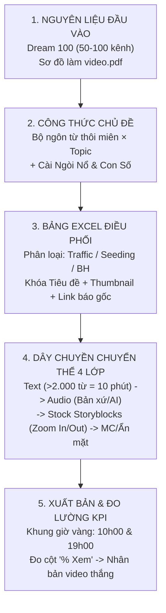

# Chi Tiết Cách Tạo Ra 1 Video Cài NGÒI NỔ TRIỆU VIEW, TỚI ĐIỂM BỦNG PHÁT Cực Nhanh 1

- **Mã bài học (SKU):** `VIDEO-af90f4`
- **Thuộc học phần:** Module 3 (`HUAN-M03` — Chiến Lược Ngách, Từ Khóa & Sản Xuất Video Triệu View) — Bài 48
- **Thời lượng thực tế:** `1806.04s` (`30:06`)
- **Tài liệu đính kèm trực tiếp trong bài:**
  1. [Sơ đồ làm video YouTube (`Youtube_SO_DO_LAM_VIDEO.pdf` — Tài liệu gốc được mở trực tiếp trên màn hình từ `18:16` đến `22:45`)](../../assets/docs-huan/Youtube_SO_DO_LAM_VIDEO.pdf)
  2. [Quy trình làm việc siêu chi tiết (`Quy_trinh_lam_viec_SIEU_CHI_TIET.pdf`)](../../assets/docs-huan/Quy_trinh_lam_viec_SIEU_CHI_TIET.pdf)
  3. [Checklist SEO YouTube 100 Điểm (`SEO_100_DIEM.pdf`)](../../assets/docs-huan/SEO_100_DIEM.pdf)
  4. [Bảng tính Checklist SEO & Quản lý sản xuất (`SEO_Youtube_Checklist_.xlsx`)](../../assets/docs-huan/SEO_Youtube_Checklist_.xlsx)

---

## 1. Tổng Quan & Tư Duy Cốt Lõi (Executive Summary)

Bài giảng **Bài 48 (`VIDEO-af90f4`)** là cẩm nang vận hành dây chuyền sản xuất video YouTube công nghiệp của Huân Academy, nối tiếp trực tiếp phần tư duy Ngòi Nổ và Từ Khóa ở các bài trước để giải quyết câu hỏi thực thi: **"Làm thế nào để biến một từ khóa và ngòi nổ triệu view thành hàng trăm video chất lượng cao với chi phí thấp nhất, không phụ thuộc vào năng khiếu cá nhân?"**

Mở đầu bằng bức ảnh kỷ niệm góc bàn làm việc trong căn phòng trọ sinh viên năm 2016 (với chiếc laptop cũ, điện thoại iPhone 5, tai nghe dây và cuốn sách *"Bí Mật Tư Duy Triệu Phú"* chiếu trên slide lúc `00:30`), giảng viên Nguyễn Văn Huân chứng minh rằng một "Đế chế vô hình" triệu view không đòi hỏi máy quay đắt tiền hay trường quay hoành tráng. Toàn bộ bài học đi sâu vào 4 trụ cột thực chiến:
1. **Phân tách 2 trường phái sản xuất (Quay Dựng Trực Tiếp vs. Chuyển Thể Nội Dung)** và ma trận 4 lớp nguyên liệu (`Content Text` — `Audio` — `Hoạt Cảnh Stock` — `MC/AI`).
2. **Mổ xẻ trực tiếp Bảng Excel Quản Trị Sản Xuất Thực Tế** (`13:23–18:14`): cách điều phối đội ngũ làm việc từ xa (Content, Audio, Video, Thumbnail), lịch đăng cố định `10h sáng` & `19h tối`, kỹ thuật đảo số Hotline ở đầu mô tả, quy tắc hợp thức hóa tiêu đề giật tít để không bị gậy Clickbait, và quản trị kênh bằng chỉ số **`% Xem` (Average Percentage Viewed)**.
3. **Giải phẫu trực tiếp tài liệu gốc `Sơ đồ làm video.pdf`** (`18:16–22:45`) của đội ngũ tách ra từ hệ thống **Thầy Trần Việt Quân**: công thức nhân bản chủ đề **`Bộ ngôn từ thôi miên × Topic = Chủ đề video`** và kho hơn 100 thẻ phân loại nội dung.
4. **Chiến thuật "Đầu Đầu Tư 100% — Đuôi Nhân Bản"** qua Case Study kênh game **Fortnite** nổ **4.000.000 views trong 48 giờ** dù chủ kênh bị say tiền đình không biết chơi game, cùng bài toán nhân sự tuyển sinh viên Báo chí viết kịch bản (`8.000.000 VNĐ/tháng` cho 26 ngày công).

---

## 2. Phân Tích Chuyên Sâu Theo Dòng Thời Gian & Visual Slide

### 2.1. Khởi đầu năm 2016 & Hai trường phái sản xuất Video YouTube (`00:00` – `06:28`)

Trên slide trình chiếu lúc `00:30` và `04:20` (**`CÁCH THỨC TẠO RA VIDEO`**), giảng viên đối chiếu trực diện 2 mô hình sản xuất cốt lõi trên YouTube:

| Tiêu chí đối chiếu | Trường phái 1: QUAY DỰNG TRỰC TIẾP | Trường phái 2: CHUYỂN THỂ NỘI DUNG (Đế Chế Vô Hình) |
| :--- | :--- | :--- |
| **A. Nguyên liệu / Bối cảnh** | 1. **Vlog** (đời sống cá nhân) 2. **Review** (trải nghiệm sản phẩm/dịch vụ) 3. **Hoạt động** (sự kiện, lớp học, giao dịch thực tế) | 1. **Text chuyển thể thành Audio** (kịch bản văn bản đọc thành tiếng) 2. **Slide Ảnh + Video minh họa** khớp ngữ cảnh 3. **MC dẫn chương trình** (hoặc nhân vật ảo AI / ẩn mặt) |
| **B. Thiết bị yêu cầu** | Điện thoại, Máy quay chuyên dụng, GoPro, Micro thu âm hiện trường | Chỉ cần **Điện thoại** và **Máy tính** có kết nối Internet |
| **Ví dụ kênh thực tế trong bài** | **Mạnh Ô Tô** (`@ManhOto`), **Thế Giới Di Động** (`@TheGioiDiDong`), **Phạm Thành Long Official** (`@phamthanhlong`) | **Web 5 Ngày** (`@Web5Ngay`), **Thế Giới Huyền Bí** (`@TheGioiHuyenBi`), **Việt Sử Toàn Thư** (`@Việt_Sử_Toàn_Thư`), **Master Phùng Phương** (`@MasterPhungPhuong`) |
| **Khả năng nhân bản** | Phụ thuộc lớn vào sự xuất hiện của chuyên gia/chủ kênh và bối cảnh quay | **Nhân bản công nghiệp 100% online**, dễ dàng mở rộng lên hàng chục kênh đa ngôn ngữ |

> [!TIP]
> **Mô hình kết hợp chuẩn truyền hình (`VTV24`):** Bạn hoàn toàn có thể lai ghép cả hai trường phái như bản tin của **VTV24** (`@VTV24`) — có MC đứng dẫn ở đầu và giữa bản tin (tạo sự uy tín, giữ bản quyền hình ảnh), xen kẽ với các đoạn video/hình ảnh chuyển thể minh họa cho nội dung bài viết.

---

### 2.2. Ma trận 4 Lớp Nguyên Liệu của mô hình Chuyển Thể Nội Dung (`06:28` – `12:20`)

Trên slide **`CHUYỂN THỂ NỘI DUNG - CÁCH THỨC ĐƠN GIẢN NHẤT ĐỂ BẮT ĐẦU VỚI VIDEO`** (`08:20`), quy trình bóc tách thành 4 mắt xích độc lập:

#### (1) CONTENT TEXT — 5 Nguồn khai thác kịch bản bất tận
1. **Các tờ báo điện tử lớn** (`vietnamnet.vn`, `vnexpress.net`, `marketingai.vn`...).
2. **Google News:** Công cụ gom tin tức nóng theo từng từ khóa ngách mỗi ngày.
3. **Website & Blog chuyên ngành:** Ví dụ riêng ngách giảm cân/sức khỏe tại Việt Nam đã có sẵn hơn **400 bài viết** chuyên sâu; người làm nội dung chỉ cần tổng hợp, biên tập lại ngôn từ (đổi cách diễn đạt nhờ sự đa nghĩa phong phú của tiếng Việt) là có ngay kịch bản mới mà không sợ trùng lặp.
4. **Nội dung Mạng xã hội (Facebook, Douyin/TikTok):** Nơi kiểm chứng sẵn các câu chuyện và kịch bản có tương tác cao.
5. **Nội dung Nước ngoài:** Dịch các bài báo, trang tổng hợp danh ngôn (Quotes) hoặc kịch bản từ tiếng Anh/Trung sang tiếng Việt.

#### (2) AUDIO — 3 Cấp độ chuyển văn bản thành giọng nói
1. **Tự đọc Audio:** Mẹo thực chiến cho người mới là dùng chính chiếc điện thoại đặt **cách miệng khoảng 1 gang tay**, ngồi trong phòng kín có nhiều đồ đạc, rèm cửa hoặc trùm chăn để triệt tiêu tiếng vang.
2. **Thuê giọng đọc tự do:** Tuyển cộng tác viên thu âm trên các Group Facebook việc làm tại nhà/Freelancer với chi phí rất rẻ theo từng bài.
3. **Sử dụng phần mềm AI (`AICLIP.AI`):** Chuyển văn bản thành giọng đọc tự nhiên hoặc tạo luôn nhân vật MC ảo cử động miệng khớp lời nói (như cách kênh **Việt Sử Toàn Thư** triển khai).

#### (3) HOẠT CẢNH (Visual Stock) & Kỹ thuật Zoom đổi tiêu cự
- **Nguồn nguyên liệu:** Ảnh từ **Google Images** kết hợp kho video bản quyền mua tại **Storyblocks.com** (trước đây là **VideoBlocks**).
- **Kỹ thuật dựng sống còn (`11:15`):** Khi đưa ảnh tĩnh hoặc footage lấy từ Storyblocks vào phần mềm dựng, bắt buộc phải đặt hiệu ứng **Zoom In (phóng to dần) hoặc Zoom Out (thu nhỏ dần)** để tiêu điểm khung hình dịch chuyển liên tục, giữ mắt khán giả không bị nhàm chán.

#### (4) MC DẪN CHƯƠNG TRÌNH & Bí mật độ dài 2.000 từ của kênh `Thế Giới Huyền Bí`
- Có 4 lựa chọn cho lớp MC: **(1) Tự làm MC**, **(2) Thuê MC**, **(3) Dùng AI (`AICLIP.AI`)**, hoặc **(4) Không cần MC**.
- **Case Study thực chiến `Thế Giới Huyền Bí` (`@TheGioiHuyenBi`, phút `09:00` – `10:19`):**
  - Kênh hoàn toàn không có MC xuất hiện, chỉ dùng giọng đọc truyền cảm kết hợp hình ảnh/video minh họa nhưng nằm chễm chệ trên **Tab Thịnh Hành (Trending) Việt Nam suốt 6 tháng liên tục**.
  - Video tiêu biểu: *"Quan Thế Âm Bồ Tát hiển linh từ đáy biển"* đạt **4.100.000 lượt xem**.
  - **Bài toán kinh tế của độ dài 10 phút (`2.000 từ`):** Tốc độ đọc trung bình là **200 từ/phút**. Giảng viên yêu cầu mọi kịch bản dài phải đạt tối thiểu **2.000 từ** để thành phẩm video dài từ **10 phút trở lên** (nay YouTube hạ ngưỡng xuống **8 phút**), giúp kênh bật được **Quảng cáo giữa video (Mid-roll Ads)** — vừa tăng gấp nhiều lần doanh thu AdSense, vừa nhân tổng thời lượng xem (Watch Time) để đề xuất mạnh hơn.

---

### 2.3. Chu trình 4 Giai Đoạn & 9 Bước Triển Khai Kênh YouTube (`12:20` – `13:23`)

Slide **`VIỆC CỦA BẠN CẦN LÀM LÀ (CÁC BƯỚC TRIỂN KHAI YOUTUBE)`** (`12:20`) chuẩn hóa toàn bộ lộ trình vận hành một kênh từ con số 0:
1. **Giai đoạn 1 — Sản Xuất Video:** `(1) Tìm Chủ Đề` $\rightarrow$ `(2) Viết Content` $\rightarrow$ `(3) Quay Dựng Video`.
2. **Giai đoạn 2 — Up YouTube:** `(3) Đặt Tiêu Đề` $\rightarrow$ `(4) Hình Thu Nhỏ Thumbnail` $\rightarrow$ `(5) SEO Video (chuẩn 100 điểm)`.
3. **Giai đoạn 3 — Phát Triển:** `(6) Chia Sẻ Video` $\rightarrow$ `(7) Chạy Quảng Cáo (nếu cần mồi traffic)`.
4. **Giai đoạn 4 — Đo Lường & Tối Ưu:** `(8) Đánh giá hiệu quả kênh dựa trên các chỉ số YouTube Analytics` $\rightarrow$ `(9) Tối ưu từng chỉ số yếu (CTR, Average View Duration, % Xem)`.

---

### 2.4. Mổ Xẻ Bảng Excel Quản Trị Sản Xuất Thực Tế & Luật Hợp Thức Hóa Clickbait (`13:23` – `18:16`)

Từ phút `13:23` đến `18:14`, giảng viên mở trực tiếp **Bảng tính Excel quản lý đội ngũ sản xuất hàng ngày** của một kênh kinh doanh - tài chính thực tế trên màn hình (`f_980.jpg`):

| Cột trong Bảng Excel | Nội dung thực tế trên màn hình bài giảng (`16:20`) | Ý nghĩa quản trị & Vận hành thực chiến |
| :--- | :--- | :--- |
| **1. Thứ / Lịch đăng** | Thứ 2 $\rightarrow$ Chủ Nhật; khung giờ cố định **`10h sáng`** và **`19h tối`** | Rèn thói quen xem video đúng giờ cho khán giả và tạo nhịp xuất bản đều đặn cho thuật toán. |
| **2. Kiểu Làm** | `Traffic` (Kéo view) / `Seeding` / `BH` (Bán hàng) | Phân bổ tỷ lệ chiến lược giữa video thu hút đại chúng (Traffic) và video chuyển đổi ra đơn (BH). |
| **3. Chủ Đề & Link nguồn** | *"Câu nói bất hủ tỷ phú Phạm Nhật Vượng"*, *"Tỷ phú Phạm Nhật Vượng Đầu Tư 230.000 Tỷ"* (`marketingai.vn`, `vietnamnet.vn`) | Người quản lý (Leader) là người chốt sẵn Chủ đề và đính kèm Link bài báo gốc trước khi giao cho đội Content. |
| **4. SỐ LÊN ĐẦU** | Đảo luân phiên 2 số Hotline đuôi **`1199`** và **`519`** | Kỹ thuật đo lường hiệu quả chuyển đổi (Tracking) và phân tải cuộc gọi cho đội ngũ Sale/Tư vấn. |
| **5. Tiêu đề đặt & Thumbnail** | Leader hoặc người có tư duy Ngòi Nổ chốt sẵn ý tưởng Tiêu đề + Thumbnail | Không để nhân sự viết kịch bản tự nghĩ tiêu đề theo cảm tính; Content phải viết để phục vụ Tiêu đề & Thumbnail đã chốt. |
| **6. Content / Audio / Video** | Các cột đánh dấu tiến độ và gắn link file Google Drive của từng bộ phận | Vận hành mô hình **Đế chế vô hình 100% Online**: Content xong $\rightarrow$ Audio thu âm $\rightarrow$ Editor dựng video. |
| **7. `% Xem` (KPI Tối Thượng)** | Ghi nhận tỷ lệ phần trăm thời lượng xem trung bình của từng video | **Chỉ số quan trọng nhất để Leader đọc báo cáo:** Không cần mở kênh mỗi ngày, chỉ cần nhìn cột `% Xem` để biết chủ đề nào khán giả xem lâu nhất rồi nhân bản tiếp, chủ đề nào `% Xem` thấp thì loại bỏ ngay. |

> [!IMPORTANT]
> **Quy tắc Hợp Thức Hóa Ngòi Nổ — Chống gậy Clickbait Thumbnail (`16:36` – `17:24`):**
> Rất nhiều kênh bị YouTube quét lỗi `Clickbait` vì giật tít *"Có 10 nói 100"* mà trong nội dung video không hề nhắc tới chi tiết đó. Giảng viên chỉ rõ: khi Tiêu đề và Thumbnail đã giật con số **`230.000 tỷ`** hoặc **`30 câu nói bất hủ`**, người viết kịch bản **bắt buộc phải đưa chính xác cụm từ và con số `230.000 tỷ` / `30 câu nói bất hủ` đó vào ngay trong văn bản kịch bản (Content)**. Khi âm thanh và phụ đề trong video có nhắc đúng thông tin trên tiêu đề, thuật toán YouTube hoàn toàn không thể bắt lỗi "ăn không nói có".

---

### 2.5. Giải Phẫu Tài Liệu `Sơ đồ làm video.pdf` & Chiến Lược Thuê Voice Bản Xứ (`18:16` – `24:00`)

Ở phút `18:16` (`f_1220.jpg`), giảng viên mở trực tiếp file PDF **`Sơ đồ làm video.pdf`** (`docs/course-docs/Youtube_SO_DO_LAM_VIDEO.pdf`) — bản quy trình do một đội ngũ tách ra từ hệ thống của **Thầy Trần Việt Quân** (`@ThayTranVietQuan`, nổi tiếng với năng lực đúc kết sơ đồ hóa) xây dựng:

1. **Bước 1 — Đúc kết `Bộ ngôn từ thôi miên` từ Dream 100 (`18:21` – `19:12`):**
   - Quét 50–100 kênh lớn trong ngách để lọc ra những cụm từ khóa lặp đi lặp lại đánh trúng tử huyệt tâm lý của tệp khán giả mục tiêu (ví dụ nam giới từ **30–50 tuổi**): *"Triết lý cho đàn ông tuổi 30–50"*, *"Sống khôn ngoan hơn"*, *"Thay đổi cuộc sống nhờ..."*, *"Vượt qua khó khăn"*, *"Lời khuyên từ vĩ nhân"*.
2. **Bước 2 — Lập danh sách `Topic` triệu view (`19:13` – `19:37`):**
   - Nhóm các chủ đề luôn có lượng người xem khổng lồ: *Tình yêu, Gia đình, Kinh doanh, Triết gia, Vĩ nhân, Bậc thầy tâm linh, Ngạn ngữ dân tộc (Do Thái, Nhật Bản, Trung Quốc)*.
3. **Bước 3 — Xây dựng `Kho Content` hơn 100 thẻ phân loại (`19:37` – `20:10`):**
   - Thu thập câu nói, câu chuyện từ **Google**, các trang **Web Quote tiếng Anh**, **ChatGPT** và **Báo chí**, sau đó dịch sang tiếng Việt và gắn thẻ phân loại theo từng góc chủ đề.
4. **Bước 4 — Công thức nhân bản Chủ đề Video (`20:11` – `21:55`):**
   $$\text{Chủ đề Video} = \text{Bộ ngôn từ thôi miên} \times \text{Topic} \times (\text{Vấn đề} + \text{Đối tượng} + \text{Ngòi nổ})$$
   - Kết hợp đa dạng các kiểu câu: *Câu hỏi, Phủ định, Cảm thán, Khẳng định*, đi kèm kho hình ảnh, kho video stock và **nhạc nền đồng nhất nhịp độ xuyên suốt toàn kênh**.
5. **Bước 5 — Thuê Voice Bản Xứ khi đánh thị trường Quốc tế (`22:00` – `22:45`):**
   - Nếu người Việt tự đọc tiếng Anh, khán giả bản xứ nghe không hiểu và thoát video ngay.
   - Khi làm thị trường **Mỹ (US)**, đội ngũ của giảng viên thuê 100% **người Mỹ gốc Mỹ (giọng Anh-Mỹ)** thu âm; khi đánh thị trường **châu Âu (UK/EU)** thì thuê **người Anh gốc Anh (giọng Anh-Anh)**. Chính ngữ điệu bản xứ chuẩn xác giúp thuật toán nhận diện giọng nói của YouTube đề xuất video thẳng vào tệp người xem tại quốc gia mục tiêu.

---

### 2.6. Case Study Kênh Game Fortnite 4.000.000 Views / 48h & Bài Toán Tuyển Sinh Viên Báo Chí (`24:00` – `30:06`)

Phần cuối bài giảng đúc kết 2 bài học thực chiến cực kỳ đắt giá về tư duy **Cải tiến thay vì tự sáng tạo** và **Định mức nhân sự sản xuất**:

- **Case Study Kênh Game Fortnite nổ `4.000.000 views / 48 giờ` (`24:00` – `26:30`):**
  - **Rào cản:** Giảng viên muốn làm kênh game **Fortnite** tiếng Anh vì lượng view toàn cầu quá lớn, nhưng bản thân bị rối loạn tiền đình — cứ nhìn màn hình nhân vật nhảy bắn và xây nhà vài phút là hoa mắt, chóng mặt, buồn nôn, hoàn toàn không biết chơi game.
  - **Cách giải quyết bằng nguyên lý Ngòi Nổ:** Thay vì tự chơi hoặc xem hàng giờ stream, anh quét các video nhiều view nhất của đối thủ, dịch tiêu đề ra tiếng Việt và phát hiện ngòi nổ triệu view: *"Top 10 phát bắn Sniper (ống ngắm) không cần ngắm (no-scope) khủng khiếp nhất"*.
  - **Chiến thuật sản xuất 1 + 19:** Anh chỉ tự làm đúng **1 việc duy nhất**: tìm kiếm một đoạn clip dài khoảng **1 phút** quay cảnh bắn Sniper mãn nhãn nhất khớp 100% với hình ảnh trên Thumbnail và Tiêu đề để **đặt ngay ở phút đầu tiên của video**. Sau đó, anh giao cho nhân sự dựng video tự tìm thêm **19 phân đoạn bắn súng khác** ghép nối vào phía sau.
  - **Kết quả:** Khán giả click vào vì Thumbnail/Tiêu đề và ngay lập tức được thỏa mãn bởi pha highlight đỉnh cao ở 60 giây đầu tiên $\rightarrow$ Kênh bùng nổ **4.000.000 lượt xem chỉ trong 48 giờ** dù chủ kênh không hề biết chơi game.

- **Bài toán Nhân sự Content — Tuyển dụng Sinh viên Báo chí (`27:00` – `30:06`):**
  - Khi tự viết kịch bản, chủ kênh thường bị chi phối bởi cảm xúc cá nhân (lúc vui viết nhanh, lúc tụt cảm xúc cả tuần không ra nổi 1 bài).
  - Để công nghiệp hóa, **80% – 90% nhân sự viết kịch bản** trong hệ thống của giảng viên được tuyển từ các trường **Báo chí** (sinh viên mới ra trường hoặc thực tập sinh báo chí).
  - **Định mức chi phí & KPI thực tế:**
    - Mức lương: **`8.000.000 VNĐ / tháng`** (làm việc **26 ngày công/tháng**, tương đương khoảng `300.000 VNĐ/ngày`).
    - Sản lượng: **`2 – 3 kịch bản / ngày`**, mỗi kịch bản dài trên **`2.000 từ`** (tương đương 1 video dài hơn 10 phút).
    - Chi phí thực tế chỉ hơn **`100.000 VNĐ / kịch bản 2.000 từ`**, đảm bảo văn phong mạch lạc, có sẵn kỹ năng tổng hợp nguồn báo và bố cục Mở - Thân - Kết chuẩn mực.

---

## 3. Danh Bạ Kênh YouTube & Công Cụ Thực Chiến Trong Bài

### 3.1. Các kênh YouTube được phân tích & đối chiếu (Đã xác thực trạng thái hoạt động)
1. **Master Phùng Phương - Phong Thủy** ([@MasterPhungPhuong](https://www.youtube.com/@MasterPhungPhuong)) — *Verified HTTP 200*: Hình mẫu ứng dụng quy trình sản xuất công nghiệp vào ngách phong thủy.
2. **Việt Sử Toàn Thư** ([@Việt_Sử_Toàn_Thư](https://www.youtube.com/@Vi%E1%BB%87t_S%E1%BB%AD_To%C3%A0n_Th%C6%B0)) — *Verified HTTP 200*: Kênh lịch sử Việt Nam sử dụng nhân vật MC ảo từ phần mềm `AICLIP.AI`.
3. **Yoga Luna Thái** ([@Yogalunathaivn](https://www.youtube.com/@Yogalunathaivn)) — *Verified HTTP 200*: Ví dụ ngách sức khỏe - tập luyện thể chất.
4. **Mạnh Ô Tô** ([@ManhOto](https://www.youtube.com/@ManhOto)) — *Verified HTTP 200*: Điển hình cho trường phái Quay Dựng Trực Tiếp (Review & Vlog thực tế).
5. **Thế Giới Di Động** ([@TheGioiDiDong](https://www.youtube.com/@TheGioiDiDong)) — *Verified HTTP 200*: Kết hợp quay review sản phẩm với kịch bản tổng hợp từ tin tức công nghệ.
6. **VTV24** ([@VTV24](https://www.youtube.com/@VTV24)) — *Verified HTTP 200*: Chuẩn mực kết hợp MC dẫn hiện trường và phóng sự chuyển thể.
7. **Web 5 Ngày** ([@Web5Ngay](https://www.youtube.com/channel/UCt1Oul3UUHpYa8c5jYckeRw)) — *Verified HTTP 200*: Đại diện tiêu biểu của mô hình Chuyển Thể Nội Dung (Đế chế vô hình).
8. **Phạm Thành Long Official** ([@phamthanhlong](https://www.youtube.com/@phamthanhlong)) — *Verified HTTP 200*: Mô hình quay dựng bối cảnh hoạt động đào tạo.
9. **Thế Giới Huyền Bí** ([@TheGioiHuyenBi](https://www.youtube.com/@TheGioiHuyenBi)) — *Verified HTTP 200*: Kênh chuyển thể không MC giữ Top Trending 6 tháng với video *"Quan Thế Âm Bồ Tát hiển linh từ đáy biển"* (4,1M views).
10. **Trần Việt Quân** ([@ThayTranVietQuan](https://www.youtube.com/@ThayTranVietQuan)) — *Verified HTTP 200*: Hệ thống đào tạo gốc của đội ngũ thiết kế tài liệu `Sơ đồ làm video.pdf`.
11. **Bí Quyết Thành Công** (`@Biquyetthanhcong`) — *Kênh cũ hiện không còn tồn tại độc lập (`dead: true`)*.

### 3.2. Hệ sinh thái Công cụ & Nguồn nguyên liệu được sử dụng
- **Nguồn khai thác văn bản:** `Google News`, `Google`, `ChatGPT`, báo điện tử (`vietnamnet.vn`, `marketingai.vn`), `Douyin`, `Facebook`.
- **Giọng đọc & MC ảo:** `AICLIP.AI` (chuyển văn bản thành giọng nói và MC ảo), cộng tác viên thu âm trên các Group Facebook, hoặc Voice-over bản xứ (Anh-Mỹ / Anh-Anh).
- **Kho hình ảnh & Footage bản quyền:** `Storyblocks` (`Storyblocks.com` / `VideoBlocks`), `Google Images`.
- **Quản trị & Đo lường:** `Excel` / Google Sheets (Bảng điều phối 14 cột), `YouTube Analytics` (đo lường cột `% Xem`).

---

## 4. Lộ Trình Thực Thi Ngay Sau Bài Học (Actionable Checklist)

- [ ] **Thiết lập Bảng Excel Quản Trị Sản Xuất:** Tạo ngay file theo dõi gồm đủ các cột: *Thứ | Kiểu làm (Traffic/Seeding/BH) | Chủ đề | Link nguồn | Số Hotline/CTA lên đầu | Tiêu đề đặt | Thumbnail | SEO | Content | Audio | Video | % Xem*.
- [ ] **Áp dụng tài liệu `Youtube_SO_DO_LAM_VIDEO.pdf`:** Thống kê 50–100 kênh đối thủ để rút ra **Bộ ngôn từ thôi miên** + **Danh sách Topic**, sau đó tạo kho thẻ phân loại nội dung.
- [ ] **Kiểm tra Quy tắc "Khớp Ba Đỉnh" trước khi xuất bản:** Đảm bảo 100% con số/tình tiết giật tít trên **Tiêu đề** và **Thumbnail** phải xuất hiện ngay trong **60 giây mở đầu video** và trong văn bản kịch bản để triệt tiêu rủi ro Clickbait và tối đa hóa tỷ lệ giữ chân.
- [ ] **Chuẩn hóa thời lượng kịch bản $\ge 2.000$ từ:** Đảm bảo video hoàn chỉnh đạt trên 8–10 phút để kích hoạt quảng cáo Mid-roll, đồng thời đặt hiệu ứng Zoom In/Out cho toàn bộ cảnh dựng từ Storyblocks.
