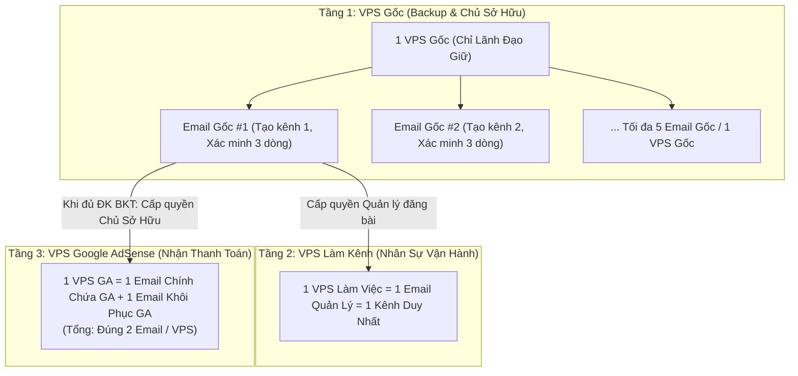

# Hướng Dẫn VPS Chi Tiết Và Cách Thức Đăng Ký Google AdSense Bật Kiếm Tiền (`VIDEO-b267fe`)

> **Phân hệ:** Support Kỹ Thuật & Quản Trị Hạ Tầng (Huân Academy / GODA)  
> **Thời lượng:** `36:27` (`2187.63s`) | **Diễn giả:** Hoàng GODA & Nguyễn Văn Huân | **Tài liệu trình chiếu trên màn hình:** `QUẢN TRỊ & BẢO MẬT KÊNH YOUTUBE THEO MÔ HÌNH GODA.docx` (5 trang) + Video hướng dẫn chuẩn hóa Bật kiếm tiền & Xác minh Google AdSense qua Persona

---

## 1. Bối Cảnh & Tư Duy Quản Trị Hạ Tầng Cốt Lõi (Phần 1 — `00:00` đến `05:40`)

Từ sau đợt cập nhật chính sách quét mạnh tay của YouTube vào **tháng 7**, cơ chế **quét liên đới (quét lan)** do AI của Google kiểm soát đã khiến rất nhiều hệ thống đăng nhập hàng chục kênh trên cùng một máy tính hoặc dùng chung một dải Proxy bị xóa sổ hàng loạt mà không thể gặp nhân sự thật để kháng cáo.

Tại buổi Zoom chuyên đề này, đại diện vận hành hệ thống của GODA (đang trực tiếp quản lý **hơn 1.000 Email** và **hơn 100 máy chủ ảo VPS**, có những VPS duy trì bền bỉ **8–9 năm từ 2017** với 1 IP tĩnh duy nhất không hề biến động) công bố toàn bộ kiến trúc bảo mật 5 phần đang áp dụng thực tế:

| Phương án Hạ tầng | Đánh giá Thực tế từ Hệ thống GODA (>100 VPS) | Quyết định Vận hành |
| :--- | :--- | :--- |
| **Đăng nhập nhiều kênh trên 1 máy tính cá nhân** | Trùng 100% địa chỉ IP, trùng **Browser Fingerprint** (nhận diện trình duyệt, lịch sử, thao tác tay). Chỉ cần 1 kênh bị die (spam, nội dung nguy hiểm, không trung thực) là AI quét bay toàn bộ các kênh còn lại. | **Loại bỏ** khi làm từ vài kênh trở lên. |
| **Proxy dân cư / Proxy giá rẻ** | Chi phí rẻ nhưng thiếu sự ổn định dài hạn, dễ bị rớt kết nối hoặc dính IP từng có lịch sử xấu. | **Không sử dụng** cho kênh chính và Google AdSense. |
| **GPMLogin + SIM 4G / Phone Farm** | Đã test thực tế nhưng phụ thuộc quá nhiều SIM vật lý, thiếu tính chủ động và khó tối ưu khi vận hành đội ngũ nhân sự từ xa. | **Không ưu tiên** cho hệ thống lớn. |
| **Máy chủ ảo VPS (1 VPS = 1 Hệ sinh thái khép kín)** | Định danh độc lập hoàn toàn (`VPS = Danh tính số`). Coi VPS không chỉ là máy tính ảo mà là **tài sản bảo vệ Email, Kênh YouTube và Tài khoản Google AdSense (GA)**. | **Tiêu chuẩn bắt buộc của GODA** (*Ưu tiên: Độ bền > Tốc độ > Số lượng*). |

---

## 2. Kiến Trúc Tách Bạch 2 Tầng Email & VPS Cô Lập Rủi Ro (Phần 2 — `05:42` đến `12:54`)

Trên tài liệu `QUẢN TRỊ & BẢO MẬT KÊNH YOUTUBE THEO MÔ HÌNH GODA.docx` (Trang 1–2), hệ thống phân tách nghiêm ngặt **2 loại Email** trên **2 tầng VPS độc lập**:

### 2.1. Phân loại 2 nhóm Email trong hệ thống
1. **Email Gốc (Email nuôi kênh & Backup):**
   * **Vai trò:** Dùng để tạo kênh (giữ quyền Chủ sở hữu chính), xác minh đầy đủ 3 dòng trên YouTube Studio và làm nơi dự phòng (backup). Sau khi thiết lập xong, gần như để yên, thỉnh thoảng mới vào đọc thư nhẹ nhàng.
   * **Giới hạn trên VPS:** Đăng nhập **tối đa 5 Email gốc (5 kênh) trên 1 VPS gốc**. Không đăng nhập hàng chục kênh trên 1 VPS để tránh lặp lại rủi ro chết chùm.
   * **Nguyên tắc sống còn:** **Tuyệt đối không dùng Email gốc để trực tiếp làm kênh hàng ngày và KHÔNG chứa tài khoản Google AdSense (GA)**. Lý do: Nếu kênh chẳng may dính lỗi nhẹ (như Reused Content hoặc chết kênh do lỗi spam nhẹ), tài khoản GA nằm ở Email riêng vẫn hoàn toàn sạch và tái sử dụng được cho kênh khác.
2. **Email Làm Kênh (Email vận hành hàng ngày):**
   * **Công thức bắt buộc:** **`1 Email = 1 Kênh = 1 VPS`**.
   * Mỗi kênh khi bàn giao cho nhân sự sản xuất/đăng bài sẽ chạy trên 1 VPS riêng biệt. Chủ hệ thống nắm giữ toàn bộ mật khẩu Email gốc và Email làm kênh; nhân sự chỉ truy cập vào VPS làm việc để tối ưu hóa bảo mật và đồng bộ IP cố định.

### 2.2. Nguyên tắc nối Email khôi phục theo "Vòng Tròn Khép Kín" (`10:34`)
* **Quy tắc chuẩn:** Mỗi Email chỉ nối **1 Email khôi phục duy nhất**, và ghép từ **2 đến tối đa 3 Email thành một vòng tròn khép kín** (Ví dụ: `Hoang1` nối khôi phục sang `Hoang2` $\rightarrow$ `Hoang2` nối sang `Hoang3` $\rightarrow$ `Hoang3` nối ngược về `Hoang1`; tối ưu nhất là cặp 2 Email nối chéo nhau).
* **Quy trình cách ly khi có kênh bệnh ("Cô lập dịch bệnh"):** Trong 1 VPS gốc chứa 5 kênh, nếu 1 kênh phát sinh vi phạm/sự cố, lập tức **giữ nguyên kênh lỗi đó ở lại VPS cũ** để tiến hành kháng cáo, đồng thời **di chuyển ngay 4 kênh lành còn lại sang một VPS mới tinh** để cắt đứt hoàn toàn nguy cơ quét lan.
* **Cấm kỵ tuyệt đối:** Không bao giờ dùng 1 Email khôi phục chung cho 10–30 kênh và **tuyệt đối không dùng Email tên miền riêng (Email Domain công ty như `hoang@goda.media` hoặc nguồn mail domain giá rẻ)** vì khi 1 địa chỉ trong domain vi phạm, AI của Google sẽ xóa sổ toàn bộ các tài khoản chung hậu tố tên miền đó mà không thể kháng cáo.

---

## 3. Quy Chuẩn Nuôi Email & Chăm Sóc Google AdSense (Phần 3 & 4 — `12:55` đến `24:00`)

Trên Trang 2–4 của tài liệu trình chiếu (`14:05` – `20:10`), quy trình nuôi và vận hành Google AdSense (GA) được thiết lập với kỷ luật cao nhất:

### 3.1. Điều kiện chuẩn bị trước khi tạo Google AdSense
* **Thời gian nuôi Email:** Email dùng để lập GA phải được tự tạo mới và nuôi tương tác trước **tối thiểu 14 ngày** (tốt nhất là **20–30 ngày**). Không dùng các loại "email cổ mua sẵn" không rõ lịch sử.
* **Lịch sử sạch 100%:** Email và IP của VPS đó **chưa từng tạo bất kỳ tài khoản GA nào** trước đây và chưa từng dính vi phạm chính sách Google.
* **Số điện thoại xác minh:** Phải là **SIM số điện thoại mới hoàn toàn (chính chủ)**, chưa từng liên kết với bất kỳ tài khoản GA nào.

### 3.2. Quy định cứng: `1 VPS = 1 Google AdSense` & Nuôi điểm Trust Score
* Trên 1 VPS dành cho GA chỉ được phép đăng nhập đúng **2 Email**: **1 Email chính chứa GA** + **1 Email khôi phục cho GA đó**.
* **Nuôi hành vi người dùng thật (Trust Score) 30 giây/ngày:**
  * Tận dụng lợi thế VPS bật 24/24 để mở trình duyệt xem YouTube (nhạc, tin tức) tự nhiên.
  * Đăng ký nhận bản tin (Newsletter) từ các trang báo nước ngoài để mỗi ngày có email tự động gửi về; dành **30 giây mỗi ngày** (hoặc vài ngày/lần) mở VPS vào đọc email, lướt báo, tìm kiếm Google như người dùng thật.
  * **Tuyệt đối không dùng Tool tự động nuôi tài khoản trên VPS**: Dùng tool sẽ bị hệ thống chống gian lận của Google phát hiện và quét chết cả dàn VPS.
* **Thực tiễn kiểm chứng từ GODA (`17:16`):** Sau đợt bão quét GA mua vào tháng 6–7, toàn bộ hệ thống chuyển sang tự nuôi GA chính chủ trên VPS riêng. Kết quả có những tài khoản GA tháng trước chỉ nhận $30\text{–}\$40$ (chưa đủ minpay), ngay tháng sau nhận thanh toán **$\$340.000$ trên 1 kênh / 1 con GA** hoàn toàn mượt mà, không gặp bất kỳ trở ngại nào.

### 3.3. Quy trình chuẩn 4 Bước Bật Kiếm Tiền An Toàn (`20:00`)
1. **Bước 1:** Từ VPS chứa **Email gốc**, cấp quyền **Chủ sở hữu kênh (Owner)** sang cho **Email chứa GA**.
2. **Bước 2:** Đăng nhập vào **VPS chứa GA**, thực hiện toàn bộ thao tác liên kết và bật kiếm tiền ngay trên VPS của GA đó.
3. **Bước 3:** Sau khi bật kiếm tiền thành công, giữ nguyên trạng thái tĩnh trên VPS chứa GA: Không đăng nhập GA sang bất kỳ thiết bị/IP nào khác, chỉ duy trì xem YouTube nhẹ nhàng để bảo toàn tài sản.

---

## 4. Hướng Dẫn Thực Hành Đăng Ký & Xác Minh Danh Tính Google AdSense Từ A-Z (`24:44` đến `31:35`)

Trong phần thứ hai của bài giảng, video hướng dẫn chi tiết minh họa trực quan **4 giai đoạn bật kiếm tiền YouTube**:

### Giai đoạn 1: Đạt điều kiện bật kiếm tiền YouTube (`25:13`)
* **Mốc bước đệm (Bật kiếm tiền sớm):** Đạt đồng thời **500 người đăng ký** + **3 video công khai trong 90 ngày** + **3.000 giờ xem công khai trong 12 tháng** (hoặc **3 triệu lượt xem Shorts** trong 90 ngày).
* **Mốc bật kiếm tiền đầy đủ (Quảng cáo video dài):** Đạt **1.000 người đăng ký** + **4.000 giờ xem công khai**.

### Giai đoạn 2 & 3: Đăng ký Google AdSense trong YouTube Studio & Chờ duyệt (`25:37` – `27:55`)
1. Vào **YouTube Studio $\rightarrow$ Kiếm tiền (Earn)** $\rightarrow$ Bấm **Bắt đầu (Start)** ở Bước 1 để đọc và đồng ý Điều khoản Chương trình Đối tác YouTube (YPP).
2. Ở Bước 2 (*Đăng ký Google AdSense*), chọn **Tạo tài khoản mới** $\rightarrow$ Chọn đúng tài khoản Gmail dành cho GA $\rightarrow$ Chọn quốc gia **Việt Nam** $\rightarrow$ Tích đồng ý điều khoản và bấm **Setup Account**.
3. **Điền thông tin thanh toán cá nhân (Cực kỳ quan trọng):**
   * **Loại tài khoản (Account Type):** Bắt buộc chọn **`Individual` (Cá nhân)**.
   * **Tên và Địa chỉ (Name and Address):** Điền họ và tên, địa chỉ thường trú **trùng khớp 100% từng ký tự** với giấy tờ tùy thân (Căn cước công dân / Hộ chiếu).
   * **Mã bưu chính (`Postal Code`):** Lên Google tra cứu chính xác mã Postal Code 5–6 số của Tỉnh/Thành phố nơi thường trú.
   * **Số điện thoại:** Nhập số điện thoại SIM chính chủ mới chuẩn bị $\rightarrow$ Bấm **Submit** và nhập mã OTP gửi về tin nhắn trong 1–3 phút.
4. **Thời gian chờ phê duyệt:** Duyệt tài khoản GA mất từ **1 ngày đến tối đa 2 tuần**; sau khi GA duyệt, YouTube sẽ xét duyệt kênh trong khoảng **3–7 ngày**.

### Giai đoạn 4: Xác minh danh tính (Identity Verification) qua Persona ở ngưỡng 10 USD (`27:59` – `30:10`)
Khi doanh thu kênh đạt ngưỡng **10 USD**, Google AdSense sẽ yêu cầu xác minh danh tính. Giảng viên hướng dẫn ưu tiên **Cách 1 (Xác minh trực tuyến bằng Giấy tờ tùy thân + Quét khuôn mặt qua cổng Persona)** vì nhanh và an toàn hơn chờ mã PIN bưu điện:
1. Truy cập Google AdSense $\rightarrow$ Bấm **Xác minh ngay (Verify now)** $\rightarrow$ Chuyển sang cổng **Persona** $\rightarrow$ Chọn quốc gia Việt Nam và loại giấy tờ (**Căn cước công dân**, Giấy phép lái xe hoặc Hộ chiếu).
2. Dùng điện thoại di động **quét mã QR** hiển thị trên màn hình máy tính.
3. **Chụp ảnh mặt trước CCCD:** Đưa giấy tờ nằm trọn trong 4 góc khung hình, đảm bảo đủ sáng, không bị lóa chữ. *(Lưu ý: Ưu tiên dùng bản CCCD có in đầy đủ dòng **Nơi thường trú** ở mặt trước để hệ thống tự động đối chiếu địa chỉ nhanh nhất).*
4. Kiểm tra lại biểu mẫu thông tin cá nhân, sau đó cấp quyền Camera trên điện thoại và **xoay khuôn mặt theo mũi tên chỉ dẫn** để hoàn tất nhận diện sinh trắc học.
5. **Giới hạn 3 lần thử:** Mỗi tài khoản GA chỉ có **tối đa 3 lần xác minh**. Nếu thử đến lần thứ 2 vẫn báo lỗi, học viên phải dừng lại ngay và liên hệ đội ngũ hỗ trợ Huân Academy (qua **TeamViewer** / Hotline Zalo `088 9697 888`) để được xử lý, tuyệt đối không bấm thử lần 3 dẫn đến khóa tính năng xác minh.

---

## 5. Khuyến Nghị Nhà Cung Cấp VPS Quốc Tế & Việt Nam (`31:50` đến `36:25`)

Ở phần cuối bài giảng, giảng viên tổng kết danh sách các nhà cung cấp VPS đã qua kiểm chứng thực tế:

| Phân khúc | Nhà cung cấp Khuyến nghị | Cấu hình & Chi phí Tham khảo | Đánh giá Thực chiến |
| :--- | :--- | :--- | :--- |
| **VPS Quốc tế (Global)** | **Amazon (AWS EC2 / Lightsail)** | Gói khoảng **$22\text{ USD/tháng}$** | Top 1 thế giới về độ ổn định hạ tầng đám mây (nơi đặt máy chủ của cả **Cloudflare**, **Storyblocks**, **CapCut**). Độ tin cậy IP cực cao. |
| **VPS Nội địa Việt Nam** | **1. Đại lý VPS đối tác của Huân Academy** **2. Low End Việt (`lowendviet`)** **3. Vietnix (`vietnix`)** **4. Lanit (`lanit`)** | Cấu hình chuẩn: **Tối thiểu `2GB RAM`** Chi phí trung bình: **$\sim 300.000\text{ VNĐ/tháng}$** | Bề dày hoạt động lâu năm tại Việt Nam, dải IP sạch, tốc độ kết nối trong nước mượt mà, đáp ứng tốt nhu cầu nuôi Email gốc, vận hành kênh và giữ Google AdSense. |

---

## 6. Tài Liệu Đính Kèm Trong Bài Học (`course_docs`)

1. **[Hướng Dẫn VPS Chi Tiết & Đăng Ký GA Bật Kiếm Tiền](/assets/docs-huan/Huong_Dan_VPS_Chi_Tiet_Va_Cach_Dang_Ky_GA.txt)** — Toàn văn hướng dẫn thiết lập kiến trúc VPS 2 tầng và các bước tạo Google AdSense.
2. **[Tài Liệu Hướng Dẫn Nuôi Kênh & Nuôi GA An Toàn](/assets/docs-huan/Tai_Lieu_Huong_Dan_Nuoi_Kenh_Nuoi_GA.txt)** — Quy trình nuôi điểm Trust Score cho Email và GA trong 14–30 ngày đầu tiên.
3. **[Quy Trình Quản Lý VPS Nuôi Kênh Triệu View](/assets/docs-huan/Quy_Trinh_Quan_Ly_VPS_Nuoi_Kenh.txt)** — Sổ tay phân quyền VPS cho nhân sự và quy trình cô lập kênh bệnh khi xảy ra quét liên đới.
4. **[Checklist Bật Kiếm Tiền Google AdSense 100%](/assets/docs-huan/Checklist_Bat_Kiem_Tien_Google_AdSense.txt)** — Danh sách rà soát thông tin cá nhân, mã Postal Code, SIM điện thoại và quy trình xác minh Persona 3 bước.
