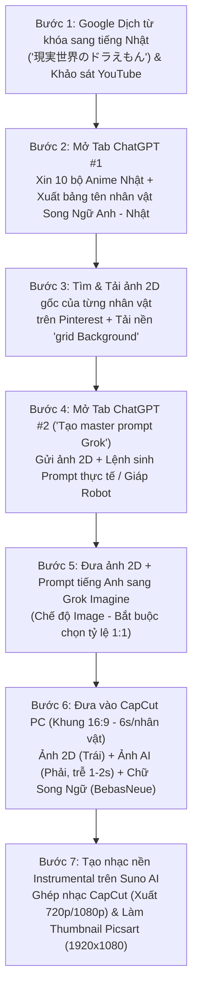

# BÀI 20 (`DGMD-M06` · `VIDEO-bfdec7`): QUY TRÌNH SẢN XUẤT VIDEO BIẾN ĐỔI NHÂN VẬT VIEW NHẬT (ANIME IN REAL LIFE / AI LIVE-ACTION)

> **Mã học phần:** `VIDEO-bfdec7` (Bài 20 — Thuộc Module 6: `DGMD-M06` — Đại Gia Mang Dép Academy)  
> **Thời lượng:** `25:53` (`1.553,20 giây` — `181 phân đoạn phụ đề sạch 100%`)  
> **Trạng thái kiểm định:** `GROUNDED_VERIFIED` (Đã đối soát 19 khung hình CUDA `frame_10.jpg` $\rightarrow$ `frame_1520.jpg`, phụ đề khớp lời giảng thực tế và kiểm tra sống `HTTP 200` các kênh đối thủ)  
> **Tệp đính kèm chuẩn hóa:** [`assets/docs-dgmd/VIDEO-bfdec7/master_prompt.md`](../../assets/docs-dgmd/VIDEO-bfdec7/master_prompt.md)

---

## 1. TỔNG QUAN CHIẾN LƯỢC & TẠI SAO NGÁCH "BIẾN ĐỔI NHÂN VẬT VIEW NHẬT" CẮN ĐỀ XUẤT BỀN BỈ?

Trong Bài 20 (`VIDEO-bfdec7`), giảng viên **Đại Gia Mang Dép** giải mã một ngách nội dung ngoại quốc cực kỳ tiềm năng dành cho người mới lẫn các đội nhóm sản xuất công nghiệp: **Biến đổi nhân vật hoạt hình Nhật Bản (Anime) sang phiên bản đời thực (Real Life / AI Live-Action / Robot / Samurai)** nhắm trực tiếp vào khán giả Nhật Bản (**View Nhật**).

### 1.1. Đặc điểm hành vi khán giả & thuật toán tại thị trường Nhật Bản (`00:00 – 01:03` & `19:30 – 25:53`)
- **Độ bền đề xuất cao & RPM ngoại quốc tốt:** Khác với các trào lưu ngắn hạn sớm nở tối tàn, các bộ Anime huyền thoại tại Nhật Bản (*Doraemon, Shin-chan, Pokémon, Conan, Dragon Ball, Chiikawa...*) gắn liền với tuổi thơ của hàng chục triệu khán giả ở mọi lứa tuổi. Khi một video đi đúng form so sánh **Ảnh 2D gốc (Bên trái) $\rightarrow$ Ảnh AI thực tế (Bên phải)**, luồng view tự nhiên từ Nhật Bản đổ về rất đều và giữ đề xuất cực lâu.
- **Chu kỳ cắn view thực tế (`19:30 – 20:05`):** Giảng viên nhấn mạnh nguyên tắc *"Dục tốc bất đạt"* — với ngách View Nhật, không nên làm ẩu ngày 10 video chất lượng thấp, mà chỉ cần làm chỉn chu khoảng **10 video chuẩn form**, đăng đều đặn và kiên nhẫn chờ **từ 5 đến 10 ngày (thậm chí 20 ngày)** để thuật toán YouTube bắt đầu đẩy mạnh luồng đề xuất tại Nhật.
- **Tận dụng linh hoạt tài nguyên kênh (`25:25 – 25:53`):** Học viên hoàn toàn có thể lấy **kênh YouTube Shorts Việt Nam sẵn có** để chuyển sang đăng dòng video ngang (`16:9`) làm View Nhật mà vẫn lên view bình thường, không bắt buộc phải lập kênh mới ngâm từ đầu.

### 1.2. Cách tìm kiếm ngách & Các kênh đối thủ thực tế trên màn hình bài giảng (`00:00 – 01:03`)
Để tìm đúng ngách như giảng viên thao tác trên màn hình (`frame_10.jpg`, `frame_30.jpg`, `frame_60.jpg`):
1. Mở **Google Dịch** (`Tiếng Việt -> Tiếng Nhật`), gõ cụm từ: **`Doraemon phiên bản thực tế`** $\rightarrow$ Nhận kết quả tiếng Nhật: **`現実世界のドラえもん`**.
2. Sao chép cụm từ **`現実世界のドラえもん`** dán thẳng vào thanh tìm kiếm YouTube (`https://www.youtube.com/results?search_query=現実世界のドラえもん`).
3. **Danh sách các kênh mẫu xuất hiện trực tiếp trong kết quả tìm kiếm của bài giảng (Đã xác thực trạng thái HTTP thực tế):**
   - **Kênh 1 — `AnimeAI` ([`@AnimeAI1616`](https://www.youtube.com/@AnimeAI1616) — `HTTP 200 LIVE`):** Xuất hiện ở đầu kết quả tìm kiếm (`frame_10.jpg`) với video *"what if doremon character in real life (もしドラえもんのキャラクターが現実世界にいたら) | AI live action"* thu hút hơn **123.000 lượt xem** chỉ sau 1 tháng.
   - **Kênh 2 — `Anime real` ([`@Animereal-y8o`](https://www.youtube.com/@Animereal-y8o) — `HTTP 200 LIVE`):** Xuất hiện ngay bên dưới (`frame_10.jpg`, URL góc dưới màn hình `watch?v=6SSol_B-hmw`) với video *"【ドラえもん】AIで実写化したら、未来の世界がザワついた件 | Doraemon Live Action Looks TOO REAL"* đạt **111.000 lượt xem** chỉ sau **6 ngày** đăng tải.
   - **Kênh 3 — `PAI CHANNEL` ([`@pai0212`](https://www.youtube.com/@pai0212) — `HTTP 200 LIVE`):** Xuất hiện khi cuộn xuống (`frame_30.jpg`) với video *"【Doraemon】ドラえもんのキャラクターをAIで実写化 | Doraemon Characters in Real Life AI Generated"* đạt **202.000 lượt xem** sau 3 tuần.
   - *(Ghi chú đối soát chuẩn Gate 5: Kênh thứ tư được giảng viên bấm vào xem trực tiếp ở `00:45 – 01:02` (`frame_60.jpg`) là kênh `AI Boost` với video 1,4 triệu view — handle cũ `@aiboost-y5n` hiện trả về `HTTP 404` trên YouTube nên được ghi chú lịch sử tại đây và không đưa vào mảng URL kích hoạt).*

---

## 2. HỆ SINH THÁI 7 CÔNG CỤ THỰC CHIẾN TRONG BÀI GIẢNG (`01:04 – 01:26`)

| STT | Tên công cụ | Địa chỉ truy cập | Vai trò chính xác trong dây chuyền sản xuất (Bài 20) |
| :---: | :--- | :--- | :--- |
| 1 | **Google Dịch** | [translate.google.com](https://translate.google.com) | Dịch từ khóa tìm kiếm ngách (`Doraemon phiên bản thực tế` $\rightarrow$ `現実世界のドラえもん`) và đối chiếu tên nhân vật tiếng Nhật. |
| 2 | **ChatGPT** | [chatgpt.com](https://chatgpt.com) | Chia làm **2 tab độc lập**: **Tab 1** tìm 10 bộ Anime Nhật, liệt kê nhân vật, xuất bảng tên nhân vật song ngữ Anh - Nhật và viết prompt nhạc Suno; **Tab 2** đóng vai *"Con tạo Master Prompt Grok"* tự động sinh prompt tiếng Anh từ ảnh 2D. |
| 3 | **Pinterest** | [pinterest.com](https://www.pinterest.com) | Kho tải ảnh 2D gốc chất lượng cao của từng nhân vật hoạt hình (`Doraemon`, `Nobita`, `Shizuka`, `Chaien`, `Xêkô`, `Dorami`...) và tải ảnh nền kẻ ô tối màu (`grid Background`). |
| 4 | **Grok Imagine** | [grok.com/imagine](https://grok.com/imagine) | Công cụ AI tạo ảnh chủ lực (chế độ **`Image`**): Tải ảnh gốc 2D lên kèm prompt tiếng Anh của ChatGPT để sinh ảnh nhân vật phiên bản thực tế / Robot ở tỷ lệ bắt buộc **`1:1`**. |
| 5 | **Suno AI** | [suno.com/create](https://suno.com/create) | Công cụ tạo nhạc nền AI: Chọn chế độ **`Simple`**, bật **`Instrumental`** (nhạc không lời), dán prompt từ ChatGPT để tạo bản nhạc nền hoạt hình Nhật Bản vui nhộn không dính bản quyền. |
| 6 | **CapCut PC** | [capcut.com](https://www.capcut.com) | Dựng khung ngang **`16:9`**: Đặt nền lưới tối, chia đôi màn hình đặt ảnh 2D (Trái) và ảnh AI thực tế (Phải) tỷ lệ `1:1` (6 giây/nhân vật), gắn hiệu ứng động Vào/Ra, chèn chữ song ngữ Anh - Nhật (font `BebasNeue`) và xuất file **`720p`/`1080p`**. |
| 7 | **Picsart** | [picsart.com/create/editor](https://picsart.com/create/editor) | Thiết kế Thumbnail kích thước chuẩn **`1920 x 1080`**: Ghép ảnh Doraemon 2D bên trái, ảnh Doraemon thực tế bên phải và chèn nhãn dán **mũi tên đỏ** ở giữa. |

---

## 3. QUY TRÌNH SẢN XUẤT CHI TIẾT TỪNG BƯỚC (STEP-BY-STEP SOP)



---

### BƯỚC 1: Dùng ChatGPT khai thác 10 bộ Anime Nhật Bản & Xuất bảng tên nhân vật Song Ngữ Anh - Nhật (`01:27 – 03:05`)

Nhiều học viên không xem hoạt hình Nhật Bản sẽ không biết ngoài Doraemon còn những bộ phim nào hay các nhân vật tên tiếng Nhật viết ra sao. Giảng viên hướng dẫn giải quyết triệt để trên **Tab ChatGPT #1 (`Gợi ý phim hoạt hình Nhật` — `frame_95.jpg`, `frame_140.jpg`, `frame_200.jpg`)**:

1. **Câu lệnh 1 — Mở rộng kho chủ đề Anime Nhật (`01:31`):**
   ```text
   cho tôi xin tên 10 bộ phim hoạt hình của Nhật Bản
   ```
   - **10 bộ Anime vàng được ChatGPT gợi ý trên màn hình (`frame_95.jpg`):**
     1. *Chiikawa* (Nhân vật dễ thương đang cực hot tại Nhật)
     2. *Doraemon* (Quốc dân, dễ nhận diện ở mọi độ tuổi)
     3. *Crayon Shin-chan* (Shin - Cậu bé bút chì)
     4. *Pokémon* (Hệ lượng nhân vật/Pokémon khổng lồ để làm hàng trăm video)
     5. *Demon Slayer: Kimetsu no Yaiba* (Thanh Gươm Diệt Quỷ — cực hợp làm实写/Live-action)
     6. *Sazae-san* (Biểu tượng gia đình truyền thống Nhật Bản)
     7. *Chibi Maruko-chan* (Nhóc Maruko)
     8. *Detective Conan* (Thám tử lừng danh Conan)
     9. *Dragon Ball* (7 Viên Ngọc Rồng)
     10. *Sailor Moon* (Thủy Thủ Mặt Trăng)

2. **Câu lệnh 2 — Liệt kê toàn bộ tuyến nhân vật trong bộ phim được chọn (`02:01`, `frame_140.jpg`):**
   ```text
   cho tôi xin các tên nhân vật trong doraemon
   ```
   - ChatGPT trả về danh sách 20 nhân vật từ chính đến phụ (*Doraemon, Nobita Nobi, Shizuka Minamoto, Takeshi Gouda / Gian, Suneo Honekawa, Dorami, Dekisugi Hidetoshi, Tamako Nobi, Nobisuke Nobi, Jaiko Gouda, Sewashi Nobi, Sensei...*).

3. **Câu lệnh 3 — Xuất bảng đối chiếu tên nhân vật Song Ngữ Tiếng Anh & Tiếng Nhật (`02:23`, `frame_200.jpg`):**
   ```text
   viết cho tôi các tên nhân vật doraemon , 1 bên là tiếng anh , 1 bên là tiếng nhật
   ```
   - **Mục đích thực chiến:** Khi dựng video cho người Nhật xem, nếu viết tên tiếng Việt kiểu *"Si-zu-ka"* hay *"Chai-en"* khán giả Nhật sẽ không hiểu. Bảng 2 cột (`English` | `日本語`) giúp học viên chỉ cần tô đen sao chép một lần cả dòng Tiếng Anh lẫn dòng chữ Nhật (`Kanji/Kana`) dán thẳng vào CapCut!

---

### BƯỚC 2: Tìm ảnh 2D gốc trên Pinterest & Thiết lập "Con tạo Master Prompt" trên ChatGPT (`03:06 – 07:09`)

1. **Tải ảnh gốc 2D của từng nhân vật trên Pinterest (`03:06 – 03:53`):**
   - Sao chép tên tiếng Anh từ bảng ChatGPT (ví dụ: `Doraemon`, `Nobita Nobi`, `Shizuka Minamoto`, `Goda Takeshi`, `Suneo Honekawa`, `Dorami`) dán vào thanh tìm kiếm **Pinterest (`pinterest.com`)**.
   - **Quy tắc thao tác kép bắt buộc (`06:55` & `10:15`):** Khi chọn được một bức ảnh 2D ưng ý trên Pinterest, bạn phải làm **đồng thời 2 việc**:
     1. **Tải ảnh đó về máy tính (`Tải ảnh xuống`)** để lát nữa đưa vào CapCut làm ảnh gốc bên trái.
     2. **Nhấn chuột phải chọn `Sao chép hình ảnh` (`Copy image`)** để dán ngay sang ChatGPT lấy prompt!

2. **Thiết lập "Con tạo Master Prompt" trên Tab ChatGPT #2 (`03:54 – 06:24`, `frame_280.jpg`, `frame_350.jpg`, `frame_380.jpg`):**
   - Mở một cuộc trò chuyện ChatGPT mới hoàn toàn (trên màn hình giảng viên có tiêu đề ***"Tạo master prompt Grok"***), dán bức ảnh 2D đầu tiên (Doraemon) vào ô chat và gõ chính xác câu lệnh khởi tạo sau:
     ```text
     hãy tạo cho tôi 1 master prompt , khi tôi gửi hình ảnh bất kỳ lên đây , bạn hãy tạo cho tôi 1 prompt chi tiết , để sử dụng hình ảnh đó trên grok tạo lại hình ảnh khác , bám sát toàn bộ hình ảnh gốc , biến đổi nhân vật sang phiên bản thực tế , yêu cầu prompt chi tiết đầy đủ ngắn gọn để tôi gửi ảnh đưa lên grok tạo video
     ```
   - **Cơ chế tự động hóa:** Ngay sau câu lệnh này, ChatGPT sẽ ghi nhớ quy tắc. Từ nhân vật số 2 trở đi (`Nobita`, `Shizuka`, `Chaien`, `Xêkô`...), bạn **không cần gõ bất kỳ chữ nào nữa** — chỉ cần dán (`Ctrl + V`) bức ảnh 2D vào ô chat và nhấn gửi, ChatGPT sẽ tự động phân tích tư thế, màu áo, biểu cảm, bối cảnh của bức ảnh đó và xuất ra đoạn **`PROMPT GROK – ẢNH HIỆN TẠI`** bằng tiếng Anh (`frame_440.jpg`)!

---

### BƯỚC 3: Tư duy biến tấu khác biệt & Tạo ảnh AI tỷ lệ `1:1` trên Grok Imagine (`07:10 – 13:04`)

1. **Thao tác tạo ảnh trên Grok Imagine (`07:10 – 08:10`, `frame_440.jpg`):**
   - Truy cập **`https://grok.com/imagine`**, chuyển thanh công cụ bên dưới sang chế độ **`Image`** (Tạo hình ảnh).
   - Tải bức ảnh 2D gốc của nhân vật lên làm ảnh tham chiếu, sau đó dán đoạn prompt tiếng Anh vừa copy từ ChatGPT vào.
   - **QUY TẮC SỐNG CÒN (`07:20`):** Tại mục chọn kích thước khung hình, **BẮT BUỘC phải chọn tỷ lệ `1:1` (Vuông)** — tuyệt đối không chọn `9:16` hay `16:9`. Lý do: Khi dựng video so sánh 2 ảnh đặt cạnh nhau trên khung ngang `16:9` của CapCut, hai khung ảnh vuông `1:1` đặt ở nửa trái và nửa phải sẽ vừa khít và cân đối tuyệt đối!

2. **Tư duy biến tấu để vượt đối thủ & Kích thích tranh luận (`04:35 – 05:30` & `08:11 – 12:15`, `frame_500.jpg`, `frame_650.jpg`):**
   - Giảng viên phân tích: Nếu tất cả các kênh đều chỉ làm *"phiên bản thực tế thông thường"*, kênh đi sau phải biết đặt vấn đề sáng tạo trên cùng một nền tảng nhân vật gốc:
     - **Biến tấu 1 — Trang bị Giáp Robot Cơ Khí / Giáp Vàng / Giáp Samurai (`08:11`, `frame_500.jpg`):** Nhập lệnh bổ sung vào ChatGPT:
       ```text
       các nhân vật sau , khi tôi gửi lên , tạo 1 prompt biến đổi các nhân vật đó sang phiên bản thực tế , trang bị quần áo như robot
       ```
       Khi gửi lại ảnh Doraemon, Nobita, Shizuka, Chaien, Xêkô, Grok Imagine lập tức tạo ra các phiên bản người thật khoác bộ giáp cơ khí cực ngầu nhưng vẫn giữ nguyên gương mặt và tư thế gốc!
     - **Biến tấu 2 — Phiên bản Đáng Yêu (Cute 3D) cho trẻ em (`08:35`).**
     - **Biến tấu 3 — Chiêu "Cài cắm gây tranh cãi" (Controversy Bait — `11:30`, `frame_650.jpg`):** Khi tạo ảnh cho nhân vật nam như **Nobita**, nếu AI tình cờ tạo ra một phiên bản... **con gái đeo kính mặc áo vàng giống hệt Nobita**, **hãy lấy luôn bức ảnh đó đưa vào video!** Khán giả Nhật khi xem đến đoạn Nobita biến thành nữ sẽ ồ ạt bình luận thắc mắc, chỉ trích hoặc cười đùa bên dưới — chính luồng bình luận tranh cãi đó sẽ đẩy chỉ số tương tác khiến thuật toán YouTube đề xuất video mạnh gấp bội!

---

### BƯỚC 4: Kỹ thuật dựng khung so sánh Trái/Phải & Nhân bản tốc độ cao trên CapCut PC (`13:05 – 21:14`)

1. **Thiết lập nền lưới tối (`grid Background`) trên khung `16:9` (`13:10 – 14:25`, `frame_820.jpg`):**
   - Lên Pinterest gõ từ khóa **`grid Background`**, tải một tấm hình nền kẻ ô tối màu về máy.
   - Mở **CapCut PC**, tạo dự án tỷ lệ **`16:9`**. Nếu ảnh nền tải về có chiều dọc `9:16`, kéo vào Track nền dưới cùng, xoay góc **`90 độ`** và kéo phóng to phủ kín khung `16:9` (kéo dài nền ra hết thời lượng video).

2. **Chuẩn hóa khung `1:1` & Căn vị trí Trái/Phải cho Nhân vật số 1 (`14:26 – 17:10`, `frame_1000.jpg`):**
   - **Xử lý ảnh gốc 2D chưa vuông (`14:30`):** Kéo ảnh Doraemon 2D gốc xuống Track 1 (trên lớp nền). Nhấn vào công cụ **Cắt (`Crop`)** trên thanh timeline CapCut $\rightarrow$ Chọn tỷ lệ **`1:1`** $\rightarrow$ Nhấn **Xác nhận**. Việc cắt `1:1` ngay từ nhân vật đầu tiên đảm bảo lát nữa khi Copy-Paste sang các nhân vật sau, mọi bức ảnh thay thế vào đều tự động đóng khung vuông `1:1`!
   - **Chia đôi màn hình cân đối (`14:55`, `frame_1000.jpg`):**
     - **Ảnh 2D gốc (Track dưới):** Thu phóng (`Scale`) về khoảng **`86%`**, kéo sang nửa bên trái màn hình (Tọa độ `X = -934`, `Y = 0`), kéo thời lượng chuẩn **`6 giây`** (`00:00` $\rightarrow$ `00:06`).
     - **Ảnh AI biến đổi (Track trên):** Đặt nằm đè phía trên nhưng **kéo lùi điểm bắt đầu trễ hơn 1 đến 2 giây** (bắt đầu xuất hiện tại giây thứ `00:01` hoặc `00:02` và kết thúc cùng lúc ở giây thứ `00:06`), thu phóng **`86%`**, đặt ở nửa bên phải màn hình (`X = 934`, `Y = 0`).
   - **Gắn Hiệu ứng động (`Animation` — `15:30 – 17:10`):**
     - Chọn từng ảnh $\rightarrow$ Vào tab **Hiệu ứng động**:
       - **Tab Vào (`In`):** Chọn hiệu ứng **`Rõ dần`**, **`Phóng to`** hoặc **`Lau màn hình`**, kéo thanh thời lượng hiệu ứng lên **`1 giây – 2 giây`**.
       - **Tab Ra (`Out`):** Chọn hiệu ứng **`Mờ dần` (`Fade Out`)**, đặt thời lượng **`1 giây`** cho cả hai ảnh để khi kết thúc 6 giây, cặp ảnh nhân vật cũ mờ đi mượt mà trước khi nhân vật mới xuất hiện.

3. **Tuyệt chiêu "Tư duy Copy-Paste" nhân bản toàn bộ video trong 2 phút (`17:11 – 17:58`):**
   - Sau khi đã căn chỉnh hoàn hảo tọa độ Trái/Phải, tỷ lệ `1:1` và hiệu ứng Vào/Ra cho cặp ảnh Doraemon đầu tiên (6 giây), **bôi đen cả 2 track ảnh đó $\rightarrow$ Nhấn `Ctrl + C` và `Ctrl + V` liên tiếp** dọc theo thanh timeline cho đủ số lượng nhân vật (`Shizuka`, `Nobita`, `Chaien`, `Xêkô`, `Dorami`...).
   - Tiếp theo, từ kho phương tiện (`Media`) góc trái trên, bạn chỉ việc **kéo trực tiếp ảnh 2D mới đè lên track dưới và ảnh AI mới đè lên track trên** của từng cụm 6 giây — CapCut sẽ tự động thay thế hình ảnh mà giữ nguyên 100% kích thước `1:1`, vị trí Trái/Phải và hiệu ứng động!

4. **Chèn chữ tên nhân vật Song Ngữ Anh - Nhật & Nhãn dán tương tác (`17:59 – 21:14`, `frame_1180.jpg`):**
   - Vào mục **Văn bản (`Text`)** $\rightarrow$ Kéo **Văn bản mặc định** đặt lên Track cao nhất khớp với phân đoạn 6 giây của nhân vật đầu tiên.
   - Quay lại bảng 2 cột trên ChatGPT (`frame_1290.jpg`), sao chép tên nhân vật dán thành **2 dòng** nằm chính giữa phía trên hoặc giữa hai khung ảnh (`frame_1180.jpg`):
     - Dòng 1 (Tiếng Anh): `Doraemon` (hoặc `Shizuka Minamoto`)
     - Dòng 2 (Tiếng Nhật): `ドラえもん` (hoặc `源 静香`)
   - Chọn phông chữ rõ nét, hiện đại (trên màn hình giảng viên chọn font **`BebasNeue`**, cỡ chữ **`15`**), gắn **Hiệu ứng động Vào (`2 giây`)** và **Ra (`1 giây`)**, sau đó Copy-Paste lớp chữ này sang các phân đoạn tiếp theo và thay tên nhân vật tương ứng.
   - Vào mục **Nhãn dán (`Stickers`)** (`20:15`): Cứ cách khoảng **4 – 5 nhân vật** lại chèn một nhãn dán động kêu gọi **`Like` / `Subscribe` / `Chia sẻ`** kèm hiệu ứng vào `2 giây`.

---

### BƯỚC 5: Tạo nhạc nền không lời trên Suno AI, Xuất video `720p`/`1080p` & Thiết kế Thumbnail trên Picsart (`21:15 – 25:53`)

1. **Tạo nhạc nền không lời chuẩn mood Anime trên Suno AI (`21:15 – 22:50`, `frame_1290.jpg` & `frame_1340.jpg`):**
   - Tại ô chat của ChatGPT, gõ câu lệnh:
     ```text
     dựa theo những hình ảnh trên , bạn hãy tạo cho tôi 1 prompt để tạo nhạc nền không lời trên suno , ngắn gọn
     ```
   - Sao chép đoạn prompt tiếng Anh do ChatGPT sinh ra (`frame_1340.jpg`):
     ```text
     Cute Japanese anime instrumental, playful, cheerful, warm, light piano, ukulele, soft bells, gentle strings, whimsical adventure, nostalgic childhood mood, no vocals
     ```
   - Mở **`https://suno.com/create`**, chọn tab **`Simple`**, bật công tắc **`Instrumental`** (Nhạc không lời), dán prompt vào ô mô tả và nhấn **`Create`**. Tải 2 bản nhạc MP3 tạo ra (trên màn hình là bản *Paper Crane Parade*) đưa vào CapCut làm nhạc nền xuyên suốt video.

2. **Quy tắc xuất file (`Export`) trên CapCut PC (`22:54 – 23:24`):**
   - Nhấn nút **Xuất (`Export`)**: Giảng viên dặn kỹ **BẮT BUỘC chỉ chọn độ phân giải `720p` hoặc `1080p`** — tuyệt đối **không xuất `2K` hay `4K`** vì đây là video ghép từ ảnh tĩnh biến đổi, xuất `1080p` vừa nhẹ máy, render cực nhanh mà chất lượng hiển thị trên YouTube đã hoàn toàn sắc nét.

3. **Thiết kế Thumbnail tối giản tỷ lệ click (CTR) cao trên Picsart (`23:25 – 25:53`, `frame_1450.jpg` & `frame_1520.jpg`):**
   - Truy cập **`https://picsart.com/create/editor`**, vào phần **Size (`Kích cỡ`)** chọn đúng chuẩn Thumbnail YouTube: **`1920 x 1080`**.
   - Nhấn **`Upload`** tải 2 bức ảnh ấn tượng nhất lên (trong bài giảng là **Ảnh Doraemon 2D gốc** và **Ảnh Doraemon AI phiên bản thực tế**):
     - Kéo ảnh **Doraemon 2D gốc** đặt chiếm nửa bên trái khung hình.
     - Kéo ảnh **Doraemon AI thực tế** đặt chiếm nửa bên phải khung hình, căn kích thước hai nhân vật cân xứng nhau.
   - Vào mục **Nhãn dán (`Stickers`)**, tìm từ khóa **`mũi tên đỏ`** (`24:35`, `frame_1450.jpg`), chọn một mũi tên đỏ nổi bật đặt ở chính giữa chỉ hướng từ nhân vật 2D sang nhân vật thực tế rồi nhấn tải ảnh Thumbnail về máy!

---

## 4. BẢNG KIỂM ĐỊNH CHẤT LƯỢNG TRƯỚC KHI XUẤT BẢN (PRE-PUBLISH CHECKLIST)

- [ ] **Từ khóa & Tiêu đề:** Đã dùng Google Dịch kiểm tra từ khóa tiếng Nhật chuẩn (`現実世界のドラえもん` / `AI実写化`) để đặt tiêu đề song ngữ Nhật - Anh chuẩn SEO?
- [ ] **Tỷ lệ khung ảnh `1:1`:** Cả ảnh 2D gốc (đã Crop `1:1` trong CapCut) và ảnh AI tạo từ Grok Imagine đều đạt chuẩn vuông `1:1`, đặt cân đối hai bên Trái (`X = -934`) và Phải (`X = 934`) trên nền `grid Background` `16:9`?
- [ ] **Nhịp độ & Hiệu ứng:** Mỗi nhân vật kéo dài `5–6 giây`, ảnh AI bên phải xuất hiện trễ hơn ảnh gốc `1–2 giây`, có đầy đủ hiệu ứng động Vào (`1–2s`) và Mờ dần Ra (`1s`)?
- [ ] **Chữ tên nhân vật Song Ngữ:** Đã dán đúng cặp tên Tiếng Anh (Dòng 1) + Tiếng Nhật Kanji/Kana (Dòng 2) lấy từ bảng ChatGPT (tuyệt đối không viết phiên âm tiếng Việt)?
- [ ] **Yếu tố giữ chân & Kích thích bình luận:** Đã biến tấu trang phục (Robot / Samurai / Giáp vàng) hoặc cài cắm 1 nhân vật biến đổi gây bất ngờ (như Nobita phiên bản nữ) để kéo bình luận tự nhiên?
- [ ] **Độ phân giải & Thumbnail:** Video xuất ở chuẩn `720p` hoặc `1080p` (kèm nhạc nền không lời từ Suno AI) và Thumbnail `1920x1080` trên Picsart có bố cục Trước/Sau + Mũi tên đỏ rõ ràng?
