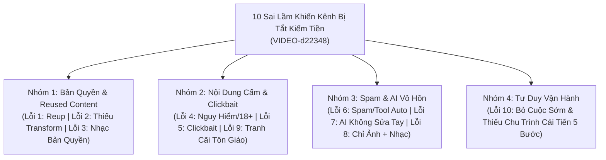

# 10 Sai Lầm Khiến YouTube Từ Chối Hoặc Tắt Kiếm Tiền

> **Mã bài học:** `VIDEO-d22348` | **Module:** `DGMD-M10` (Bài 40 — Bài tổng kết Module 10) — *Chiến Lược Tăng Trưởng & Thuật Toán Đề Xuất*
> **Thời lượng:** `13:26` (`806.53s` — `84 segments`) | **Phân nhóm:** `chuyen_gia` (*Quản Trị AdSense & Hạ Tầng Kênh*)
> **Tài liệu thực hành đính kèm:** [`assets/docs-dgmd/VIDEO-d22348/master_prompt.md`](../../assets/docs-dgmd/VIDEO-d22348/master_prompt.md)

---

## 1. Tổng Quan Bài Học: Hệ Thống 10 "Cửa Tử" Chính Sách Kiếm Tiền YouTube

Trong **Bài 40 (`VIDEO-d22348`)**, giảng viên hệ thống hóa **10 sai lầm phổ biến nhất** khiến các kênh YouTube tại Việt Nam và quốc tế bị từ chối đơn đăng ký bật kiếm tiền (`YouTube Partner Program - YPP`) hoặc bị tước quyền kiếm tiền đột ngột sau khi đã bật.

Toàn bộ bài giảng được trình bày qua **10 bảng Infographic trực quan (`#DGMDMEDIA`)**, chia 10 lỗi vi phạm thành 4 cụm rủi ro chính:
1. **Cụm Bản quyền & Tái sử dụng nội dung (Lỗi 1, 2, 3):** Reup nguyên bản, hiểu sai nguyên tắc chuyển đổi `Fair Use`, và vi phạm bản quyền âm nhạc `Content ID`.
2. **Cụm Nội dung Nhạy cảm, Tranh cãi & Lừa dối khán giả (Lỗi 4, 5, 9):** Chủ đề bạo lực/18+/trẻ em/chiến tranh bịa đặt, giật tít `Clickbait` sai sự thật, và kích động tranh cãi tôn giáo/chính trị.
3. **Cụm Lạm dụng Thuật toán & Sản xuất Công nghiệp Vô hồn (Lỗi 6, 7, 8):** Spam số lượng lớn, lặp lại công thức (`Repetitive Content`), lạm dụng `AI Content` tự động 100% không qua biên tập tay, và thiếu giọng nói/cảm xúc con người.
4. **Cụm Tư duy Vận hành (Lỗi 10):** Thiếu kiên trì và không thực thi vòng lặp phân tích – cải tiến.

---

## 2. Phân Giải Chi Tiết 10 Lỗi Tắt Kiếm Tiền Theo Mốc Thời Gian Thực Tế

### 2.1. Lỗi 1: Reup / Sao Chép Nội Dung (`00:00 – 01:15`)
- **Dữ liệu trực quan trên slide (`MỤC 1 - LỖI 1: REUP / SAO CHÉP NỘI DUNG`):**
  - `Copy video = KHÔNG KIẾM TIỀN`: *Reup video người khác*, *Lấy TikTok / Facebook đăng lại*, *Không chỉnh sửa nội dung*.
  - Cảnh báo đỏ từ hệ thống YouTube: `Reused content — This content in other videos without your permission -> Not suitable for most advertisers`.
- **Phân tích của giảng viên:** Nhiều người tải nguyên video từ `Facebook`, `TikTok` hoặc kênh `YouTube` khác về đăng thẳng lên kênh mà không chỉnh sửa. Nếu muốn sử dụng lại tư liệu của người khác theo luật **Fair Use** của YouTube, bắt buộc phải biên tập làm mới hoàn toàn: cắt nhỏ từng phân đoạn tầm **4–5 giây**, kết hợp kể lại một câu chuyện mới (`Storytelling`) và đưa lời bình phẩm độc lập vào.

---

### 2.2. Lỗi 2: Không Đủ "Transform" — Vi Phạm Fair Use (`01:16 – 02:22`)
- **Dữ liệu trực quan trên slide (`MỤC 2 - LỖI 2: KHÔNG ĐỦ "TRANSFORM"`):**
  - Ngộ nhận phổ biến: **`"Cắt nhỏ video + thêm nhạc = hợp lệ" -> SAI`**.
  - Thông báo từ chối kiếm tiền: *`Video không đủ tính chuyển đổi — Không đủ điều kiện để kiếm tiền. Nội dung của bạn không đáp ứng chính sách sử dụng hợp lý của YouTube`*.
  - **4 yếu tố bắt buộc phải có (`PHẢI CÓ`):** `1. Bình luận (Commentary)` + `2. Phân tích` + `3. Biến đổi nội dung rõ ràng` + `4. Giá trị mới`.
- **Phân tích của giảng viên:** Rất nhiều học viên làm bán content chỉ cắt video ra từng đoạn 4–5 giây rồi ghép một bản nhạc tạo bằng AI **Suno** hoặc lấy nhạc trong **YouTube Studio** đè lên và tưởng thế là qua mặt được thuật toán. Cách đó chắc chắn bị tắt kiếm tiền nếu thiếu lời bình luận, phân tích và giá trị nội dung mới. Trong khóa học này, học viên được hướng dẫn làm **Content mới hoàn toàn** (chỉ mượn ý tưởng của kênh khác để tự sản xuất video mới) nên triệt tiêu tận gốc rủi ro Lỗi 1 & Lỗi 2.

---

### 2.3. Lỗi 3: Dùng Nhạc Bản Quyền (`02:23 – 04:18`)
- **Dữ liệu trực quan trên slide (`MỤC 3 - LỖI 3: DÙNG NHẠC BẢN QUYỀN`):**
  - **3 nhóm nhạc dễ dính bản quyền:**
    1. Nhạc nổi tiếng (`TikTok`, `Spotify`, `Zing MP3`,...).
    2. Nhạc phim, nhạc show, chương trình truyền hình.
    3. Nhạc viral, remix, cover không có bản quyền.
  - **Hậu quả nhận về:**
    - **Bị Content ID:** `Doanh thu = 0` (toàn bộ tiền quảng cáo chảy về chủ sở hữu bài hát).
    - **Video bị chặn (`Visibility: Blocked`):** Không cho xem hoặc bị chặn ở nhiều quốc gia.
    - **Mất doanh thu / Ăn gậy bản quyền.**
  - **3 Giải pháp an toàn trên slide:**
    1. Dùng nhạc miễn phí (`YouTube Audio Library`).
    2. Mua nhạc bản quyền (`Artlist`, `Epidemic Sound`,...).
    3. Tự sáng tạo nhạc / thu âm (sử dụng AI tạo nhạc trong khóa học).
- **Ví dụ thực chiến từ giảng viên:** Chỉ cần cắt **5–10 giây** nhạc thương mại ghép vào video dài hoặc Shorts là bị báo bản quyền ngay lập tức — điển hình như ca khúc **Bắc Bling** của **Hòa Minzy** (`@HoaMinzyOfficial`), chỉ cần đăng lên là hệ thống chặn quốc gia ngay lập tức. Đặc biệt lưu ý: **Khi đăng YouTube Shorts bằng máy tính**, tuyệt đối không tự chèn nhạc bản quyền vào file video (chỉ được chèn hiệu ứng âm thanh `Sound Effects`).

---

### 2.4. Lỗi 4: Nội Dung Nguy Hiểm / Nhạy Cảm (`04:19 – 05:28`)
- **Các nhóm chủ đề bị giới hạn hoặc tắt kiếm tiền:**
  - Cảnh bạo lực đánh nhau, tai nạn giao thông máu me.
  - Nội dung `18+`, ăn mặc hở hang phản cảm.
  - Vũ khí, tội phạm, và các vi phạm liên quan đến **an toàn trẻ em** (yếu tố bị YouTube quét cực gắt).
  - **Tin tức nhạy cảm về chiến tranh / khủng bố:** Giảng viên lấy ví dụ thực tế đợt xung đột **Mỹ và Iran**, nhiều kênh Việt Nam làm tin tức kiểu *"nhét chữ vào mồm"* lãnh đạo Mỹ và Iran (*"Mỹ tuyên bố thế này, Iran tuyên bố thế kia"* hoàn toàn bịa đặt). Giải pháp duy nhất là chỉ chọn các chủ đề xanh, an toàn tuyệt đối.

---

### 2.5. Lỗi 5: Clickbait / Gây Hiểu Lầm (`05:29 – 06:24`)
- **Dữ liệu trực quan trên slide (`MỤC 5 - LỖI 5: CLICKBAIT / GÂY HIỂU LẦM`):**
  - **Các lỗi thường gặp:** Tiêu đề giật tít gây sốc; `Thumbnail` sai sự thật (ví dụ trên slide: Thumbnail giật tít **`"SỐC! YOUTUBE TRẢ 1000$/NGÀY"`** hoặc giảng viên nêu ví dụ trong video là cảnh cô gái bình thường nhưng ngoài `Thumbnail` lại cắt ghép cảnh cô gái hở hang để kích thích cánh đàn ông bấm vào); Nội dung bên trong không đúng như tiêu đề.
  - **4 Hậu quả trực tiếp trên biểu đồ:** `1. Giảm tỷ lệ nhấp (CTR)` -> `2. Tăng tỷ lệ thoát (Bounce Rate)` -> `3. Giảm thời gian xem (Watch Time)` -> `4. Giảm hoặc mất doanh thu`.
  - **Nguyên tắc vàng:** *"Nói đúng những gì bạn làm – làm đúng những gì bạn nói. TRUNG THỰC = PHÁT TRIỂN BỀN VỮNG"*.

---

### 2.6. Lỗi 6: Spam / Lạm Dụng Thuật Toán (`06:25 – 09:10`)
- **Dữ liệu trực quan trên slide (`MỤC 6 - LỖI 6: SPAM / LẠM DỤNG THUẬT TOÁN`):**

| 5 Hành vi Spam phổ biến khiến kênh sập đề xuất | 5 Dấu hiệu kênh đang bị đánh giá thấp | 5 Giải pháp khắc phục chuẩn chỉnh |
| :--- | :--- | :--- |
| **1. Up quá nhiều video trong thời gian ngắn:** Ví dụ đăng **20 video dài 1 tiếng/ngày** trên cùng 1 kênh. | Video ít được đề xuất trên trang chủ. | Đăng video đều đặn, ưu tiên chất lượng. |
| **2. Nội dung lặp lại, na ná nhau (`Repetitive Content`):** Học một công thức viral rồi nhân bản vô tội vạ (ví dụ: *hôm nay đứa trẻ cầm cây kẹo đi học, ngày mai cầm cây bút đi học, ngày kia cầm quyển sách đi học*). | View giảm sâu dù nội dung không đổi. | Xây dựng nội dung đa dạng, sáng tạo. |
| **3. Dùng hashtag không liên quan, nhồi nhét quá nhiều:** Spam `#viral #viral #youtube #foryou`, hoặc làm video bóng đá nhưng nhét thẻ `#ASMR`. | Tỷ lệ click (`CTR`) thấp bất thường. | Chỉ dùng thẻ hashtag liên quan, đúng chủ đề. |
| **4. Spam bình luận, spam link:** Gắn hàng loạt bình luận chứa link dẫn người xem sang nền tảng khác. | Video không còn xuất hiện trên tab tìm kiếm (`YouTube Search`). | Tương tác thật, văn minh với khán giả. |
| **5. Sử dụng tool, phần mềm auto:** Dùng tool auto tăng view, tăng sub hoặc tool tự động ghép rồi tự đăng video hàng loạt (chỉ được phép dùng tool cắt chỉnh sửa hoặc tool hỗ trợ phát livestream hợp lệ). | Nhận cảnh báo vi phạm chính sách Spam từ YouTube. | **Nói không tuyệt đối với tool, phần mềm auto tăng view/sub.** |

---

### 2.7. Lỗi 7 & Lỗi 8: AI Content Không Chỉnh Sửa & Nội Dung "Vô Hồn" Thiếu Giá Trị Con Người (`09:11 – 11:25`)
- **Lỗi 7 — AI Content nhưng không chỉnh sửa (`09:11 – 10:21`):**
  - Giảng viên khẳng định: **Làm nội dung AI KHÔNG bị cấm kiếm tiền**, nhưng nếu giao phó 100% cho máy móc mà không có thao tác bằng tay của con người thì chắc chắn bị đánh trượt.
  - **Cách làm SAI (`Chết kênh`):** `AI viết kịch bản + AI đọc text + AI tạo ảnh + AI ghép video tự động` (nội dung rập khuôn, không có dấu hiệu con người biên tập).
  - **Cách làm ĐÚNG:** Dùng AI hỗ trợ viết nháp kịch bản và tạo tư liệu, sau đó **con người trực tiếp chỉnh sửa bằng tay**, thêm ý tưởng, thêm lời bình luận, lồng góc nhìn cá nhân và dựng khớp từng phân đoạn.
- **Lỗi 8 — Không có giọng nói / Giá trị con người (`10:21 – 11:25`, Slide `MỤC 8`):**
  - **Dấu hiệu nhận biết (`NỘI DUNG "VÔ HỒN"`):**
    - Video chỉ có **1 tấm ảnh tĩnh + nhạc nền** kéo dài hàng giờ đồng hồ (kiểu video cày RPM thời kỳ cũ, nay đã bị quét sạch).
    - Hoặc làm `Storytelling` / `Podcast` nhưng thả nguyên cục giọng đọc **ElevenLabs** khô khan, không dẫn dắt, không cảm xúc, không có dấu ấn biên tập của con người -> `Retention thấp - Không được đề xuất`.
  - **Giải pháp 5 bước trên slide `MỤC 8`:** `1. Thêm giọng nói (Voice over / Giọng thật)` -> `2. Xây dựng kịch bản có dẫn dắt, câu chuyện` -> `3. Thêm giá trị cá nhân: quan điểm, trải nghiệm` -> `4. Tạo cảm xúc: kể chuyện, ví dụ thực tế` -> `5. Tăng thời gian xem (Retention)`.

---

### 2.8. Lỗi 9 & Lỗi 10: Nội Dung Nhạy Cảm Gây Tranh Cãi & Thiếu Kiên Trì Cải Tiến (`11:26 – 13:26`)
- **Lỗi 9 — Nội dung nhạy cảm / Gây tranh cãi (`11:26 – 12:31`, Slide `MỤC 9`):**
  - **6 nhóm chủ đề rủi ro cao trên slide:** `1. Chính trị nhạy cảm`, `2. Tôn giáo gây tranh cãi` (ví dụ: đụng chạm, so sánh kích động cãi vã giữa **Tin Lành**, **Công Giáo** và các đạo khác), `3. Bạo lực, máu me, kinh dị`, `4. Chất cấm, ma túy`, `5. Nội dung 18+ người lớn`, `6. Tin giả, thông tin sai lệch`.
  - **Hậu quả:** Bị hạn chế hiển thị, không được bật kiếm tiền, mất lượt xem, thậm chí bị xóa video hoặc khóa kênh.
  - **Cổng tra cứu chính sách chính thức trên slide:** `https://www.youtube.com/howyoutubeworks/policies/`.
- **Lỗi 10 — Thiếu kiên trì, học hỏi và cải tiến (`12:31 – 13:26`):**
  - **Những việc nên tránh:** Nản chí bỏ cuộc sớm, sao chép nội dung người khác, chạy theo lượt view ảo, sản xuất nội dung kém chất lượng lặp đi lặp lại mỗi ngày mà ngừng học hỏi.
  - **Quy trình cải tiến nội dung 5 bước khép kín:**
    $$\text{Ý tưởng} \longrightarrow \text{Sản xuất} \longrightarrow \text{Đăng tải} \longrightarrow \text{Phân tích số liệu} \longrightarrow \text{Cải tiến}$$

---

## 3. Các Cờ Đỏ Cần Tránh Tuyệt Đối (Avoid Flags)

- **Không đăng ồ ạt 20 video dài/ngày hoặc nhân bản 1 kịch bản đổi đạo cụ:** Hành vi lặp lại công thức (*hôm nay cầm kẹo, mai cầm bút, ngày kia cầm sách*) bị thuật toán đánh thẳng vào lỗi hành vi `Repetitive Content`.
- **Không dùng dù chỉ 5–10 giây nhạc bản quyền thương mại:** Tuyệt đối không lấy nhạc hot từ `TikTok`, `Spotify`, `Zing MP3` hay các bài hit như *Bắc Bling* của Hòa Minzy đưa vào video; khi đăng Shorts bằng máy tính không chèn nhạc bản quyền.
- **Không dùng tool auto ghép video & auto đăng tải:** Mọi sản phẩm ứng dụng AI đều phải qua bàn tay con người biên tập, cắt dựng khớp cảnh và lồng ghép giá trị bình luận/cảm xúc thực.
