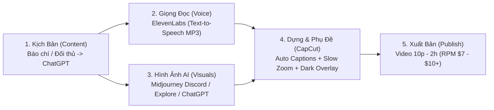

# Bài 15: Cách Để Đánh Giá 1 Chủ Đề Có Thể Làm Và Có Tiềm Năng Kiếm Tiền Không (`VIDEO-f72ddb`)

> **Thuộc Chương 1 — Chọn Chủ Đề & Ngách Tiềm Năng (Huân Academy)**  
> **Thời lượng:** `30:59` (`1859.25s`) | **Phân loại:** Thực chiến Đánh giá Chủ đề + 3 Quy trình Dựng Video AI (Stoic, Buddha Story, Story of Jesus)

---

## 1. Mục tiêu & Trọng tâm Bài giảng

Bài 15 kết hợp giữa **Bộ tiêu chí định lượng đánh giá một chủ đề có ra tiền ngay hay không** (trích xuất trực tiếp từ Tab 6 `CÁC CHỦ ĐỀ RA TIỀN LUÔN` và Tab 2 `TIÊU CHÍ CHỦ ĐỀ`) với màn **mổ xẻ trực tiếp Tab 8 (`8. Chủ Đề Nước Ngoài`)** kèm theo **3 video hướng dẫn dựng (Edit SOP) từng bước trên màn hình**.

Mục tiêu cốt lõi của bài học:
1. Giúp học viên **nhìn bằng con số thực tế** khi đánh giá bất kỳ ngách nào (cả Việt Nam lẫn Global): Kênh top đầu bao nhiêu view/tháng, kênh mới lập 1–3 tháng lên được bao nhiêu view, và bản thân 1 người có tự làm được kịch bản + hình ảnh + dựng video hay không.
2. **Xóa bỏ hoàn toàn nỗi sợ làm nội dung tiếng Anh và nỗi sợ công nghệ AI**: Giảng viên mở trực tiếp 3 quy trình sản xuất nội bộ (Stoic Philosophy, Gautam Buddha Story, Story of Jesus) để chứng minh toàn bộ video triệu view ở nước ngoài chỉ xoay quanh tổ hợp **ChatGPT + Midjourney + ElevenLabs + CapCut**.
3. Chỉ rõ **lợi thế cạnh tranh tuyệt đối của người làm YouTube tại Việt Nam** khi đánh thị trường nước ngoài: Lấy năng suất và số lượng (30–150 video/tháng nhờ chi phí nhân sự rẻ và AI) để chiến thắng các kênh phương Tây chỉ ra được 7 video/tháng.

---

## 2. Bảng Tiêu Chí Định Lượng Đánh Giá Chủ Đề Cho 1 Người Làm (Tab 6 & Tab 2)

Trên màn hình bài giảng (`00:45`), giảng viên mở trực tiếp bảng tính **Chọn Chủ Đề 1 Người Làm** với các ngưỡng kiểm chứng bắt buộc trước khi quyết định xuống tay làm kênh:

| Hạng mục Đánh giá | Ngưỡng Chuẩn Thị Trường Việt Nam | Ngưỡng Chuẩn Thị Trường Nước Ngoài (Global) | Công cụ & Nguồn Kiểm Chứng |
| :--- | :--- | :--- | :--- |
| **1. Lượt view hàng tháng của Kênh Top đầu** | $\ge 3.000.000\text{ view/tháng}$ ($\sim 200.000\text{ view/48h}$) | $\ge 5.000.000\text{ view/tháng}$ ($\sim 700.000\text{ view/48h}$) | `socialblade.com`, `1of10.com`, vidIQ |
| **2. Lượt view hàng tháng của Kênh Mới (1–3 tháng)** | $\ge 1.000.000\text{ view/tháng}$ ($\sim 33.000\text{–}200.000\text{ view/48h}$) và đang có xu hướng tăng trưởng mạnh | $\ge 3.000.000\text{ view/tháng}$ ($\sim 200.000\text{ view/48h}$) và đang có xu hướng tăng trưởng mạnh | Lọc kênh mới tạo qua `1of10.com` & Biểu mẫu `Dream 100` |
| **3. Lượt view Video đơn lẻ sau 1 năm** | Đạt trên $2.000.000\text{ view}$ | Đạt trên $5.000.000\text{ view}$ | Tab *Phổ biến (Popular)* trên kênh đối thủ |
| **4. Lượt view Video đơn lẻ sau 1–3 tháng** | Có video đạt trên $500.000\text{ view}$ | Có video đạt trên $1.000.000\text{ view}$ | Biểu mẫu `Dream 100 VIDEO 3 tháng gần nhất` |
| **5. Nguồn lực tự làm 1 mình (Khả thi sản xuất)** | Tự làm được **Content** (1. Tổng hợp từ báo/nguồn tương tự; 2. Dùng **ChatGPT**; 3. Kết hợp cả hai) + Tự **Edit** + Tự **SEO Up** (Tiêu đề, Thumbnail, Mô tả, Thẻ Tag) | Hoàn toàn tương tự, kết hợp dịch thuật **ChatGPT**, tạo giọng **ElevenLabs** và tạo ảnh **Midjourney** | Danh mục báo, Danh mục YouTube, Tháp Maslow |

---

## 3. Khảo Sát Chi Tiết Tab 8 (`8. Chủ Đề Nước Ngoài`) & Hệ Thống Kênh Hình Mẫu

Giảng viên đi dọc từng dòng trong sheet `8. Chủ Đề Nước Ngoài` và mở trực tiếp các kênh đối thủ trên trình duyệt để chứng minh cách làm:

### 3.1. Nhóm Triết Lý Sống (`Philosophies for Life`) & Chủ Nghĩa Khắc Kỷ (`Stoic`)
* **Kênh hình mẫu trên màn hình:**
  * [`@PhilosophiesforLife`](https://www.youtube.com/@PhilosophiesforLife) — Kênh triết lý sống kinh điển tại thị trường tiếng Anh.
  * **The Tapestry Of Life** (`@TheTapestryOfLifeDIJ` — hiển thị tại `01:15` với **40,7 N người đăng ký**, chỉ **54 video** đã bật kiếm tiền xanh *Monetized*). Các video tiêu biểu như *Mastering Happiness - The Watermelon Lesson*, *The Story of Two Arrows*, *The Jar Of Your Life* hoàn toàn dùng ảnh tĩnh AI ghép lại thành câu chuyện ngụ ngôn ngắn.
  * [`@RealStoicJournal`](https://www.youtube.com/@RealStoicJournal) & [`@thestoiccommunity`](https://www.youtube.com/@thestoiccommunity) (**The Stoic Community** — **309 N người đăng ký**, phân tích tại `05:15` với video *DO THIS When LIFE Gets HARD | 8 Stoic Strategies to STAY STRONG in Tough Situations* dài `35:42`).
* **Đặc điểm sản xuất:** Chỉ cần **ảnh tượng cổ đại Hy Lạp/La Mã** tạo bằng AI, phủ một lớp nền tối (dark overlay), chạy chữ phụ đề tự động chính giữa màn hình kèm giọng đọc trầm của **ElevenLabs**.

### 3.2. Nhóm Châm Ngôn Cuộc Sống (`Quotes Video Channel`)
* **Kênh hình mẫu:** [`@lifequotesz`](https://www.youtube.com/@lifequotesz), [`@quotes_official`](https://www.youtube.com/@quotes_official) và kênh *Fabulous Quotes* (`18:10`, chỉ 4,27 N người đăng ký nhưng video *Funny Quotes About Aging and Getting Older* đạt **629.439 lượt xem** sau 6 tháng).
* **Tiềm năng doanh thu:** Giảng viên chỉ rõ các kênh Quotes mới lập (chỉ khoảng **164 video** hoặc kênh mới **28 video**, 3.000 sub đã có video 167.000–600.000 view) đạt các video **1,2 triệu view**. Với mức **RPM trung bình từ $\$7\text{–}\$10$**, riêng một video 1,2 triệu view đã mang về khoảng **$\$10.000$** doanh thu.

### 3.3. Nhóm Tổng Hợp Kiến Thức (`Facts`), Học Tập (`Study With Me`), DIY, Top 5/Top 10 & Dạy Tiếng Anh AI
* **Kênh hình mẫu:**
  * Tổng hợp kiến thức (`facts`): [`@ApertureThinking`](https://www.youtube.com/@ApertureThinking).
  * Video vẽ tay (Whiteboard Animation): Sử dụng phần mềm **VideoScribe** (tương tự cách làm của kênh Web 5 Ngày tại Việt Nam — chỉ cần lên YouTube gõ *"cách làm video Web 5 Ngày"* hoặc *"hướng dẫn VideoScribe"* là học được ngay).
  * Dạy tiếng Anh bằng AI (`Language Learning Videos`) và Tổng hợp Top 5/Top 10: Chỉ cần dùng **Canva** hoặc **CapCut** ghép chữ và hội thoại đơn giản.

### 3.4. Nhóm Lịch Sử (`Epic History / The AI Historian`) & Thần Thoại Hy Lạp (`Best Greek Mythology`)
* **Kênh hình mẫu Lịch sử:** [`@EpichistoryTv`](https://www.youtube.com/@EpichistoryTv), [`@AlternateHistoryHub`](https://www.youtube.com/@AlternateHistoryHub). Toàn bộ minh họa lịch sử hiện nay đều có thể tạo bằng **ChatGPT** hoặc **Midjourney** rồi đưa vào **CapCut** chạy phụ đề.
* **Kênh hình mẫu Thần thoại Hy Lạp (`20:25`):** [`@TheLifeGuide`](https://www.youtube.com/@TheLifeGuide) (**The Life Guide** — **971 N người đăng ký**, chỉ **26 video** trên toàn kênh).
  * Video *The ENTIRE Story of Greek Mythology Explained | Best Greek Mythology Documentary* (dài `3:29:54`) đạt **14 triệu lượt xem** sau 1 năm.
  * Video *Machiavelli - The Art of Power in The Modern World* (dài `46:59`) đạt **2 triệu lượt xem** sau 9 tháng.
  * **Nhận định chiến lược:** Đây là ngách cực kỳ tiềm năng nhưng **rất ít người làm** vì đối thủ nước ngoài thường bị bí ý tưởng hoặc ngại làm video dài.

### 3.5. Nhóm Sức Khỏe Tự Nhiên (`Health & Wellbeing / Natural Cures`)
* **Kênh hình mẫu (`20:50`):** [`@NaturalCures`](https://www.youtube.com/@NaturalCures) (**Chữa bệnh tự nhiên / Natural Cures** — **3,51 triệu người đăng ký**, **2,7 N video**).
* **Cách thức triển khai:** Y hệt ngách Sức khỏe tại Việt Nam (như *Sống Khỏe Mỗi Ngày* ở Bài 14): Kịch bản lấy từ các bài báo y tế/dinh dưỡng, còn hình ảnh minh họa mua tài khoản **Storyblocks** để tải các cảnh quay thực phẩm, rau củ, cơ thể tự nhiên ghép vào.

### 3.6. Nhóm Câu Chuyện Phật Giáo (`Gautam Buddha Motivational Story`), Công Giáo (`Story of Jesus`), Kể Chuyện Ngủ & Thiền Tập
* **Kênh hình mẫu:**
  * Phật giáo & Truyện Thiền (`Zen Story`): [`@DreamSparks34`](https://www.youtube.com/@DreamSparks34) — các video dài 1h36p đến 2h đạt **3,5 triệu – 4 triệu view/năm** với RPM cực khủng nhờ thời lượng xem dài; kể cả các kênh Phật giáo tại Ấn Độ cũng đạt **5 triệu view sau 6 tháng** hoàn toàn bằng ảnh AI.
  * Công giáo & Kinh Thánh (`Story of Jesus / Bible Stories`): [`@BibleStories.official`](https://www.youtube.com/@BibleStories.official) — video dài 33 phút đạt **1,8 triệu view sau 5 tháng** chỉ bằng chuỗi ảnh tĩnh AI ghép chuyển động.
  * Kể chuyện trước khi đi ngủ (`Bedtime Sleep Stories`): [`@SoothingPod`](https://www.youtube.com/@SoothingPod).
  * Hướng dẫn thiền định (`Great Meditation`): [`@GreatMeditation`](https://www.youtube.com/@GreatMeditation).

---

## 4. Ba Quy Trình Dựng Video Thực Chiến (Edit SOP) Trình Chiếu Trong Bài Giảng

Điểm giá trị nhất của Bài 15 là giảng viên mở trực tiếp **3 video hướng dẫn kỹ thuật nội bộ** của đội ngũ để học viên thấy tận mắt từng cú click chuột:

### Quy trình #1: Dựng Video Ngách Triết Lý Khắc Kỷ (`3. quy trình edit video dạng stoic` — `07:30` đến `13:30`)
1. **Bước 1 — Tạo hoặc tải ảnh bằng Midjourney:**
   * Cách 1: Vào Discord của **Midjourney**, dùng lệnh `/imagine` tạo các bức ảnh tượng triết gia Hy Lạp/La Mã cổ đại với ánh sáng điện ảnh trầm mặc, bấm `U1–U4` để nâng cấp độ phân giải và tải về máy.
   * Cách 2 (Mẹo siêu tốc tại `07:00` & `12:00`): Truy cập thẳng trang **`midjourney.com/explore?tab=hot`**, gõ từ khóa `stoic` vào ô tìm kiếm để tải miễn phí hàng loạt bức ảnh tượng Khắc kỷ cực đẹp do cộng đồng đã tạo sẵn câu lệnh.
2. **Bước 2 — Chuyển kịch bản thành âm thanh bằng ElevenLabs:**
   * Đưa kịch bản tiếng Anh (đã viết bằng **ChatGPT**) vào **ElevenLabs** để xuất file audio MP3 giọng nam trầm uy lực (*"The quality of your thoughts. In a world that constantly tries to dictate how we should feel, think and act..."*).
3. **Bước 3 — Ghép ảnh và tạo phụ đề tự động trên CapCut:**
   * Đưa file audio và các bức ảnh tượng vào timeline của **CapCut**.
   * Chọn mục **Văn bản (Text) $\rightarrow$ Phụ đề tự động (Auto Captions)** để CapCut tự động nhận diện tiếng Anh và sinh chữ chạy trên màn hình.
   * Đổi sang phông chữ cổ điển đặc trưng của dòng Stoic, phủ một lớp mặt nạ tối lên ảnh nền và thêm hiệu ứng chuyển cảnh nhẹ.

### Quy trình #2: Dựng Video Ngách Câu Chuyện Phật Giáo (`2. QUÁ TRÌNH EDIT VIDEO DẠNG BUDDHA STORY` — `22:45` đến `25:15`)
1. **Bước 1 — Tạo chuỗi ảnh Đức Phật theo kịch bản trên Midjourney:**
   * Dùng từ khóa mô tả cảnh Đức Phật đang thiền định dưới gốc cây bồ đề, cảnh mặt trời mọc, cảnh ngôi làng cổ đại để tạo bộ ảnh minh họa xuyên suốt câu chuyện.
2. **Bước 2 — Đồng bộ âm thanh và phụ đề trên CapCut:**
   * Đưa file âm thanh (`Power of Not Reacting - How to Control Your Emotions - Gautam Buddha Motivational Story.mp3`) vào timeline, chạy **Phụ đề tự động** (đặt ở cạnh dưới khung hình trên nền hộp chữ bán trong suốt).
3. **Bước 3 — Tạo chuyển động sống động bằng hiệu ứng `Thu phóng chậm`:**
   * Vào mục **Hiệu ứng (Effects) $\rightarrow$ Hiệu ứng video**, tìm hiệu ứng **`Thu phóng chậm` (Slow Zoom)** (cấu hình: *Ngang 35, Khoảng 14, Tốc độ 1, Dọc 50*) kéo phủ lên toàn bộ chuỗi ảnh tĩnh để biến ảnh tĩnh thành thước phim chuyển động mượt mà.

### Quy trình #3: Dựng Video Ngách Câu Chuyện Kinh Thánh (`3. QUÁ TRÌNH EDIT VIDEO DẠNG STORY OF JESUS` — `26:30` đến `28:50`)
1. **Bước 1 — Chuẩn bị tài nguyên theo công thức chuẩn:**
   * Dùng **Midjourney** hoặc **ChatGPT** vẽ chuỗi ảnh Chúa Jesus, vườn Địa Đàng (Garden of Eden), các tông đồ đi trên sa mạc; dùng **ElevenLabs** tạo file giọng đọc (`The complete story of the Bible like you've never seen it before..mp3`).
2. **Bước 2 — Tạo phụ đề tự động và chuẩn hóa Typography trên CapCut (`27:40`):**
   * Bật **Phụ đề tự động (Ngôn ngữ nguồn: Tiếng Anh)**.
   * Chỉnh phông chữ thành **`ZY Trend`**, cỡ chữ `5`, bật in đậm `B`, chọn kiểu chữ in hoa toàn bộ (`TT`) và thiết lập mã màu vàng rực **`#FFE800`** nổi bật trên nền tối (*"TODAY YOU WILL LEARN THE COMPLETE HISTORY OF THE BIBLE..."*).
3. **Bước 3 — Ghép chuỗi ảnh khớp ngữ cảnh lời thoại:**
   * Đặt các bức ảnh Chúa Jesus đi bộ, ngồi giảng đạo khớp với từng đoạn phụ đề và phủ lớp màu tối nếu muốn tạo chiều sâu điện ảnh như dòng Stoic.

---

## 5. Tư Duy Cốt Lõi & Các Cạm Bẫy Cần Tránh (Avoid Flags)

> [!CAUTION]
> **4 Nguyên tắc Sống Còn được Giảng viên Nhấn mạnh trong Bài 15:**
> 1. **Tuyệt đối không làm ngược quy trình (Tạo ảnh trước $\rightarrow$ Thuyết minh sau):** Nhiều người mới mắc sai lầm đi tải hoặc tạo một bức ảnh đẹp trên Midjourney rồi mới nhìn bức ảnh đó để bịa câu chuyện thuyết minh. Quy trình đúng bắt buộc phải là **Làm Content (Kịch bản) trước**, sau đó dùng ChatGPT/Midjourney tạo tài nguyên hình ảnh để **phục vụ cho kịch bản đó**.
> 2. **Cảnh giác trùng lặp nội dung (Reused Content) khi lấy video Canva:** Dùng video có sẵn trên **Canva** hay bất kỳ kho nào mà bê nguyên xi đều có nguy cơ bị từ chối bật kiếm tiền do trùng lặp. Bắt buộc phải áp dụng quy tắc **Edit Video** (cắt ghép 3–5s, đổi bố cục, thêm lớp phủ) kết hợp kịch bản gốc mới 100%.
> 3. **Lộ trình tài chính thực tế: Bán Content trước $\rightarrow$ Thuần Content sau (`16:12`):** Khi mới bắt đầu một mình, làm Bán Content (tổng hợp và tái tạo bằng AI) giúp ra tiền nhanh và nhân bản được ngay. Khi đã tích lũy được vốn và xây dựng công ty/hệ thống lớn cần sự ổn định tuyệt đối thì mới trích lợi nhuận quay lại đầu tư thuần Content gốc.
> 4. **Không bao giờ sợ "Hết chủ đề" hay "Đối thủ đã làm triệu view" (`29:30`):** Không một cá nhân nào có thể ôm hết thị trường YouTube. Một chủ đề đối thủ đã đạt hàng triệu view, bạn hoàn toàn có thể làm lại và đạt triệu view tiếp bằng cách **đổi góc nhìn khai thác** (góc nhìn Tích cực thu hút tệp khán giả tích cực; góc nhìn Tiêu cực thu hút tệp khán giả tiêu cực) cộng với lượng người dùng Internet mới gia nhập mỗi tháng.

---

## 6. Tài Liệu Đính Kèm Trong Bài Học (`course_docs`)

1. **[Bảng Excel Gốc: GODA - LEVEL CHỦ ĐỀ (Tab 2. Tiêu Chí Đánh Giá Chủ Đề Tiềm Năng)](/assets/docs-huan/Bai_Tap/GODA_-_LEVEL_CHU_DE.xlsx_-_2._TIEU_CHI_CHU_DE_2.pdf)** — Bản quy chiếu đầy đủ các tiêu chí chọn ngách cho 1 người làm (View kênh top, View kênh mới 1–3 tháng, Nguồn lực tự làm Content/Edit/SEO).
2. **[Biểu Mẫu Gốc: GODA - Dream 100 - Mẫu.xlsx](/assets/docs-huan/QUY_TRINH_TRIEN_KHAI_KENH_2025/GODA_-_Dream_100_-_Mau.xlsx)** — File Excel mẫu để lập danh sách 100 kênh đối thủ cùng ngách, theo dõi lượng sub, ngày tạo kênh, tổng view và mức độ tiềm năng.
3. **[Biểu Mẫu Gốc: GODA - Dream 100 VIDEO 3 Tháng Gần Nhất - Mẫu.xlsx](/assets/docs-huan/QUY_TRINH_TRIEN_KHAI_KENH_2025/GODA_-_Dream_100_VIDEO_3_thang_gan_nhat_-_Mau.xlsx)** — Biểu mẫu thống kê các video nổ view trong vòng 90 ngày gần nhất của đối thủ để bóc tách từ khóa và tiêu đề chiến thắng.
