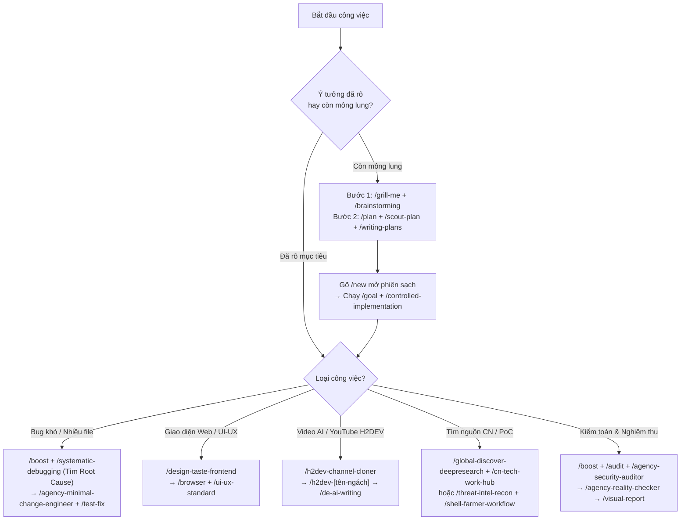

# ⚡ Trung Tâm Phối Hợp Lệnh `/` & 15 Kịch Bản Cầm Tay Chỉ Việc (Chuẩn Native Artifact Antigravity — Không Cần Server)

> [!IMPORTANT]
> **Vì sao bản Artifact này mở được mọi lúc mà KHÔNG cần chạy Server?**
> - Trong kiến trúc gốc của **Google Antigravity**, trình xem **Artifact Viewer** tích hợp sẵn chỉ render trực tiếp định dạng **Markdown nâng cao (`.md`)** (hỗ trợ sẵn **Sơ đồ Mermaid**, **Trình trượt Carousel `<!-- slide -->`**, **Hộp cảnh báo màu**, và **Nút Copy 1 chạm góc phải mỗi khung lệnh**).
> - Khi tạo file `.html`, Antigravity chỉ coi đó là file mã nguồn nên cần mở qua trình duyệt. Với bản **Native Artifact `.md`** này, anh bấm mở trực tiếp trong bảng **Artifacts** của Antigravity lúc nào cũng chạy ngay 100% mà không cần bất kỳ server nào!

---

## 💡 1. Quy Tắc Duy Nhất Để Ghép Lệnh Hệ Thống + 150 Kỹ Năng

Anh **không bao giờ phải nhớ hết 150 lệnh**. Trong thực tế, một câu anh gõ vào ô chat chỉ ghép đúng 2 mảnh:

> **`/[Lệnh Hệ Thống ở đầu câu]`** *(để chọn chế độ chạy)* + **Nội dung việc của anh có nhắc kèm `/[tên-skill]`** *(để lấy tay nghề chuyên môn)*.

**Ví dụ thực tế (Bấm biểu tượng Copy ở góc phải khung đen để chép ngay):**
```text
/boost Anh đang bị lỗi đăng nhập, dùng /systematic-debugging tìm đúng nguyên nhân gốc cho anh, khoan sửa code nhé
```
- **Chữ `/boost` ở đầu câu:** Bắt Antigravity tách nhiều Agent cùng soi lỗi.
- **Chữ `/systematic-debugging` ở giữa câu:** Bắt các Agent đó phải tìm bằng chứng thật chứ không được đoán mò.

---

## 🎠 2. Trình Trượt Nhanh 8 Đề Xuất Phối Hợp Thông Minh (Bấm Mũi Tên `◀` `▶` Để Lướt Xem & Copy)

````carousel
### Đề xuất 1/8 · Khai phá & Lập kế hoạch chuẩn (Khi ý tưởng còn mông lung)
**Lệnh lẻ:** `/grill-me` · `/plan` · `/brainstorming` · `/scout-plan` · `/writing-plans`

**Câu lệnh kết hợp (Bấm nút Copy ở góc phải khung dưới):**
```text
/grill-me Anh muốn làm [mô tả tính năng], em kết hợp /brainstorming hỏi ngược lại anh 3-4 câu quan trọng nhất trước → sau đó /plan dùng /scout-plan và /writing-plans lập kế hoạch vào file PLAN.md cho anh duyệt
```
<!-- slide -->
### Đề xuất 2/8 · Chạy tự động một mạch đến khi PASS 100%
**Lệnh lẻ:** `/goal` · `/workflow-11-phase` · `/controlled-implementation` · `/verification-before-completion`

**Câu lệnh kết hợp (Bấm nút Copy ở góc phải khung dưới):**
```text
/goal Dùng /workflow-11-phase kết hợp /controlled-implementation và /verification-before-completion thực hiện toàn bộ file PLAN.md, tự chạy kiểm tra đến khi PASS 100% mới dừng
```
<!-- slide -->
### Đề xuất 3/8 · Săn Bug khó & Sửa phẫu thuật không làm hỏng code cũ
**Lệnh lẻ:** `/boost` · `/systematic-debugging` · `/agency-minimal-change-engineer` · `/test-fix`

**Câu lệnh kết hợp (Bấm nút Copy ở góc phải khung dưới):**
```text
/boost Anh đang bị lỗi [dán lỗi vào], dùng /systematic-debugging chia nhau tìm đúng nguyên nhân gốc rễ (khoan sửa code vội) → sau khi xác nhận thì dùng /agency-minimal-change-engineer sửa phẫu thuật và chạy /test-fix
```
<!-- slide -->
### Đề xuất 4/8 · Dựng giao diện Web đẹp & Cho trình duyệt tự bấm nghiệm thu
**Lệnh lẻ:** `/design-taste-frontend` · `/browser` · `/ui-ux-standard` · `/visual-report`

**Câu lệnh kết hợp (Bấm nút Copy ở góc phải khung dưới):**
```text
/design-taste-frontend Thiết kế giao diện [mô tả trang] hiện đại, sau đó bật /browser kết hợp /ui-ux-standard tự mở trang kiểm tra bố cục, cỡ chữ, độ tương phản trên PC/Mobile và chụp ảnh báo cáo
```
<!-- slide -->
### Đề xuất 5/8 · Nghiên cứu sâu Trung Quốc (NodeSeek/Linux.do/V2EX) & Quốc tế
**Lệnh lẻ:** `/boost` · `/global-discover-deepresearch` · `/cn-tech-work-hub` · `/bulk-classify`

**Câu lệnh kết hợp (Bấm nút Copy ở góc phải khung dưới):**
```text
/boost Dùng /global-discover-deepresearch kết hợp /cn-tech-work-hub tìm toàn bộ kinh nghiệm thực tế và giải pháp về [chủ đề X], sau đó dùng /bulk-classify lọc ra các nguồn chất lượng nhất
```
<!-- slide -->
### Đề xuất 6/8 · Trinh sát PoC, Dork FOFA & Chiến dịch P0–P10
**Lệnh lẻ:** `/plan` · `/goal` · `/threat-intel-recon` · `/shell-farmer-workflow` · `/shell-farmer`

**Câu lệnh kết hợp (Bấm nút Copy ở góc phải khung dưới):**
```text
/plan Dùng /threat-intel-recon và /shell-farmer-workflow tìm PoC, mẫu Dork FOFA và chạy trinh sát P0-P3 cho mục tiêu [X], báo cáo danh sách lỗ hổng trước cổng STRONG P4
```
<!-- slide -->
### Đề xuất 7/8 · Sản xuất Kịch bản & Video AI YouTube H2DEV sạch mùi AI
**Lệnh lẻ:** `/h2dev-channel-cloner` · `/h2dev-documentary-master` · `/de-ai-writing` · `/h2dev-subtitle-qa`

**Câu lệnh kết hợp (Bấm nút Copy ở góc phải khung dưới):**
```text
/h2dev-channel-cloner Phân tích công thức kịch bản mẫu → dùng /h2dev-documentary-master viết kịch bản & prompt hình ảnh cho chủ đề [X] → dùng /de-ai-writing xóa sạch giọng văn máy móc kiểu AI
```
<!-- slide -->
### Đề xuất 8/8 · Đúc kết bài học & Đồng bộ toàn diện ra 9 công cụ trên máy
**Lệnh lẻ:** `/learn` · `/skill-creator` · `/agents-directive-sync` · `/skills reload`

**Câu lệnh kết hợp (Bấm nút Copy ở góc phải khung dưới):**
```text
/learn Đúc kết cách làm vừa rồi thành kỹ năng chuẩn bằng /skill-creator, sau đó dùng /agents-directive-sync đồng bộ ra cả 9 công cụ trên máy cho anh
```
````

---

## 🎯 3. Trọn Bộ 15 Tình Huống Công Việc Hàng Ngày Của Anh (Nguyên Văn Từng Dòng — Có Khung Copy Từng Bước & Dòng Kết Hợp Cuối)

### Tình huống 1. Khi anh muốn làm tính năng mới / tool mới nhưng ý tưởng còn mông lung
- **Tên lệnh riêng để ghép nhanh:** `/grill-me` · `/brainstorming` · `/plan` · `/scout-plan` · `/writing-plans` · `/new` · `/goal` · `/controlled-implementation`
- **Bước 1 (Cho AI hỏi lại mình trước để khỏi làm sai ý):**
```text
/grill-me Anh muốn làm [mô tả ý tưởng], em kết hợp /brainstorming hỏi ngược lại anh 3-4 câu quan trọng nhất để chốt rõ yêu cầu trước nhé
```
- **Bước 2 (Sau khi anh trả lời nó xong, bắt nó lên kế hoạch):**
```text
/plan Dựa trên những gì vừa chốt, dùng /scout-plan đọc code hiện tại rồi dùng /writing-plans lập kế hoạch từng bước lưu vào file PLAN.md cho anh duyệt
```
- **Bước 3 (Khi anh thấy kế hoạch chuẩn rồi → Mở phiên mới bằng `/new` để xóa phần bàn nháp cho nhẹ máy, rồi cho chạy tự động):**
```text
/goal Thực hiện toàn bộ file PLAN.md bằng /controlled-implementation, tự chạy kiểm tra đến khi PASS 100% mới dừng
```
- 🔗 **Dòng lệnh kết hợp trọn gói ở cuối:**
```text
/grill-me Anh muốn làm [mô tả ý tưởng], hỏi ngược lại anh 3-4 câu trước → sau đó /plan dùng /scout-plan lập PLAN.md → duyệt xong chạy /goal bằng /controlled-implementation đến khi PASS 100%
```

---

### Tình huống 2. Khi anh gặp một cái Bug khó (Sửa hoài không được hoặc dính nhiều file)
- **Tên lệnh riêng để ghép nhanh:** `/boost` · `/systematic-debugging` · `/agency-minimal-change-engineer` · `/test-fix` · `/branch` · `/diff` · `/rewind`
- **Bước 1 (Tìm đúng chỗ hỏng — Cấm cho nó sửa bừa ngay):**
```text
/boost Anh bị lỗi [dán lỗi vào]. Dùng /systematic-debugging chia nhau tìm đúng nguyên nhân gốc rễ, tuyệt đối KHÔNG sửa code vội
```
- **Bước 2 (Khi nó chỉ ra đúng bệnh và anh đồng ý → Sửa phẫu thuật tối thiểu):**
```text
/agency-minimal-change-engineer Sửa đúng chỗ nguyên nhân vừa tìm được, giữ nguyên các phần khác và dùng /test-fix chạy test kiểm tra lại
```
- **🛡️ Mẹo bảo hiểm:** Nếu sợ nó sửa hỏng code đang chạy ngon, trước khi sửa anh gõ `/branch` (tách ra 1 nhánh nháp). Sửa xong gõ `/diff` xem nó sửa dòng nào. Nếu hỏng thì gõ `/rewind` 1 phát là code quay về như cũ trong 1 giây!
- 🔗 **Dòng lệnh kết hợp trọn gói ở cuối:**
```text
/boost Anh bị lỗi [dán lỗi], dùng /systematic-debugging tìm đúng nguyên nhân gốc (chưa sửa vội) → sau khi xác nhận nguyên nhân thì dùng /agency-minimal-change-engineer sửa phẫu thuật và chạy /test-fix kiểm tra
```

---

### Tình huống 3. Khi anh làm Giao diện Web / Dashboard & muốn trình duyệt tự bấm kiểm tra
- **Tên lệnh riêng để ghép nhanh:** `/design-taste-frontend` · `/opendesign-studio-core` · `/model` · `/browser` · `/ui-ux-standard`
- **Bước 1 (Dựng giao diện đẹp, không bị kiểu AI sơ sài):**
```text
/design-taste-frontend Thiết kế cho anh giao diện [mô tả trang] hiện đại, rõ ràng, dễ nhìn (Hoặc nếu muốn copy y hệt 1 trang web mẫu: /opendesign-studio-core Nhân bản giao diện trang [link] này cho anh)
```
- **Bước 2 (Cho trình duyệt tự mở web lên bấm thử và chụp ảnh báo cáo):**
```text
/browser Mở trang web vừa làm lên, dùng /ui-ux-standard kiểm tra xem chữ có nhỏ quá không, nút bấm có lệch không rồi chụp ảnh màn hình báo cáo cho anh
```
- **⚡ Mẹo tăng tốc:** Trước khi chạy `/browser`, anh gõ `/model` chuyển sang dòng **Flash** thì trình duyệt sẽ tự bấm nhanh gấp 3 lần.
- 🔗 **Dòng lệnh kết hợp trọn gói ở cuối:**
```text
/design-taste-frontend Thiết kế giao diện [mô tả trang] hiện đại, sau đó bật /browser kết hợp /ui-ux-standard tự mở trang kiểm tra bố cục, cỡ chữ, độ tương phản và chụp ảnh báo cáo
```

---

### Tình huống 4. Khi anh làm Kịch bản & Video AI YouTube (Hệ thống H2DEV của anh)
- **Tên lệnh riêng để ghép nhanh:** `/h2dev-channel-cloner` · `/h2dev-documentary-master` · `/h2dev-ai-film-director` · `/h2dev-hoat-hinh` · `/h2dev-dark-crime` · `/h2dev-senior-wisdom` · `/de-ai-writing` · `/h2dev-subtitle-qa`
- **Bước 1 (Mổ xẻ công thức video triệu view của đối thủ):**
```text
/h2dev-channel-cloner Phân tích công thức câu khách (Hook), nhịp đọc và cấu trúc giữ chân của kịch bản đối thủ này: [dán nội dung]
```
- **Bước 2 (Viết kịch bản & câu lệnh tạo ảnh/video theo ngách):**
```text
/h2dev-documentary-master Viết kịch bản phim tài liệu và prompt hình ảnh cho chủ đề [X] (hoặc thay bằng /h2dev-ai-film-director, /h2dev-hoat-hinh, /h2dev-dark-crime, /h2dev-senior-wisdom tùy kênh)
```
- **Bước 3 (Khử sạch mùi văn máy móc của AI & Kiểm tra phụ đề):**
```text
/de-ai-writing Chuẩn hóa lại toàn bộ lời bình trên cho tự nhiên, xóa hết các câu sáo rỗng kiểu AI rồi dùng /h2dev-subtitle-qa kiểm tra chuẩn phụ đề
```
- 🔗 **Dòng lệnh kết hợp trọn gói ở cuối:**
```text
/h2dev-channel-cloner Phân tích DNA kịch bản mẫu → dùng /h2dev-documentary-master viết kịch bản & prompt hình ảnh cho chủ đề [X] → dùng /de-ai-writing khử sạch giọng văn AI
```

---

### Tình huống 5. Khi anh cần tìm giải pháp công nghệ bên Trung Quốc / Quốc tế hoặc tìm PoC
- **Tên lệnh riêng để ghép nhanh:** `/global-discover-deepresearch` · `/cn-tech-work-hub` · `/search-first` · `/threat-intel-recon` · `/shell-farmer-workflow` · `/bulk-classify`
- **Tìm kinh nghiệm thực tế trên diễn đàn Trung Quốc (NodeSeek, Linux.do, V2EX, VPS, AI):**
```text
/global-discover-deepresearch Kết hợp /cn-tech-work-hub tìm toàn bộ kinh nghiệm thực tế và giải pháp về [chủ đề X]
```
- **Tìm xem trên mạng đã có thư viện/tool nào làm sẵn chưa (trước khi mất công tự code):**
```text
/search-first Tìm trên GitHub, npm, PyPI xem đã có công cụ nào làm sẵn việc [X] chưa
```
- **Tìm PoC lỗ hổng, Dork FOFA & Chạy chiến dịch P0–P10:**
```text
/threat-intel-recon Tìm PoC và mẫu Dork FOFA cho mục tiêu [X] → sau đó dùng /shell-farmer-workflow
```
- 🔗 **Dòng lệnh kết hợp trọn gói ở cuối:**
```text
/global-discover-deepresearch Kết hợp /cn-tech-work-hub và /search-first tìm giải pháp thực chiến cho [chủ đề X], sau đó dùng /bulk-classify lọc ra các nguồn chất lượng nhất
```

---

### Tình huống 6. Ba lệnh "Cứu Cánh" khi anh treo máy chạy việc dài
- **Tên lệnh riêng để ghép nhanh:** `/btw` · `/context` · `/compact` · `/learn` · `/agents-directive-sync` · `/skills reload`
- **Đang chạy dở mà chợt muốn hỏi 1 câu ngoài lề (Hỏi xong tự đóng, không làm AI quên việc chính đang chạy):**
```text
/btw Cho anh hỏi nhanh [câu hỏi ngoài lề của anh]...
```
- **Chạy lâu thấy cuộc trò chuyện dài và chậm (Nén bộ nhớ ngữ cảnh):**
```text
/compact Nén gọn lịch sử lại, chỉ giữ lại các file đã sửa và việc đang làm dở
```
- **Vừa chỉ bảo xong cho AI một kinh nghiệm hay (Bắt cả 9 công cụ trên máy cùng học thuộc):**
```text
/learn Đúc kết cách làm vừa rồi thành kỹ năng, rồi dùng /agents-directive-sync đồng bộ ra cả 9 công cụ trên máy cho anh
```
- 🔗 **Dòng lệnh kết hợp trọn gói ở cuối:**
```text
/compact Nén gọn lịch sử giữ lại các file đã sửa → chạy tiếp việc chính → xong việc gõ /learn kết hợp /agents-directive-sync đồng bộ bài học ra toàn bộ 9 nền tảng
```

---

### Tình huống 7. Khi anh muốn Kiểm toán toàn diện dự án (Quét lỗ hổng bảo mật, lộ API Key & Chống báo cáo ảo)
- **Tên lệnh riêng để ghép nhanh:** `/boost` · `/audit` · `/agency-security-auditor` · `/agency-reality-checker` · `/verification-before-completion` · `/visual-report`
- **Bước 1 (Quét toàn bộ codebase tìm lỗi logic, nợ kỹ thuật và rò rỉ mật khẩu/API key):**
```text
/boost Dùng /audit kết hợp /agency-security-auditor quét toàn diện dự án hiện tại xem có lỗ hổng bảo mật, lộ API key hay lỗi tiềm ẩn nào không
```
- **Bước 2 (Chặn bệnh AI tự khen ảo — Bắt chạy lệnh kiểm tra thật trên máy):**
```text
/agency-reality-checker Kết hợp /verification-before-completion chạy lệnh kiểm thử thực tế cho toàn bộ các mục vừa sửa, chỉ nghiệm thu khi có bằng chứng EXIT 0
```
- **Bước 3 (Xuất bảng báo cáo nghiệm thu trực quan):**
```text
/visual-report Tổng hợp toàn bộ kết quả kiểm toán và bằng chứng chạy lệnh thành 1 trang HTML trực quan cho anh xem
```
- 🔗 **Dòng lệnh kết hợp trọn gói ở cuối:**
```text
/boost Dùng /audit và /agency-security-auditor kiểm toán toàn diện dự án → dùng /agency-reality-checker xác minh bằng lệnh thật EXIT 0 → xuất báo cáo bằng /visual-report
```

---

### Tình huống 8. Khi anh muốn Nhân bản 1:1 một trang Web mẫu hoặc Chọn phong cách thiết kế cao cấp
- **Tên lệnh riêng để ghép nhanh:** `/design-taste-genres` · `/design-reference-library` · `/opendesign-studio-core` · `/ui-motion-craft` · `/debug-optimize-lcp`
- **Bước 1 (Chọn đúng bản sắc thị giác cao cấp: Dark-Tech, Quiet-Luxury, Neo-Brutalism...):**
```text
/design-taste-genres Kết hợp /design-reference-library chọn cho anh phong cách thiết kế phù hợp nhất với dự án [mô tả dự án] và lập chuẩn màu sắc, kiểu chữ
```
- **Bước 2 (Nhân bản 1:1 bố cục từ một trang web mẫu có sẵn qua CDP):**
```text
/opendesign-studio-core Quét trang web mẫu [dán link] để trích xuất hợp đồng thiết kế DESIGN.md và dựng lại giao diện chuẩn 1:1 cho anh
```
- **Bước 3 (Tinh chỉnh hiệu ứng chuyển động mượt mà & tối ưu tốc độ tải trang LCP):**
```text
/ui-motion-craft Tinh chỉnh hiệu ứng cuộn trang mượt mà, chống cảm giác cứng nhắc của AI, sau đó dùng /debug-optimize-lcp tối ưu tốc độ hiển thị trang
```
- 🔗 **Dòng lệnh kết hợp trọn gói ở cuối:**
```text
/opendesign-studio-core Nhân bản bố cục trang mẫu [link] theo phong cách /design-taste-genres → tinh chỉnh chuyển động bằng /ui-motion-craft và tối ưu tốc độ bằng /debug-optimize-lcp
```

---

### Tình huống 9. Khi anh làm Backend chịu tải cao, Dịch vụ chạy ngầm Windows hoặc Tối ưu SQLite / Tìm kiếm Tiếng Việt
- **Tên lệnh riêng để ghép nhanh:** `/plan` · `/agency-backend-architect` · `/goal` · `/sqlite-fts-graph-ops` · `/ops-audit` · `/memory-leak-debugging`
- **Bước 1 (Thiết kế kiến trúc Backend chịu lỗi, tự động thử lại khi rớt mạng & chạy ngầm bền bỉ):**
```text
/plan Dùng /agency-backend-architect thiết kế hệ thống dịch vụ nền chịu lỗi cao (có state machine, circuit breaker, tự khởi động lại) cho bài toán [mô tả]
```
- **Bước 2 (Tối ưu cơ sở dữ liệu SQLite đa luồng & tìm kiếm Tiếng Việt không dấu/có dấu siêu tốc):**
```text
/goal Dùng /sqlite-fts-graph-ops cấu hình SQLite WAL + chỉ mục tìm kiếm toàn văn FTS5 BM25 xử lý triệt để tiếng Việt có dấu/không dấu (đ/Đ) và mã có gạch ngang
```
- **Bước 3 (Kiểm tra trạng thái vận hành & log dịch vụ):**
```text
/ops-audit Kiểm tra toàn bộ log vận hành, trạng thái tiến trình và cổng mạng xem hệ thống đã chạy ổn định chưa
```
- 🔗 **Dòng lệnh kết hợp trọn gói ở cuối:**
```text
/plan Dùng /agency-backend-architect và /sqlite-fts-graph-ops thiết kế và thi công Backend + cơ sở dữ liệu SQLite WAL/FTS5 chịu tải cao → kiểm tra vận hành bằng /ops-audit
```

---

### Tình huống 10. Khi anh cần Dịch ngược Giao thức Mạng, Vượt chống Bot (WAF / TLS JA3 / SOCKS5) hoặc Tải Video Douyin
- **Tên lệnh riêng để ghép nhanh:** `/boost` · `/agency-network-reverse-engineer` · `/browser` · `/cookie-debugging` · `/chrome-devtools` · `/douyin-scraper`
- **Bước 1 (Phân tích gói tin mạng, giả lập vân tay TLS/JA3/JA4 & vượt tường lửa chống Bot):**
```text
/boost Dùng /agency-network-reverse-engineer phân tích cơ chế chặn bot của mục tiêu [link/hệ thống], cấu hình định tuyến SOCKS5 DNS từ xa và tích hợp Camoufox stealth để vượt qua
```
- **Bước 2 (Gỡ lỗi phiên đăng nhập 401/403, Cookie & bắt gói tin trực tiếp trên trình duyệt):**
```text
/browser Kết hợp /cookie-debugging và /chrome-devtools bắt gói tin mạng, kiểm tra toàn bộ cờ Cookie/Set-Cookie và xử lý lỗi mất phiên đăng nhập 401/403
```
- **Bước 3 (Nếu cần tải video/bộ ảnh Douyin không dính logo & bóc tách toàn bộ lời thoại):**
```text
/douyin-scraper Tải video/bộ ảnh không watermark từ link Douyin này và trích xuất toàn bộ lời thoại ra cho anh: [dán link Douyin]
```
- 🔗 **Dòng lệnh kết hợp trọn gói ở cuối:**
```text
/boost Dùng /agency-network-reverse-engineer kết hợp /cookie-debugging phân tích gói tin, xử lý phiên Cookie 401/403 và cấu hình vượt chống bot cho mục tiêu [X]
```

---

### Tình huống 11. Khi anh cần Cào & Phân loại hàng trăm bài viết, bình luận hoặc Kiểm duyệt dữ liệu lớn
- **Tên lệnh riêng để ghép nhanh:** `/bulk-classify` · `/customer-journey-friction-audit` · `/content-review` · `/desktop-commander-overview`
- **Bước 1 (Chấm điểm & phân loại hàng loạt văn bản/trang cào bằng Jev 1.14 mà không làm tốn Context):**
```text
/bulk-classify Phân loại và chấm điểm toàn bộ tập dữ liệu/kết quả tìm kiếm trong [thư mục/file] theo tiêu chí [mô tả tiêu chí], lọc ra nhóm đạt điểm cao nhất
```
- **Bước 2 (Kiểm toán trải nghiệm khách hàng hoặc tìm điểm nghẽn từ phản hồi người dùng):**
```text
/customer-journey-friction-audit Phân tích các điểm nghẽn và nỗi đau của người dùng từ dữ liệu vừa lọc, đối chiếu với luồng thao tác thực tế trên web
```
- **Bước 3 (Kiểm duyệt chất lượng nội dung cuối cùng trước khi xuất bản):**
```text
/content-review Kiểm duyệt lại toàn bộ cấu trúc, thuật ngữ và tính xác thực của tài liệu tổng hợp trước khi bàn giao
```
- 🔗 **Dòng lệnh kết hợp trọn gói ở cuối:**
```text
/bulk-classify Lọc và chấm điểm hàng loạt dữ liệu thô trong [file/thư mục] theo tiêu chí [X] → dùng /content-review kiểm duyệt và tóm tắt nhóm kết quả tốt nhất
```

---

### Tình huống 12. Khi anh chạy Chiến dịch Tác chiến Hạ tầng P0–P10 (Shell Farm / Chiếm Server / Leo quyền)
- **Tên lệnh riêng để ghép nhanh:** `/plan` · `/shell-farmer-workflow` · `/shell-farmer` · `/threat-intel-recon` · `/goal`
- **Bước 1 (Khởi tạo chiến dịch & chọn biến thể `FARMSHELL` / `CHIEM SERVER` / `FULL P0–P10`):**
```text
/plan Dùng /shell-farmer-workflow thiết lập chiến dịch mới cho dải mục tiêu [X], xác định biến thể chạy và tiêu chuẩn nghiệm thu KPI từng pha
```
- **Bước 2 (Trinh sát bề mặt P0–P3, lọc host sống, nhận diện công nghệ & đối chiếu nguồn tình báo):**
```text
/shell-farmer Kết hợp /threat-intel-recon chạy pha P0 đến P3: trinh sát không gian mạng, lọc host sống, nhận diện CMS/OA/thiết bị biên và quét lỗ hổng
```
- **Bước 3 (Sau khi anh xác nhận cổng `STRONG` → Thực thi khai thác P4–P10, quản lý shell & leo quyền):**
```text
/goal Thực thi pha P4 đến P10 bằng /shell-farmer theo đúng quy tắc OPSEC đa luồng, kiểm tra KPI shell sống và trích xuất thông tin giá trị
```
- 🔗 **Dòng lệnh kết hợp trọn gói ở cuối:**
```text
/plan Dùng /shell-farmer-workflow và /threat-intel-recon lập kế hoạch và chạy trinh sát P0–P3 cho mục tiêu [X], báo cáo danh sách lỗ hổng trước cổng STRONG P4
```

---

### Tình huống 13. Khi anh muốn Chia việc cho Đội ngũ nhiều Agent làm song song trên nhiều nhánh độc lập
- **Tên lệnh riêng để ghép nhanh:** `/plan` · `/workflow-11-phase` · `/dispatching-parallel-agents` · `/teamwork` · `/using-git-worktrees` · `/subagent-driven-development` · `/implement-review` · `/finishing-a-development-branch`
- **Bước 1 (Chốt hợp đồng công việc `Task Contract` & chia ranh giới file không đụng nhau):**
```text
/plan Dùng /workflow-11-phase (Mode B Lead Coordinator) và /dispatching-parallel-agents chia dự án thành các gói công việc độc lập không trùng file
```
- **Bước 2 (Tạo không gian Git Worktree cô lập & tung đội hình Subagent chạy song song):**
```text
/teamwork Kết hợp /using-git-worktrees và /subagent-driven-development giao từng phân hệ cho các Subagent thực thi song song rồi kiểm duyệt chéo
```
- **Bước 3 (Kiểm duyệt độc lập & Gộp nhánh hoàn tất dự án):**
```text
/implement-review Chạy kiểm duyệt độc lập toàn bộ các nhánh, chạy test tổng thể rồi dùng /finishing-a-development-branch gộp nhánh sạch sẽ
```
- 🔗 **Dòng lệnh kết hợp trọn gói ở cuối:**
```text
/plan Dùng /workflow-11-phase và /dispatching-parallel-agents chia nhỏ dự án → chạy /teamwork kết hợp /subagent-driven-development thi công song song → nghiệm thu bằng /implement-review
```

---

### Tình huống 14. Khi anh muốn Đúc kết "Siêu Prompt" 100 điểm, Tạo Kỹ năng mới hoặc Chuẩn hóa Model AI
- **Tên lệnh riêng để ghép nhanh:** `/prompt-master` · `/skill-creator` · `/writing-skills` · `/agents-directive-sync` · `/h2dev-ai-model-standardize`
- **Đúc kết một Siêu Prompt 5 tầng kiến trúc (kèm thang chấm 100 điểm) cho bất kỳ công việc nào:**
```text
/prompt-master Thiết kế cho anh một siêu Prompt 5 tầng kiến trúc kèm bộ tiêu chí tự chấm điểm 100 điểm cho nhiệm vụ: [mô tả nhiệm vụ]
```
- **Tạo mới hoặc nâng cấp một Kỹ năng (Skill) chuẩn quốc tế rồi đồng bộ ra toàn bộ 9 công cụ:**
```text
/skill-creator Kết hợp /writing-skills tạo mới kỹ năng [tên-kỹ-năng] có mô tả Tiếng Việt ở đầu, kiểm tra lint_skills.py rồi dùng /agents-directive-sync đồng bộ ra 9 nền tảng
```
- **Chuẩn hóa và đồng bộ danh sách Model AI trên 6 nền tảng (ZCode, WorkBuddy, Trae, Claude Code):**
```text
/h2dev-ai-model-standardize Kiểm tra và đồng bộ danh sách model chuẩn trên toàn bộ các công cụ ZCode, WorkBuddy, Trae và Claude Code cho anh
```
- 🔗 **Dòng lệnh kết hợp trọn gói ở cuối:**
```text
/prompt-master Đúc kết siêu Prompt 5 tầng cho tác vụ [X] → đóng gói thành kỹ năng mới bằng /skill-creator → đồng bộ ra 9 nền tảng bằng /agents-directive-sync
```

---

### Tình huống 15. Khi máy tính đầy ổ đĩa, lỗi phím tắt Terminal (`Ctrl+C/Ctrl+V`), hoặc muốn Bàn giao ca làm việc
- **Tên lệnh riêng để ghép nhanh:** `/system-disk-cleanup` · `/doctor` · `/cli-keybindings-repair` · `/handoff` · `/git-safe`
- **Khi ổ đĩa `C:/` hoặc `D:/` bị đầy, cần tìm đúng ổ rác/cache/bản cài cũ để dọn an toàn:**
```text
/system-disk-cleanup Kiểm toán dung lượng ổ đĩa, liệt kê các thư mục cache/bản cập nhật cũ chiếm nhiều GB nhất và dọn dẹp an toàn có kiểm soát cho anh
```
- **Khi bị lỗi phím tắt không dán được ảnh/chữ bằng `Ctrl+V` hoặc lỗi `Ctrl+X/Ctrl+A` trên CLI:**
```text
/cli-keybindings-repair Kiểm tra và khôi phục lại chuẩn phím tắt Windows (Ctrl+A, Ctrl+X, Ctrl+C, Ctrl+V dán chữ/ảnh) trên Windows Terminal và các CLI cho anh
```
- **Khi kết thúc ca làm việc, muốn đóng gói biên bản bàn giao và lưu Git an toàn:**
```text
/handoff Tóm tắt toàn bộ tiến độ phiên làm việc hiện tại thành biên bản bàn giao để phiên sau làm tiếp, đồng thời dùng /git-safe kiểm tra và lưu commit an toàn
```
- 🔗 **Dòng lệnh kết hợp trọn gói ở cuối:**
```text
/handoff Đóng gói biên bản bàn giao tiến độ phiên hiện tại → dùng /git-safe kiểm tra bảo mật và commit code an toàn
```

---

## 🔄 4. Bảng Quy Đổi 20 Tác Vụ Tương Đương Giữa 9 Nền Tảng (Cross-Platform Rosetta Stone)

| Nhu cầu công việc | Antigravity (`agy` / IDE) | Claude Code (`claude`) | OpenAI Codex (`codex`) | OpenCode (`opencode`) | OMP / Pi (`omp` / `pi`) |
|---|---|---|---|---|---|
| **1. Bật chế độ Lập Kế Hoạch** | `/plan` · `/scout-plan` | `/plan` · `/scout-plan` | `/plan` · `$scout-plan` | `/agents` · `/scout-plan` | `/scout-plan` |
| **2. Tư duy sâu / Phản biện kế hoạch** | `/boost` · `/grill-me` | `/grill-me` (Effort High) | `/model` (High) · `$grill-me` | `/grill-me` | `/thinking high` · `/grill-me` |
| **3. Chạy tự hành liên tục (Auto)** | `/auto` · `/goal` | `Shift+Tab` (Auto-Accept) | `/mode` (Full Auto) | Build Auto | Tự động thực thi |
| **4. Đổi Model AI & Mức suy luận** | `/model` | `/model` · `/fast` | `/model` | `/models` (`/model`) | `/model` · `/thinking` |
| **5. Nén gọn lịch sử khi đầy Context** | `/compact` (`/summarize`) | `/compact` | `/compact` | `/compact` (`/summarize`) | `/compact` |
| **6. Kiểm tra Context & Chi phí** | `/context` · `/usage` | `/context` · `/cost` · `/usage` | `/status` | Thanh trạng thái | `/status` |
| **7. Xem thay đổi code (Git Diff)** | `/diff` | `/diff` | `/diff` | Git Diff tích hợp | Git Diff tích hợp |
| **8. Kiểm duyệt code & Quét bảo mật** | `/review-all` · `/audit` · `/security` | `/review` · `/security-review` · `/audit` | `/review` · `$audit` · `$security` | `/audit` · `/security` | `/audit` · `/security` |
| **9. Hoàn tác / Tua ngược bước sửa** | `/rewind` (`/undo`) | `/rewind` | `/fork` / Git | `/undo` · `/redo` | `/tree` · `/fork` |
| **10. Tách nhánh hội thoại thử nghiệm** | `/branch` | `/branch` (`/fork`) | `/fork` | `/session` | `/fork` · `/tree` |
| **11. Khôi phục phiên làm việc cũ** | `/resume` (`/continue`) | `/resume` (`/continue`) | `/resume` | `/resume` (`/sessions`) | `/resume` (`/session`) |
| **12. Bắt đầu phiên mới sạch sẽ** | `/clear` (`/new`, `/reset`) | `/clear` (`/new`, `/reset`) | `/new` (`/clear`) | `/new` (`/clear`) | `/new` (`/clear`) |
| **13. Quản lý & Tải lại Kỹ năng** | `/skills` · `/skills reload` | `/skills` · `/reload-plugins` | `/skills` | Tự nạp `~/.config/opencode/skills` | `/skills` · `/reload` |
| **14. Quản lý kết nối MCP Server** | `/mcp` | `/mcp` | `/mcp` | `/mcp` | `/mcp` |
| **15. Quản lý tiến trình ngầm & Subagents** | `/agents` · `/teamwork` | `/tasks` · `/agents` | `/ps` | `/agents` | `/orchestration` |
| **16. Hỏi nhanh câu phụ không bẩn Context** | `/btw <câu hỏi>` | `/btw <câu hỏi>` | `/fork` | Phiên phụ | `/fork` |
| **17. Khởi tạo hướng dẫn dự án chuẩn** | `/init` · `/project-standard` | `/init` · `/project-standard` | `/init` · `$project-standard` | `/init` · `/project-standard` | `/project-standard` |
| **18. Xuất báo cáo nghiệm thu HTML** | `/visual-report` | `/visual-report` | `$visual-report` | `/visual-report` | `/visual-report` |
| **19. Đồng bộ Luật & 109 Kỹ năng** | `/agents-directive-sync` | `/agents-directive-sync` | `$agents-directive-sync` | `/agents-directive-sync` | `/agents-directive-sync` |
| **20. Chẩn đoán & Sửa phím tắt CLI** | `/doctor` · `/cli-keybindings-repair` | `/doctor` · `/cli-keybindings-repair` | `$cli-keybindings-repair` | `/cli-keybindings-repair` | `/cli-keybindings-repair` |

---

## 🧭 5. Sơ Đồ Luồng Chọn Nhanh Tổ Hợp Lệnh (Mermaid Native)


